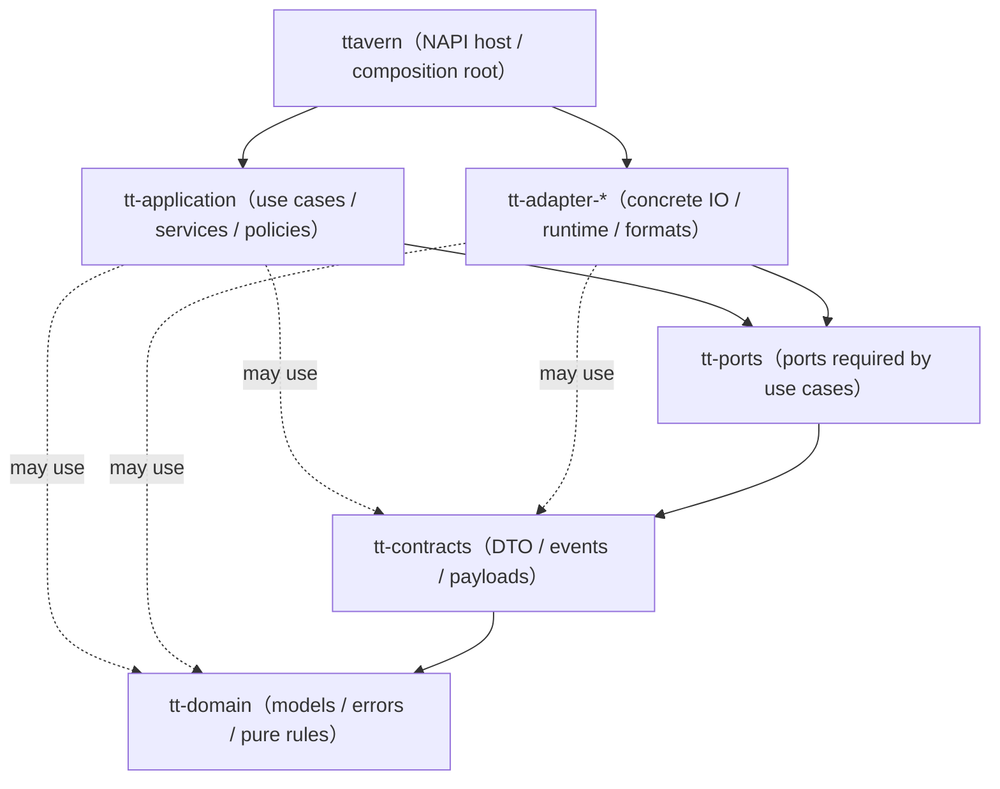

# TauriTavern → HarmonyOS 原生移植方案

> 版本：v0.1（第一阶段：方案文档）
> 日期：2026-10-26
> 目标工程：`<项目根目录>`（DevEco Studio 工程，API 6.0.2 / SDK 22）
> 上游参考快照：`tauritavern-ref/`（TauriTavern `main` @ `fff9af0`，版本 2.4.0，SillyTavern 前端同步至 1.19.0）

---

## 0. 项目总览与完成度（2026-10-28 19:05 更新）

| 阶段 | 内容 | 状态 |
| --- | --- | --- |
| P1 | 方案文档（本文件）+ 上游通读 | ✅ |
| P2 | 鸿蒙工程骨架 + NAPI 桥接 demo（ArkTS 调 Rust hello/add） | ✅ |
| P3 | command 三层接线（contract/ports/application）+ 分批移植 | ✅ |
| P4 | ArkTS 宿主基建：initialize/就绪/资源播撒/图片渲染 | ✅（模拟器实测） |
| P5 | 核心对话 UI：聊天列表/生成流式/端点授权三步握手/设置页密钥 | ✅（模拟器实测） |
| P6.1 | 77 命令第一遍 + 契约测试 | ✅ |
| P6.2 | agent/sync 域补齐（74 DTO + 26 sync 命令 + 事件桥） | ✅（模拟器 12/12） |
| P7-1 | 权限核查（INTERNET-only）+ 通知运行时授权 | ✅（模拟器实证） |
| P7-2 | AGC 签名 + 真机安装 | ✅ 签名已就位，真机待验 |
| P7-3 | ChatPage 重试/摘要/图片 + SettingsPage 预设/提示词/模型目录 + 配对弹窗 | ✅（模拟器实测） |
| P7-4 | 技术债清理：死代码 18→0、UIContext、NavPathStack、napi d.ts | ✅（模拟器实测） |
| P7-5 | 体积优化：panic=abort 评估（保留 unwind）+ arm64-only 发布包 | ✅（33.7MB） |
| P7-6 | 性能/生命周期：事件频率/常驻任务/取消传播/重入 逐项证据核实 | ✅ |
| P7-7 | 真机全流程验收（12 项） | ⏳ 等你连真机 |

**已就绪交付物**：`dist\HarmonyTavern-arm64-release-signed.hap`（33.7MB，arm64-only 签名版，真机装这个）；`entry\build\default\outputs\default\entry-default-unsigned.hap`（61.8MB 双架构，模拟器）；`scripts\verify-device.ps1`（真机验收脚本）；下文步骤 7 逐项操作手册。**基线**：0 警告 + 1175 测试全绿（19 套件）。**待确认**：① 步骤 7 真机执行（照手册）；② UI 设计审视（harmonyos-design）3 个 MAJOR 修复批次（消息区虚拟化 / 设置页防重入 / token 一致，见 P7-3 审视图条目）。**已文档化缺口**：sync 长任务无独立取消命令；扩展管理无 UI 入口（step 7 ⑦ 需 hdc 直调或后续装配）。

---

## 1. 摘要

把 [TauriTavern](https://github.com/Darkatse/TauriTavern)（SillyTavern 的 Tauri/Rust 重写版）移植为**不依赖 Tauri/WebView** 的鸿蒙原生应用：

- **UI**：ArkTS + ArkUI 从零重写（不复用原 React/jQuery 前端）。
- **后端**：复用 Rust workspace 的 `tt-domain / tt-contracts / tt-ports / tt-application` 与全部 Tauri-free 的 `tt-adapter-*`，用 **ohos-rs（`napi-ohos` + `napi-derive-ohos`）** 编译为鸿蒙原生 `.so`，经 **NAPI** 桥接给 ArkTS 调用。
- **宿主**：原 `tauritavern` host crate（Tauri shell + 362 个 command）**不保留任何 Tauri 代码**，重写为一个 NAPI 宿主 crate（`ttavern`），command 逐文件改写为 `#[napi]` 导出。
- 上游仓库本身已有实验性 OpenHarmony 支持（Tauri fork + napi-ohos，见 `docs/OpenHarmonyDevelopment.md`），其**交叉编译 env、NDK 用法、`entry/libs` 预编译 .so 打包方式**可直接沿用；我们只需去掉 Tauri/WebView 这一层。

### 1.1 关键数字（来自上游快照实测）

| 项目 | 数量 |
| --- | --- |
| workspace crate | 18（tauritavern + 17 个 tt-*） |
| presentation command 注册 | 362（62 个 command 文件） |
| application service | 61（`tt-application/src/services/`） |
| port trait 文件 | 65（`tt-ports/src` + `repositories/`） |
| host crate 源码 | 173 文件 / 约 1.0 MB（其中约 60% 需改写或删除） |
| 前端 `src/` | 整体不搬（ArkTS 重写） |

---

## 2. 上游仓库现状（先例与事实）

### 2.1 已有 OpenHarmony 实验支持（必须继承的经验）

上游 `main` 分支自带一套可工作的 OHOS 产物链（文档：`tauritavern-ref/docs/OpenHarmonyDevelopment.md`）：

- **目标 triple**：`aarch64-unknown-linux-ohos`（真机）/ `x86_64-unknown-linux-ohos`（模拟器）；`target_os = "linux"` + `target_env = "ohos"` 区分。
- **交叉编译**：`scripts/ohos/env.sh` 用 OHOS NDK 的 clang 包一层 wrapper（`--target=<arch>-linux-ohos --sysroot=... -D__MUSL__`），设置 `CC_<triple> / CXX_<triple> / AR / RANLIB / CARGO_TARGET_*_LINKER / BINDGEN_EXTRA_CLANG_ARGS`。
- **NAPI 依赖**：`prepare.py` 给应用 crate 追加 `napi-ohos = "=1.2.0"`、`napi-derive-ohos = "=1.2.0"`（上游 fork 的 `mobile_entry_point` / `#[ability]` 宏会展开 `napi_ohos::` 路径——**我们不用这些宏，改为自己注册**）。
- **.so 打包进 HAP**：`ohrs build --arch <arch> --dist entry/libs` 生成 `entry/libs/<abi>/lib*.so`，hvigor 只打包预编译库（**无需 cpp/CMake、无需 externalNativeOptions**）；`module.json5` 开 `compressNativeLibs`。
- **已实测**：x86_64 模拟器可跑通主流程；Rust 侧 reqwest/rustls(aws-lc-rs)/miktik/gix/rmcp/triviumdb/candle 等依赖链全部在 OHOS 目标编译通过（上游 CI `ohos.yml`）。
- **已知鸿蒙限制**（直接继承）：普通应用不能绑 `NETLINK_ROUTE`（本机地址走 `getifaddrs`）；没有公开组播锁接口；后台无执行保护（生成可能被挂起）；`READ_PASTEBOARD` 为受限权限。

### 2.2 我们与上游实验性的差异

| 维度 | 上游 gen/ohos（实验） | 本方案 |
| --- | --- | --- |
| 宿主框架 | Tauri fork（wry/tao/ability + HAR 的 DefaultXComponent） | 无 Tauri，纯 ArkUI 页面 |
| 页面 | WebView 加载 SillyTavern 前端 | ArkTS/ArkUI 从零写 |
| IPC | Tauri invoke / postMessage | NAPI（napi-ohos） |
| 工程 | `crates/tauritavern/gen/ohos`（生成物） | 仓库根 `<项目根目录>`（已存在） |

---

## 3. 目标架构

```text
┌───────────────────────────────────────────────────────────────┐
│                        ArkTS / ArkUI UI 层                     │
│  pages / components / viewmodel / services / bridge            │
│  （从零重写；不复用原前端）                                      │
├───────────────────────────────────────────────────────────────┤
│                        NAPI 桥接层 (bridge)                     │
│  native.ets (import 'libttavern.so')                           │
│  invoke(command, payloadJson) → Promise<resultJson>            │
│  on(event, callback) / stream 拉取                              │
├───────────────────────────────────────────────────────────────┤
│              Rust 宿主 crate `ttavern`（重写，无 Tauri）          │
│  napi 入口（#[napi] async fn / 模块注册）                        │
│  composition root（AppState 装配，沙箱路径注入）                 │
│  基础设施：日志、bundled 资源、staging、runtime paths（OHOS 版）   │
├───────────────────────────────────────────────────────────────┤
│          tt-application（61 services，原样搬入）                 │
├───────────────────────────────────────────────────────────────┤
│          tt-ports（65 个 trait，原样搬入）                       │
├───────────────────────────────────────────────────────────────┤
│  tt-adapter-*（11 个，原样搬入 + 少量 cfg 适配）                  │
├───────────────────────────────────────────────────────────────┤
│  tt-contracts（19 文件，原样搬入） / tt-domain（48 文件，原样搬入）│
└───────────────────────────────────────────────────────────────┘
        .so 内（Rust 侧）                   ArkTS 侧（@kit.*）
  reqwest(rustls) 网络  ────────────────   @ohos.net.http（备选）
  std::fs + 沙箱路径   ◄───────────────   context.filesDir 注入
  triviumdb（保留/可选迁 rusqlite）       relationalStore（备选评估）
  gix / miktik / candle / zip 等纯 Rust   resourceManager(rawfile)
                                          剪贴板/通知/选择器/扫码
```

依赖方向严格沿用上游 Clean Architecture：外层只能依赖内层，`tt-application` 不依赖任何 adapter，adapter 不依赖 host。

---

## 4. crate 依赖关系图

### 4.1 依赖方向总图（语义边界，来自 `docs/BackendStructure.md`）



### 4.2 允许的 adapter helper 关系（上游已物理化，脚本 `scripts/check-rust-crate-boundaries.mjs` 守）

```text
tt-adapter-provider-http -> tt-adapter-http
tt-adapter-mcp           -> tt-adapter-http
tt-adapter-tokenization  -> tt-adapter-http
tt-adapter-extension     -> tt-adapter-http + tt-adapter-storage-core
tt-adapter-storage-userdata -> tt-adapter-storage-core
tt-adapter-media         -> tt-adapter-storage-core
```

### 4.3 各 crate 依赖（实测自各 `Cargo.toml`，路径依赖=workspace 内）

| crate | 依赖（workspace 内） | 主要第三方（决定 OHOS 可行性） |
| --- | --- | --- |
| `ttavern`（新，替换 tauritavern） | 全部 tt-* adapter + application + ttsync-core/contract | **napi-ohos/napi-derive-ohos =1.2.0**、tokio、reqwest、tracing、zip |
| `tt-application` | tt-contracts、tt-domain、tt-ports、ttsync-contract/core | tokio、serde、yaml_serde、sha2、headers、http |
| `tt-ports` | tt-contracts、tt-domain、ttsync-contract | async-trait、tokio、tokio-util |
| `tt-contracts` | tt-domain、ttsync-contract | serde、serde_json、percent-encoding |
| `tt-domain` | ttsync-contract | chrono、rand、serde、sha2、thiserror、uuid、url |
| `tt-adapter-http` | tt-domain、tt-ports | reqwest(rustls/aws-lc-rs/socks)、rustls |
| `tt-adapter-provider-http` | tt-domain、tt-ports、tt-adapter-http | reqwest、tokio-tungstenite、jsonwebtoken(aws_lc_rs)、sha2 |
| `tt-adapter-mcp` | tt-domain、tt-ports、tt-adapter-http | rmcp、jsonschema、reqwest |
| `tt-adapter-tokenization` | tt-domain、tt-ports、tt-adapter-http | miktik、flate2 |
| `tt-adapter-storage-core` | tt-contracts、tt-domain、tt-ports | async-compression(zstd)、icu_collator/locale_core、zstd、sys-locale |
| `tt-adapter-storage-userdata` | tt-contracts、tt-domain、tt-ports、tt-adapter-storage-core | image、yaml_serde、zip、typed-path |
| `tt-adapter-media` | tt-contracts、tt-domain、tt-ports、tt-adapter-storage-core | image(bmp/gif/ico/jpeg/png/webp)、mime_guess |
| `tt-adapter-extension` | tt-domain、tt-ports、tt-adapter-http、tt-adapter-storage-core | gix(=0.86, blocking-network-client)、gix-transport、reqwest(blocking) |
| `tt-adapter-triviumdb` | tt-contracts、tt-domain、tt-ports | triviumdb 0.8.8 |
| `tt-adapter-vector` | tt-domain、tt-ports | candle-core/nn/transformers 0.11、hf-hub(ureq)、redb、tokenizers(onig) |
| `tt-adapter-sync` | tt-contracts、tt-domain、tt-ports、ttsync-* | axum/axum-server、mdns-sd(linux→含 ohos)、if-addrs、reqwest、rustls |
| `tt-adapter-archive` | tt-contracts、tt-domain、tt-ports | zip、tar、flate2、encoding_rs |
| `tt-adapter-workspace-shell` | tt-domain、tt-ports | bashkit(jq/python)、rquickjs(**已有 ohos bindgen 分支**) |
| crates.io | — | ttsync-contract/core/fs/http/client 2.x（纯 Rust） |

> 注：上游 OHOS CI（`ohos.yml`）对 default-members（`tauritavern`，含全部 adapter）在 `aarch64-unknown-linux-ohos` 目标编译通过，因此上表第三方依赖的 OHOS 可编译性**已被上游验证**；本机首次构建仍可能因工具链版本差异需要微调（见 §10 风险）。

---

## 5. 文件归类清单

### 5.1 原样搬进 `.so`（不改代码，仅随 workspace 编译）

```
src-tauri/crates/tt-domain/**             （48 文件）
src-tauri/crates/tt-contracts/**          （19 文件）
src-tauri/crates/tt-ports/**              （65 文件）
src-tauri/crates/tt-application/**        （61 services + dto + jobs + policies）
src-tauri/crates/tt-adapter-http/**
src-tauri/crates/tt-adapter-provider-http/**
src-tauri/crates/tt-adapter-mcp/**
src-tauri/crates/tt-adapter-tokenization/**
src-tauri/crates/tt-adapter-storage-core/**
src-tauri/crates/tt-adapter-storage-userdata/**
src-tauri/crates/tt-adapter-media/**
src-tauri/crates/tt-adapter-extension/**
src-tauri/crates/tt-adapter-triviumdb/**
src-tauri/crates/tt-adapter-vector/**
src-tauri/crates/tt-adapter-sync/**
src-tauri/crates/tt-adapter-archive/**
src-tauri/crates/tt-adapter-workspace-shell/**   （编译搬入；运行时能力见 §7.7）
```

可能的少量适配（预计 <5 处 cfg）：
- `tt-adapter-sync`：`mdns-sd` 挂在 `cfg(any(windows, linux, android))`，ohos 走 linux 分支即可；上游已实测，不改。
- `tt-adapter-http`：`webpki-roots` 目前仅 android 目标；ohos 若证书校验有问题再补（上游未加，说明不需要）。

### 5.2 需要翻译/重写（host crate，`tauritavern/` → 新 crate `ttavern`）

| 上游文件 | 处置 | 说明 |
| --- | --- | --- |
| `src/lib.rs`、`src/main.rs` | **重写** | 删除 `#[cfg_attr(mobile, tauri::mobile_entry_point)]` 与 main；lib.rs 挂 NAPI 模块 |
| `src/app/host/**`（plugins/setup/window/resources/shutdown） | **删除/重写** | Tauri builder/窗口/页面加载钩子全部移除；保留 observability 初始化逻辑 |
| `src/presentation/commands/*`（62 文件） | **逐文件改写** | `#[tauri::command] fn(dto, State<Arc<AppState>>)` → `#[napi] async fn(dto) -> Result<Dto, NapiError>`；AppState 改为全局单例（`tokio::sync::OnceCell` / `static`）；`tauri::State` 参数删除 |
| `src/presentation/commands/registry.rs` | **重写** | 362 个注册 → NAPI `invoke` 分发表（command 名 → 闭包），保留分组注释 |
| `src/presentation/errors.rs` | **改写** | `CommandError` 保留；增加 `impl From<CommandError> for napi_ohos::Error` |
| `src/presentation/mod.rs`、`main_window_presenter.rs` | 删除 | WebView presenter 不再需要 |
| `src/app/state.rs` | **改写** | `AppState::new(app_handle: AppHandle, ...)` → `AppState::new(runtime_paths, startup_profile)`；AppServices 字段全部保留 |
| `src/app/composition.rs` + `composition/{adapters,repositories,services}/*` | **改写** | 去掉 `AppHandle` 参数；`services::build` 中 Tauri-bound 的 adapter（staging 清理、runtime paths 配置、通知）替换为 OHOS 版本 |
| `src/app/startup_profile.rs`、`backend_errors.rs`、`backend_readiness.rs`、`dev_observability.rs` | 改写 | dev_observability 中去掉 Tauri event 通道（鸿蒙用日志/文件） |
| `src/infrastructure/paths.rs` | **改写** | 新增 `cfg(target_env="ohos")` 分支：app_root = ArkTS 注入的 `filesDir`（或 databaseDir），删除 desktop 分支 |
| `src/infrastructure/bundled_resources.rs`、`assets.rs`、`staging.rs`、`zipkit.rs` | 改写 | bundled 资源 → HAP rawfile 落盘（ArkTS `resourceManager.getRawFileContent` → NAPI 写入）；staging 路径随 runtime paths |
| `src/infrastructure/logging/*` | 改写 | tracing 保留；文件滚动日志写到 log_root；去掉 Tauri event / devtools 通道 |
| `src/infrastructure/apis/*` | 保留主体 | github_update_repository / external_import_downloader 为纯 HTTP，可直接复用 |
| `src/infrastructure/repositories/*` | 保留主体 | file_content/file_preset 依赖 bundled resources → 随 §5.2 改造 |
| `src/platform/*` | **大部分删除** | identity.rs 保留（`HostPlatform::Ohos` 已有）；ipc/window_layout/speech_synthesis/generation_background/file_transfer(desktop/ios)/viewport_capture 删除或由 ArkTS @kit 替代 |
| `src/observability_targets.rs`、`product.rs` | 原样 | |

### 5.3 删除（不进入新工程）

```
src-tauri/crates/tauritavern/gen/**（android/apple/ohos 生成工程，全部不用）
src-tauri/crates/tauritavern/capabilities/**、tauri.conf.json、tauri.ohos.conf.json
tauri 相关 build.rs 产物与 tauri-build 依赖
前端：src/**（含 src/tauri/main/**、public 等）—— UI 全部 ArkTS 重写
scripts/ohos/prepare.py 的 Tauri fork patch 部分（我们不需要 fork）
docs/AndroidDevelopment.md / iOSDevelopment.md / OpenHarmonyDevelopment.md 的 Tauri 宿主部分（仅作参考）
```

> 保留 `docs/` 其余文档（API 契约、数据格式、Sync、ChatPayload 等）作为**行为契约**参考，不搬代码。

---

## 6. NAPI 接口清单

### 6.1 设计原则

- 单一 native 模块：Cargo `[lib] name = "ttavern"`，`crate-type = ["cdylib"]` → 产物 `libttavern.so`，ArkTS `import native from 'libttavern.so'`。
- **命令面用「JSON 字符串进出」的通用分发**：`invoke(command, payloadJson) => Promise<resultJson>`。理由：上游 362 个 command 全部是 DTO-in/DTO-out（serde），JSON 分发零类型映射成本、与 NAPI 版本耦合最小；DTO 的 ArkTS 类型声明由 `models/` 手工维护（后续可用 napi 的 typegen 辅助，标注需验证）。
- **流式与事件**：上游已是「拉取式」流（`read_chat_completion_stream(handle)`），天然适配 NAPI；事件（generation 状态等）用 NAPI `JsFunction` 回调或 ArkTS 定时拉取（`get_backend_log_tail` / 轮询 `bridge.emit_event` 的下游等价物），具体形态在阶段 3 验证。
- 错误：Rust 侧返回统一错误 JSON `{code, message, context}`，由 ArkTS bridge 转成 `Error` 抛出；`CommandError` 的区分（Unauthorized/Cancelled/Conflict…）保留。

### 6.2 生命周期与基础设施（4 个）

| NAPI 函数 | 签名（ArkTS 侧视角） | 说明 |
| --- | --- | --- |
| `initialize` | `(paths: string) => Promise<string>` | 入参 JSON：`{filesDir, databaseDir, cacheDir, bundleName, versionName}`；解析 RuntimePaths、装配 AppState（对应 `AppState::new`） |
| `shutdown` | `() => void` | 取消后台任务（sync/agent/chat history 的 CancellationToken） |
| `invoke` | `(command: string, payloadJson: string) => Promise<string>` | 通用命令分发（async） |
| `get_backend_status` | `() => string` | 就绪状态/版本（对应 `get_bootstrap_metadata` + `get_client_version`） |

### 6.3 首批命令（阶段 2–3，约 20 个）

按上游 command 文件名分组（括号内为上游注册数量）：

- bootstrap（3）：`get_bootstrap_metadata`、`backend_error_bridge_ready`、`wait_for_backend_ready`
- settings（9）：`get_tauritavern_settings`、`get_sillytavern_settings`、`update_tauritavern_settings`、`begin/append/finish/abort_settings_commit`、`get_chat_backup_storage_stats`
- user（6）：`get_all_users`、`get_user`、`get_user_by_username`、`create_user`、`update_user`、`delete_user`
- user_directory（3）：`get_user_directory`、`ensure_user_directories_exist`、`ensure_default_user_directories_exist`
- character（首批 6）：`get_all_characters`、`get_character`、`create_character`、`update_character`、`delete_character`、`rename_character`
- content（3）：`initialize_default_content`、`is_default_content_initialized`、`download_external_import_url`
- tokenizer（5）：`count_openai_tokens_batch`、`encode_tokens`、`decode_tokens`、`build_openai_logit_bias`、`count_openai_token_prefixes`
- bridge（3）：`get_client_version`、`emit_event`、`show_system_notification`（后者阶段 4 起）

### 6.4 后续批次（阶段 4–7，按依赖顺序）

| 阶段 | 命令组（上游文件名） | 数量 |
| --- | --- | --- |
| 4 | chat（get_all_chats/get_chat/create_chat/add_message…）、chat_commit、chat_swipe、byte_reader、database、secret、theme、preset、quick_reply、file/image/avatar/background/group/group_chat | ~120 |
| 5 | chat_completion（generate/stream/cancel）、chat_api、group_chat_api、llm_connection、provider_metadata、searxng、translate、tts、stable_diffusion、vector、update、data_archive（picker 部分裁剪） | ~90 |
| 6 | extension、extension_store、skill、agent、agent_session、agent_extension_tool、agent_live_projection、mcp、lan_sync、sync、sync_automation、tt_sync、file_transfer（选择器改 ArkTS） | ~130 |
| 7 | dev_logging、runtime_paths(desktop 裁剪)、resource_bridge（rawfile 方案）、window_layout（删除） | 按需 |

> 完整分组见上游 `presentation/commands/registry.rs`；每批以「能跑通一条用户链路」为验收，不做机械全量搬运。

---

## 7. 适配器替换方案（逐个）

### 7.1 reqwest → 保留 Rust 侧（推荐）

- **结论**：保留 reqwest（rustls + aws-lc-rs）在 `.so` 内。上游 OHOS CI 已编译验证；`tt-adapter-http / provider-http / mcp / sync / extension` 的协议逻辑全部在 Rust 侧，替换成 ArkTS `@ohos.net.http` 等于把网络栈迁到 ArkTS，破坏 Clean Architecture 复用面，且要重写流式/SSE/WebSocket 处理。
- **鸿蒙侧配合**：`module.json5` 声明 `ohos.permission.INTERNET`；不引入 ArkTS 网络层。
- **备选（不推荐）**：ArkTS `import { http } from '@kit.NetworkKit'`（`http.createHttp() / request(url, options): Promise<HttpResponse>`）直连 provider，仅当某个 provider 在 Rust 侧无法工作且无伤大雅时局部使用。

### 7.2 triviumdb → 三个选项，推荐 A

triviumdb（0.8.8）是纯 Rust 嵌入式 KV（命名空间式），`tt-adapter-triviumdb` 用它做 chat history 相关持久化；上游 OHOS 目标编译通过。

| 选项 | 方案 | 评价 |
| --- | --- | --- |
| **A（推荐）** | 保留 triviumdb 在 `.so` 内 | 零改动、零风险、数据格式与桌面一致 |
| B | Rust 侧改用鸿蒙 SQLite：FFI 链接系统 `libsqlite3.so`，或 **bundled rusqlite**（把 SQLite C 源码编进 .so） | 数据可迁 SQLite；rusqlite bundled 最稳（不依赖系统库）；改动集中在 `tt-adapter-triviumdb` 内部，用例层不变。**若用户坚持「鸿蒙 SQLite」落地，选 B + bundled rusqlite** |
| C | ArkTS 侧 `relationalStore` 替代 | **不推荐**。`relationalStore`（`@kit.ArkData`）是 ArkTS 能力，Rust 侧无法直接调用；把 chat history 读写迁到 ArkTS 需重写 `chat_history_coordinator` 相关用例与并发模型，改动面最大 |

> 决策建议：阶段 4 前维持 A；若未来需要「用户数据以 SQLite 呈现/导出」，在 `tt-adapter-triviumdb` 内实现 B（接口不变）。
>
> **P4 复核结论（2026-10-26，读源码确认）**：`tt_ports::database` 只被 `tt-adapter-sync`（LAN/工作区同步，属 P6）与 `tt-application::services::database_service` 引用；聊天持久化走 `FileChatRepository`（文件），**P4 与 P5 都不需要数据库**。因此该决策点顺延至 **P6（sync/vector 阶段）**，届时若需要，按选项 B + bundled rusqlite 落在 `tt-adapter-triviumdb` 内部，对上层透明。P4 不引入任何 DB 依赖。

### 7.3 文件系统与数据目录

- **沙箱路径注入**：`EntryAbility` 启动时把 `context.filesDir`（数据根）、`databaseDir`、`cacheDir` 经 NAPI `initialize` 传入；Rust 侧 `std::fs` / `tokio::fs` 直接使用这些绝对路径（鸿蒙沙箱对自身目录无限制，无需 `fileIo`）。
- **默认内容（bundled resources）**：分两类走不同路径（**P3/P4 已落地**）。① **文本**（138 个 JSON/YAML/MD/CSS/HTML，≈200 KB）：`build.rs` 扫描 `default/` 生成 `include_str!` 表编进 `.so`，经 `BundledResourceStore::read_text` 直读，无需 rawfile；② **媒体**（56 个 PNG/JPG，≈7.6 MB）：编进 `.so` 会因双 ABI 变成 15.2 MB，故走 HAP `rawfile`——ArkTS 用 `resourceManager.getRawFileContentSync(path): Uint8Array` 一次性抽取到 `<filesDir>/.bundled-media/`，路径经 `initialize` 的 `bundledMediaDir` 交给 Rust，`BundledResourceStore::read_bytes` 按「内嵌文本 → 媒体根」双源解析。
- **staging/临时文件**：`cacheDir` 之下。
- 数据目录布局（`default-user`、`characters`、`chats` 等大小写/空格契约）原样遵守。

### 7.4 局域网同步 / TT-Sync

- 保留 Rust 侧（`tt-adapter-sync` + ttsync-*）：axum server + mdns-sd + reqwest，上游已在 x86_64 模拟器验证。
- 鸿蒙约束：本机地址走 `getifaddrs`（无 NETLINK_ROUTE）；组播锁无公开接口（mdns 发现可能受限，真机待验收）。
- UI 面板（配对/设备列表）由 ArkTS 重写，调 `lan_sync_*` / `tt_sync_*` NAPI。

### 7.5 剪贴板 / 通知 / 文件选择 / 扫码 / 语音合成

- 全部走 ArkTS `@kit` 系统能力，**不进 Rust**：
  - 剪贴板：`import { pasteboard } from '@kit.BasicServicesKit'`（`pasteboard.getSystemPasteboard()`）——按需（阶段 5+）
  - 通知：`import { notificationManager } from '@kit.NotificationKit'`（`notificationManager.publish(...)`）；对应 `bridge::show_system_notification` 的 ArkTS 实现
  - 文件选择：`import { picker } from '@kit.CoreFileKit'`（`DocumentViewPicker().select(...)`）——对应 `pick_import_files` / 数据归档导入导出
  - 扫码：`@kit.ScanKit`（上游权限 CAMERA 已列，阶段 7 可选）
  - TTS：`import { textToSpeech } from '@kit.CoreSpeechKit'`（`textToSpeech.createEngine(...)`），对应 `tts_handle` 的本地 TTS 分支（阶段 6 可选）

### 7.6 扩展安装（git smart HTTP）

- 保留 Rust 侧 `tt-adapter-extension`（gix + reqwest blocking）。git 仓库物化在沙箱 filesDir；升级/分支切换逻辑不变。UI 由 ArkTS 重写。
- 注意：`reqwest blocking` 在 NAPI 线程池中调用（napi-ohos 的 libuv 线程池），不要在 JS 主线程阻塞；用 `#[napi] async` + `spawn_blocking`。

### 7.7 工作区 Shell（bashkit / QuickJS）

- `rquickjs` 已有 `cfg(target_env="ohos")` 的 `bindgen` 分支，**可编译**。
- bashkit 的 jq/python 子进程在鸿蒙沙箱**不可用**（无 shell/jq/python 二进制）；方案：`WorkspaceShell` 的 ArkTS 实现（或裁剪为仅 QuickJS），该 adapter 划入阶段 6，按需启用，默认关闭。

### 7.8 Vector（本地 embedding）

- 保留 Rust 侧（candle CPU + redb + tokenizers）。真机推理性能需验收；失败时降级为「仅索引、embedding 走 provider API」（上游 `tt-adapter-vector` 语义已支持 provider embedding）。阶段 6。

---

## 8. ArkTS 模块划分（工程路径）

> 工程根：`<项目根目录>`（DevEco，bundleName `com.example.harmonytavern`，模块 `entry`，API 6.0.2）

```text
HarmonyTavern/
├── AppScope/                       # 应用级资源（已有）
├── entry/
│   ├── build-profile.json5         # 阶段 1 微调（见 §10）
│   ├── src/main/
│   │   ├── module.json5            # + INTERNET 权限、compressNativeLibs
│   │   ├── ets/
│   │   │   ├── entryability/EntryAbility.ets   # onCreate → bridge.initialize(paths)
│   │   │   ├── pages/
│   │   │   │   ├── Index.ets                    # 阶段 1 demo：调 native.hello()
│   │   │   │   ├── Launch.ets                   # 阶段 3：初始化/错误呈现
│   │   │   │   ├── CharacterList.ets            # 阶段 4+
│   │   │   │   ├── Chat.ets                     # 阶段 5+
│   │   │   │   └── Settings.ets                 # 阶段 5+
│   │   │   ├── bridge/
│   │   │   │   ├── libttavern.so.d.ts              # 手写 NAPI 类型声明（P1 已建；后续换 ohrs typegen 产物）
│   │   │   │   ├── native.ets                      # import 'libttavern.so' 的封装与模块缓存（P3 起）
│   │   │   │   ├── invoke.ets                      # invoke(command,payload) 序列化/反序列化/错误
│   │   │   │   └── events.ets                      # 事件订阅（回调 or 轮询）
│   │   │   ├── models/                          # DTO 声明（与 Rust serde 字段一一对应）
│   │   │   │   ├── SettingsModels.ets
│   │   │   │   ├── CharacterModels.ets
│   │   │   │   └── ChatModels.ets …
│   │   │   ├── services/                        # 每 service 一个封装（调 bridge）
│   │   │   │   ├── BootstrapService.ets
│   │   │   │   ├── SettingsService.ets
│   │   │   │   ├── CharacterService.ets
│   │   │   │   ├── ChatService.ets …
│   │   │   ├── viewmodel/                       # 状态管理（@Observed/@State/AppStorage）
│   │   │   ├── components/                      # 复用组件（角色卡片、消息气泡…）
│   │   │   └── common/                          # 常量、hilog 封装、工具
│   │   ├── resources/
│   │   │   ├── base/rawfile/                    # 阶段 4：默认内容（default-user 等，由 resourceManager 读出落盘）
│   │   │   └── base/element|media|profile/
│   │   └── …
│   ├── libs/                       # ohrs --dist 输出：libs/{arm64-v8a,x86_64}/libttavern.so（预编译 .so 打包位置）
│   └── oh-package.json5
├── native/                         # Rust NAPI 宿主工程（独立 cargo workspace）
│   ├── Cargo.toml                  # workspace 根：18 members + workspace.dependencies（对齐上游版本）
│   ├── Cargo.lock                  # ★ 采用上游锁文件（bisync 等已 yank 版本的唯一出路），勿删
│   ├── resources/tokenizers/       # tt-adapter-tokenization 的 include_bytes! 资源（claude/deepseek/gemma）
│   ├── crates/
│   │   ├── ttavern/                # 宿主（原 tauritavern 的 NAPI 重写版）
│   │   │   ├── Cargo.toml          # napi-ohos =1.2.0 (async,serde-json) + 全部 tt-* path 依赖
│   │   │   ├── build.rs            # napi_build_ohos::setup()
│   │   │   └── src/{lib.rs, host/{mod,paths,runtime,logging}.rs}
│   │   ├── tt-domain/ tt-contracts/ tt-ports/ tt-application/       # 原样迁入（仅 Cargo.toml 依赖改 workspace 继承）
│   │   └── tt-adapter-{http,mcp,tokenization,sync,archive,extension,provider-http,
│   │                   vector,storage-core,storage-userdata,media,triviumdb,workspace-shell}/
│   └── scripts/
│       ├── env-ohos.ps1            # 交叉编译环境（junction、OHOS_NDK_HOME、CC/CFLAGS、cmake/ninja、bindgen 参数）
│       └── build.ps1               # cargo build --release --target <triple> -p ttavern → 复制 entry/libs/<abi>
├── default/                        # ★ tt-adapter-media 的 include_bytes! 默认头像（上游同位置：仓库根）
└── tauritavern-ref/                # 上游源码快照（只读参考，后续阶段持续对照）
```

> 说明：Rust 侧不使用 DevEco 的 `entry/src/main/cpp` + CMake 路线，沿用上游「预编译 .so 放 `entry/libs/<abi>`」的打包方式（hvigor 自动打进 HAP），Rust 由 cargo/ohrs 独立构建。

---

## 9. 鸿蒙 API 速查（签名与验证状态）

> 标记规则：✔ = 文档化 API，本方案按此写；△ = 需在 DevEco 编译/真机验证；✘ = 不可用/不采用。

| 用途 | API | 签名要点 | 状态 |
| --- | --- | --- | --- |
| NAPI 运行时 | `napi-ohos` / `napi-derive-ohos` | `use napi_ohos::bindgen_prelude::*; use napi_derive_ohos::napi;` `#[napi] pub async fn … -> Result<T>`；模块注册由运行时自动完成 | ✔（docs.rs 1.2.0 实测） |
| NAPI 构建脚本 | `napi-build-ohos` | `build.rs`: `napi_build_ohos::setup();`；`[lib] crate-type=["cdylib"]` | ✔（1.2.0） |
| NAPI 导入 | ArkTS | `import native from 'libttavern.so'` | △（与 1.2.0 的 d.ts 生成形态需首次编译验证） |
| 生命周期上下文 | `@kit.AbilityKit` `UIAbilityContext` | 只读属性 `filesDir: string`、`databaseDir: string`、`cacheDir: string`、`bundleCodeDir: string` | ✔ |
| 沙箱文件 | Rust `std::fs`/`tokio::fs` | 直接用注入的绝对路径（不经 fileIo） | ✔（上游实测） |
| rawfile 读取 | `@kit.LocalizationKit` `resourceManager` | `getRawFileContent(path: string): Promise<Uint8Array>`（path 相对 rawfile 根） | ✔ |
| 关系型数据库（备选/评估用） | `@kit.ArkData` `relationalStore` | `getRdbStore(context: Context, config: StoreConfig): Promise<RdbStore>`；`executeSql(sql, bindArgs?): Promise<void>`；`insert(table, values: ValuesBucket): Promise<number>`；`querySql(sql, bindArgs?): Promise<ResultSet>`；`execute(sql, bindArgs?): Promise<ValueType>` | ✔（仅用于 ArkTS 侧备选，见 §7.2-C） |
| 网络（备选） | `@kit.NetworkKit` `http` | `createHttp(): HttpRequest`；`request(url: string, options: HttpRequestOptions): Promise<HttpResponse>` | ✔（备选，§7.1） |
| 剪贴板 | `@kit.BasicServicesKit` `pasteboard` | `getSystemPasteboard(): SystemPasteboard` | ✔（阶段 5+） |
| 通知 | `@kit.NotificationKit` `notificationManager` | `publish(request: NotificationRequest): Promise<void>` | ✔（阶段 5+） |
| 文件选择 | `@kit.CoreFileKit` `picker` | `new DocumentViewPicker(); pick(option?: PickerOptions): Promise<Array<string>>` | ✔（阶段 6） |
| 权限 | `module.json5 requestPermissions` | `ohos.permission.INTERNET`（必须）；CAMERA/READ_PASTEBOARD 按需 | ✔ |
| 后台执行保护 | — | 无；退后台生成可能被挂起（上游已知限制） | ✘（接受） |
| NETLINK_ROUTE / 组播锁 | — | 无公开接口；本机地址走 getifaddrs | ✘（接受，§7.4） |

---

## 10. 构建与工具链（本机路线）

### 10.1 本机环境事实（已探测）

| 项 | 现状 |
| --- | --- |
| DevEco Studio | 已装：`C:\Program Files\Huawei\DevEco Studio`（含 jbr/lib/plugins/sdk） |
| OHOS NDK | `C:\Program Files\Huawei\DevEco Studio\sdk\default\openharmony\native`（llvm/bin/clang、sysroot 齐全） |
| 模拟器镜像 | 已装 `HarmonyOS-6.0.2 phone_all_x86`（`%USERPROFILE%\AppData\Local\Huawei\Sdk\system-image`）→ **可构建 x86_64 模拟器包** |
| Node | v24.14.0 ✔ |
| cargo/rustup | **未安装**（需阶段 1 装：rustup ≥1.88 MSRV + `x86_64-unknown-linux-ohos`、`aarch64-unknown-linux-ohos` target） |
| hvigorw | 工程无 wrapper；DevEco 内置构建；命令行打包需从 DevEco 工具链或 `@ohos/hvigor` 补（△） |

### 10.2 交叉编译脚本（照上游 env.sh 改造）

```powershell
# native/scripts/env-ohos.ps1（伪代码；阶段 1 落地）
$env:OHOS_NATIVE_HOME = 'C:\Program Files\Huawei\DevEco Studio\sdk\default\openharmony\native'
$env:OHOS_ARCH = 'x86_64'                        # 模拟器；真机改 arm64-v8a
$triple = 'x86_64-unknown-linux-ohos'            # 真机: aarch64-unknown-linux-ohos
# 生成 clang wrapper：clang --target=$env:OHOS_ARCH-linux-ohos --sysroot=$env:OHOS_NATIVE_HOME/sysroot -D__MUSL__
# 设置 CC_/CXX_/AR_/RANLIB_/CARGO_TARGET_*_LINKER/BINDGEN_EXTRA_CLANG_ARGS（同上游 env.sh）
```

### 10.3 构建流水线（P1 已实测通过）

```text
# 1) 交叉编译 Rust NAPI（native/ 目录）
powershell -File native\scripts\build.ps1 -Arch x86_64      # 模拟器 → entry/libs/x86_64/
powershell -File native\scripts\build.ps1 -Arch arm64-v8a   # 真机   → entry/libs/arm64-v8a/

# 2) 命令行打包 unsigned HAP（DevEco 自带工具链）
$env:DEVECO_SDK_HOME = 'C:\Program Files\Huawei\DevEco Studio\sdk'
$env:JAVA_HOME       = 'C:\Program Files\Huawei\DevEco Studio\jbr'   # hvigor 打包需要 java
$env:PATH            = "$env:JAVA_HOME\bin;$env:PATH"
& 'C:\Program Files\Huawei\DevEco Studio\tools\hvigor\bin\hvigorw.bat' assembleHap --mode module -p product=default --no-daemon
# 产物：entry\build\default\outputs\default\entry-default-unsigned.hap
# 或直接在 DevEco Studio 打开工程 Run（自动签名）。
```

实测产物（2026-10-26）：

| 阶段 | 产物 | 说明 |
| --- | --- | --- |
| P1 | `libttavern.so` 502 KB（双 ABI） | 仅 napi demo（hello/add），验证工具链 |
| P1 | HAP 639 KB | 双 .so + ArkTS 字节码 |
| **P2** | **`libttavern.so` x86_64 1.87 MB / arm64 1.79 MB** | **17 个 tt-* crate 全部编入**（LTO + opt-level=s + strip 后体积） |
| **P2** | **HAP 1.75 MB** | 内含 `libs/arm64-v8a` + `libs/x86_64` 两个全量 .so 与 `ets/modules.abc` |
| **P3** | **`libttavern.so` x86_64 24.15 MB / arm64 22.94 MB** | 12 个服务 + 14 仓储 + 43 命令真正可达 → LTO 不再裁剪 reqwest/rustls/aws-lc/rquickjs/jsonschema（§10.5 #22） |
| **P3** | **HAP 27.35 MB** | 双 .so 压缩后各 ~13.3/13.9 MB（代码可压缩率低）；P7 再优化 |
| **P4** | **`libttavern.so` x86_64 24,342,728 B / arm64 23,111,888 B；HAP 35,288,711 B** | 新增 `UserMediaService`、真实下载器与 14 条命令（.so +0.19 MB）；HAP +7,699,972 B 全部是 rawfile 媒体（PNG/JPG 不可压缩） |

> **单位口径（重要）**：本表以**字节**为准，`MB = 字节/10⁶`，`MiB = 字节/2²⁰`（Windows 资源管理器与 DevEco 显示的是 MiB）。同一文件两种读法差 4.8%：P4 的 x86_64 `.so` 是 **24.34 MB = 23.22 MiB**，HAP 是 **35.29 MB = 33.65 MiB**。早期章节混用两种口径，与资源管理器对照时会对不上——**以本表字节数为准**，任何时候用 `native/scripts/report.ps1` 复现。

产物位置：
- `native/target/{x86_64,aarch64}-unknown-linux-ohos/release/libttavern.so`（ELF64，导出 `napi_register_module_v1`；x86_64 → `Machine: X86-64`，arm64 → `Machine: AArch64`）
- `entry/libs/{x86_64,arm64-v8a}/libttavern.so`（构建脚本自动复制）
- `entry/build/default/outputs/default/entry-default-unsigned.hap`

### 10.4 验证点（△）

- `napi-ohos 1.2.0` 的 ArkTS d.ts / 导入形态（`import native from 'libttavern.so'`）——**P1 已实测通过**（CompileArkTS 仅提示 soft warning：napi 模块校验将在后续 SDK 版本启用，需自备 .d.ts；工程已提供手写 `ets/bridge/libttavern.so.d.ts`）。
- **NAPI 函数名映射**：`napi-derive-ohos` 默认把 Rust `fn` 名按 CamelCase 暴露（`to_case(ident, Case::Camel)`），故 `get_backend_status` → ArkTS 侧 `getBackendStatus`；已读源码确认（`napi-derive-ohos-1.2.0/src/parser/mod.rs:826`），**手写 d.ts 无需 `js_name`**。若今后要固定名字，用 `#[napi(js_name = "...")]`。
- `aws-lc-rs` / `gix` / `candle` / `tokenizers(rquickjs bindgen)` / `triviumdb` / `redb` / `reqwest` 在本机 NDK 下的交叉编译——**P2 已实测全部通过**（见 10.5 表 9-16 行的踩坑与修复）。
- **加载期可 dlopen 性（P2 实测，P3 复核）**：`llvm-readelf -d` 显示双 ABI 的 `libttavern.so` 的 `NEEDED` 为 `libace_napi.z.so` + `libc.so`（P3 起新增系统库 `libtime_service_ndk.so`，位于 NDK sysroot `usr/lib/<arch>-linux-ohos/`，属 OHOS 时间服务，非外部依赖）；无 libm/libstdc++/libcurl/libssl 等外部依赖，全部静态链入。P2 曾用 `llvm-nm -D --undefined-only` 取出全部未定义符号（x86_64 117 / arm64 119）逐个比对 sysroot 导出表得 **missing = 0**；P3 未定义符号增至 178（x86_64），同理均落在上述 3 个库与 `libc` 内。即：不存在「链接通过但运行期符号缺失」的隐患。
- hvigor 命令行打包：**P1/P2 已实测通过**（unsigned；真机需在 DevEco 配签名）。

### 10.5 实测记录（踩坑与结论，2026-10-26）

**P1（工具链 / NAPI 最小闭环）**

| # | 问题 | 结论 |
| --- | --- | --- |
| 1 | rustup/静态站网络 | `static.rust-lang.org` 可达；rustup 1.99.1 + 两个 OHOS target 安装成功 |
| 2 | crates.io | 可达；napi-ohos 全家桶（1.2.0）正常拉取编译 |
| 3 | rustc/cc 按空白切分 env 值 | DevEco NDK 路径含空格 → 建无空格 junction `C:\ohos-ndk` → native 目录、`C:\ohos-sdk` → SDK 根；脚本自动创建 |
| 4 | `napi-build-ohos` 要求 `OHOS_NDK_HOME` | 必须指向 SDK 根（含 `native/`），且链接 `libace_napi.z.so`（sysroot 内存在）；脚本已设置 |
| 5 | `#[napi] async fn` 编译失败 | napi-ohos 需 `features = ["async"]`（=tokio_rt，运行时自动启动）；已启用 async + serde-json |
| 6 | 链接 `cannot open crti.o` | RUSTFLAGS 中 `--sysroot` 带字面引号被原样传给 clang；junction 无空格后去掉引号即可 |
| 7 | hvigor `PackageHap` spawn java ENOENT | 需 `JAVA_HOME=DevEco\jbr` |
| 8 | 命令「exit code 1」误报 | cargo/hvigor 进度写 stderr，被 pwsh 当作错误；以日志中 `Finished/BUILD SUCCESSFUL` 为准 |

**P2（全量 workspace 交叉编译 / 宿主外壳）**

| # | 问题 | 结论 |
| --- | --- | --- |
| 9 | `bisync ^0.3.0` 版本全被 yank（gix-protocol 依赖） | 采用上游 `src-tauri/Cargo.lock` → `native/Cargo.lock`（锁文件可继续使用已 yank 版本）；**务必保留该锁文件** |
| 10 | `aws-lc-sys` 报 `Missing dependency: cmake` | 需 cmake/ninja：DevEco NDK 自带 `native/build-tools/cmake/bin/{cmake,ninja}.exe`；脚本加入 PATH 并设 `CMAKE` 环境变量 |
| 11 | aws-lc-sys 在 Windows 默认选 NMake 生成器（本机无 nmake） | 设 `CMAKE_GENERATOR=Ninja`；若已用 NMake 生成过，需先删 `target/<triple>/release/build/aws-lc-sys-*` 再建（CMakeCache 生成器冲突） |
| 12 | **PowerShell 脚本非 ASCII 注释被 GBK 误解码吞行** | .ps1 中的中文注释（UTF-8 无 BOM）在本机按 GBK 解析时可能吞掉换行，把下一行并入注释（`$env:PATH`/`$env:CMAKE`/`$ccArgs` 全部静默失效）；**脚本强制纯 ASCII**，且注释中写明该约束 |
| 13 | rquickjs-sys bindgen 报 `'stdio.h' file not found` | bindgen 用 POSIX shlex 切分 `BINDGEN_EXTRA_CLANG_ARGS`，**Windows 反斜杠被当转义符吃掉**（`C:\ohos-ndk\sysroot` → `C:ohos-ndksysroot`）；该变量里的 sysroot 必须用**正斜杠**（脚本已处理），其余变量用反斜杠无碍 |
| 14 | `include_bytes!` 引用 crate 外的资源 | tt-adapter-tokenization 需 `native/resources/tokenizers/*.gz`（从上游 `src-tauri/resources` 复制）；tt-adapter-media 需**仓库根** `default/content/user-default.png`（上游 `default/` 即在仓库根）；路径按相对深度对齐，零代码改动 |
| 15 | arm64 构建时 rustc 崩溃 `0xc0000409` (STATUS_STACK_BUFFER_OVERRUN) 编译 jsonschema | 瞬时故障，原样重试即通过（arm64 二次构建 3m04s 成功）；复发时再考虑降 opt / 加 `RUST_MIN_STACK` |
| 16 | ArkTS `arkts-no-untyped-obj-literals` / `ApplicationInfo.versionName` 不存在 / `getContext` 弃用 | 对象字面量须声明 interface；版本号用 `bundleManager.getBundleInfoForSelfSync(bundleManager.BundleFlag.GET_BUNDLE_INFO_DEFAULT).versionName`；上下文用 `this.getUIContext().getHostContext()` |
| 17 | **serde 字段命名不匹配会静默炸在运行期**：Rust 结构体 `files_dir` vs ArkTS 发送 `filesDir` | `OhosAppPaths` 加 `#[serde(rename_all = "camelCase")]`，并给每个字段加 `#[serde(alias = "files_dir")]` 双写兼容；**已用 host 探针实测**：camelCase 解析 OK、snake_case 亦 OK、缺字段报错信息带 camelCase 字段名 |
| 18 | NAPI 同步/异步契约不一致：`get_backend_status` 为同步 `fn` 但 d.ts 声明 `Promise<string>`、ArkTS 用 `.then()` | 改为 `#[napi] pub async fn`，三处（Rust/d.ts/ArkTS）对齐；**约定：d.ts 里返回 Promise 的一律在 Rust 侧写成 `async fn`** |

### 10.5.1 P2 宿主外壳（已实现）

`native/crates/ttavern/src/`
- `lib.rs` —— NAPI 导出：`hello()` / `add()` / `initialize(pathsJson)`（async）/ `get_backend_status()`
- `host/paths.rs` —— `OhosAppPaths`（filesDir/databaseDir/cacheDir/bundleName/versionName）→ `RuntimePaths`：`data=<filesDir>/data`、`logs=<filesDir>/logs`、`.data-archive/{imports,exports}`
- `host/runtime.rs` —— `OnceLock<HostRuntime>` 全局态；`initialize` 依次：解析入参 → 建目录 → `tt_adapter_storage_core::file_system::DataDirectory::initialize()` → tracing 文件日志 → 写全局；`get_backend_status` 返回 `{ready,version,platform,dataRoot,logRoot,initializedAt}` 或 `{ready:false,reason}`
- `host/logging.rs` —— `tracing-appender` daily 滚动 + `EnvFilter`（默认 `ttavern=info`）

ArkTS 侧：`entry/src/main/ets/pages/Index.ets` 增「初始化后端（Rust）」按钮，把 `UIAbilityContext` 沙箱路径 JSON 传给 `native.initialize()`，结果显示在页面上。

**P3（NAPI 桥接层：单入口分发 + 43 命令 + 服务装配）**

| # | 问题 | 结论 |
| --- | --- | --- |
| 19 | 纯文本默认内容如何进 `.so` | `build.rs` 扫描 `<repo>/default/**` 生成 `OUT_DIR/embedded_resources.rs`（`&[(相对路径, include_str!)]`），138 个文本资产（JSON/YAML/MD/CSS/HTML/TXT），skill 文档（296 KB）留 P6；**生成物里是绝对路径**，换机器由 build.rs 重算，不写死在源码里 |
| 20 | `tt_ports::repositories::chat_backup::ChatBackupRuntime` 不存在 | 实际在 `tt_ports::settings::ChatBackupRuntime`（与 `RequestProxyRuntime` 同文件）；`tt_ports::repositories::*` 只放 repository trait |
| 21 | `SettingsJsonDto` 没有 `Serialize`（试图 `serde_json::to_value` 报 E0277） | 它是 `{ bytes: Arc<Vec<u8>> }`——服务内部**已编码**并与缓存共享字节；命令侧只做 `serde_json::from_slice(&bytes)` 塞进信封，不再重新序列化 |
| 22 | `.so` 从 1.88 MB 跳到 23.8 MB（+21.9 MB） | 不是资源膨胀（文本仅 ~200 KB），而是**首次真正引用 `HttpClientPool`/12 个服务后 LTO 不再裁剪**：reqwest+rustls+aws-lc、rquickjs（tokenizer）、jsonschema、全量 tt-application 服务代码均变为可达。release 已经 `lto=true`+`opt-level="s"`+`strip="symbols"`，故这是真实代码体积；P7 用 `build-std`/feature 裁剪再优化 |
| 23 | 链接期新增 `NEEDED libtime_service_ndk.so` | 该库在 NDK sysroot 中（`sysroot/usr/lib/{aarch64,arm}-linux-ohos/`），是 OHOS 系统库（时间服务），非外部依赖；加载期可解析，无需打包 |
| 24 | napi 侧 `ThreadsafeFunction` 的可用性与调用形态 | 1.2.0 中位于 `napi_ohos::threadsafe_function::{ThreadsafeFunction, ThreadsafeFunctionCallMode}`（**不在** `bindgen_prelude`），受 `default = ["napi4"]` 控制（已满足）；`call(Ok(payload), NonBlocking)` 即默认 `CalleeHandled=true` 形态，无需构造 `false` 变体 |
| 25 | 事件通道与 `BackendErrorHub` 解耦 | 上游 `BackendErrorHub` 持 `AppHandle` 只为 `emit`；P3 改为调 `host::events::emit()`，hub 退化为纯 `Mutex<State>`，可单元测试（队列上限 50、drain 一次） |
| 26 | 设置分片上传（上游 `tauri::ipc::Request` 裸 body） | 不新增 Buffer 入口：payload 用 `{sessionId, offset, chunkBase64}`，ArkTS 侧 `util.Base64Helper`（`@kit.ArkTS`）编码、Rust 用 `base64 0.23`（已在锁文件中）解码；**offset 按字节**，多字节 UTF-8 跨块安全 |
| 27 | `get_sillytavern_settings` 上游返回二进制响应 | 服务返回的已是编码字节（约 26 KB），命令解析为 JSON 值塞进信封即可；NAPI 无 WebView IPC 帧限制，不需要独立二进制通道 |
| 28 | ArkTS 侧 `napi` d.ts 校验 | 编译仅 soft warning「module for 'libttavern.so' is not verified」（当前 SDK 未启用 napi 校验）；手写 d.ts 必须与 Rust 导出同步（P3 起 5 个符号，P4 未变） |
| 29 | `BundledResourceStore` 由 `Copy` 变 `Clone` | 加 `media_root: Option<PathBuf>` 后不再 `Copy`，`host/repositories.rs` 里 `context.resources` 需 `.clone()`（E0507 实测报错）；顺带 `read_text` 保留（文本专用）与新增 `read_bytes`（双源）分工，避免二进制路径把 7 MB 读成 `String` |
| 30 | `base64::Engine` 必须显式 import | `STANDARD.encode(…)` 在 0.23 里是 trait 方法，不 `use base64::Engine as _;` 就是 E0599（`encode_slice` 提示会误导） |
| 31 | 默认内容媒体实测 53 个 / 7,699,972 B | 按 `index.json` 展开：背景 28 + 立绘 24 + 角色卡 1（此前估 56 个是把立绘按 28 算）；HAP 因此 35.28 MB，rawfile 压缩前后同为 7,699,972 B（PNG/JPG 不可再压） |
| 32 | `.ps1` 里写中文注释会污染生成的 `.ets` | PowerShell 按控制台代码页解码脚本，`docs/移植方案.md` 变成 `绉绘鏂规`；脚本改为纯 ASCII + `[System.IO.File]::WriteAllText(..., UTF8Encoding($false))` 输出无 BOM |
| 33 | ArkTS 抽取器「Function may throw exceptions」提示 | 抽取循环包在 `try/catch` 内并 `throw new Error(...)`（fail-fast：宁可启动失败，也不要带着半个媒体根静默缺图）；剩余提示落在 `markerMatches`/`ensureDir`，由调用方处理 |
| 34 | **`cargo test -p tt-application` 整体编译失败**（os error 3） | 集成测试 `web_host_defaults.rs` 用 `include_str!("../../../../src/tauri/web-host/default-state.json")` 直读上游 Tauri 前端目录——而「不保留任何 Tauri 代码」把 `src/tauri/` 删了，于是 472 项测试一项都跑不起来。那个 JSON 是纯数据（1,723 B 快照），不是代码：拷成 `tests/fixtures/web-host-default-state.json`，测试改读 fixture，断言不变。**含义：只要有一个测试引用外路径，整个 crate 的测试就全废，且报错长得像环境问题**（`系统找不到指定的路径`），极易被当成机器毛病忽略 |

### 10.5.2 P3 宿主实现（已实现，2026-10-26）

`native/crates/ttavern/src/`
- `lib.rs` —— **5 个 NAPI 符号**：`hello` / `add` / `initialize`(async) / `getBackendStatus`(async) / `invoke`(async) / `setEventListener`（其中 hello/add 保留为工具链冒烟用）
- `host/context.rs` —— `HostContext`：替代 `AppHandle` 的五类状态（`paths`、`data_directory`、`http_client_pool`、`page_generation`、`resources`）
- `host/identity.rs` —— `HOST_IDENTITY = { platform: Ohos, kind: Mobile }`（`tt_contracts::host` 原生支持 `Ohos`）、`COMMIT_FRAME_BYTES = 4 MiB`（对齐上游 `platform/ipc.rs` 对 Ohos 的取值）
- `host/startup.rs` —— 一次性启动快照 `StartupProfile`：`load_tauritavern_settings_blocking` + `chat_backups.validate()` + `ios_policy`（OHOS 恒 `Ignored`）
- `host/repositories.rs` —— 14 个仓储装配（含 `FileContentRepository`）
- `host/services.rs` —— 12 个服务装配（`UserService`/`UserDirectoryService`/`AvatarService`/`SecretService`/`TokenizationService`/`ChatHistoryCoordinator`/`AgentWorkspaceLifecycleService`/`CharacterService`/`GroupService`/`SettingsService`/`ContentService`/`RuntimePathsService`）
- `host/resources.rs` —— `BundledResourceStore`（`BundledTemplateStore` 实现 + `read_text/list_under/copy_to`）
- `host/content_repository.rs` —— `FileContentRepository` 移植版（去 `AppHandle`，改读内嵌资源；**二进制资产（背景/立绘/头像）标记 deferred，不计入 `content.log`，P4 重跑补齐**）
- `host/events.rs` —— `EventSink`（`ThreadsafeFunction`，JSON 信封 `{"event","payload"}`）
- `host/backend_errors.rs` / `host/backend_readiness.rs` —— 上游同名结构移植（前者去 `AppHandle`）
- `host/agent_stub.rs` / `host/external_import_stub.rs` —— `NoActiveAgentRuns`（P6 前恒空）、`DeferredExternalImportDownloader`（P4 前显式报错，不静默返回空）
- `host/path_store.rs` —— `SandboxRuntimePathConfigStore`：`mode=standard`，`set_data_root` 明确报错
- `presentation/{errors,helpers,dispatch}.rs` + `presentation/commands/{bootstrap,runtime_paths,user,character,tokenizer,settings,content}.rs` —— 43 条命令

ArkTS 侧：
- `entry/src/main/ets/backend/Types.ets` —— DTO 视图（partial）+ 信封/事件类型
- `entry/src/main/ets/backend/Backend.ets` —— 门面：`initialize` / `call<T>` / `on(event)` / 业务命令包装；失败抛 `BackendError{code,message}`
- `entry/src/main/ets/pages/Index.ets` —— P3 演示页：一条链路跑通 `initialize → wait_for_backend_ready → get_bootstrap_metadata → is_default_content_initialized → initialize_default_content → get_all_users → get_runtime_paths`

### 10.6 遗留（需 DevEco 侧/真机验证）

- x86_64 模拟器运行 demo（显示「Hello from Rust」+ 点「初始化后端」看到 `ready:true`）——需用户在 DevEco 打开工程、启动模拟器运行；sandbox 无法驱动 GUI 模拟器。
- 真机 arm64 运行与签名。
- P2 的 `data/`、`logs/` 是否落在预期沙箱目录（`filesDir` 下）——运行后看 hilog 打印的 `dataRoot`/`logRoot` 即可确认。
- **P3**：点「运行 P3 链路」后应显示 `ready=true services=12 resources=138`、`bootstrap: 角色 0 / 分组 0 / 头像 0`、`默认内容已初始化=false 用户数=1 模式=standard`；同时 `files/data/default-user/` 下应出现 `settings.json`、`themes/`、`OpenAI Settings/`、`context/` 等文本内容，以及 `content.log`。

### 10.7 P2 验收清单（供 DevEco 侧逐项打勾）

| # | 操作 | 预期 |
| --- | --- | --- |
| 1 | DevEco 打开 `<项目根目录>`，Run 到模拟器 | 应用启动不闪退（说明 `.so` dlopen 成功，与 §10.4 的符号核对结果一致） |
| 2 | 观察首页 | 显示 `Hello from Rust! (TauriTavern NAPI demo)`；`add(40, 2) = 42` |
| 3 | 观察状态栏 | `{"ready":false, ...}`（未初始化） |
| 4 | 点「初始化后端（Rust）」 | 显示 `初始化完成: {"ready":true,"platform":"ohos",...}` |
| 5 | hilog 过滤 `ttavern` | 可见 `initialize with payload` 与 `backend initialized` 两条；`dataRoot` 指向 `.../files/data` |

### 10.8 P3 验收清单（供 DevEco 侧逐项打勾）

| # | 操作 | 预期 |
| --- | --- | --- |
| 1 | Run 到模拟器 | 不闪退（`.so` dlopen 成功；`NEEDED` = `libace_napi.z.so` + `libtime_service_ndk.so` + `libc.so`） |
| 2 | 点「运行 P3 链路」 | 状态行显示 `ready=true version=0.1.0 services=12 resources=138` |
| 3 | 同上 | `bootstrap: 角色 0 / 分组 0 / 头像 0`（空数据目录的正常态，命令本身成功） |
| 4 | 同上 | `默认内容已初始化=false 用户数=1 模式=standard`（`default-user` 由数据目录初始化创建） |
| 5 | 用文件管理器/DevEco 看 `files/data/default-user/` | 出现 `settings.json`、`content.log`、`themes/`、`OpenAI Settings/`、`KoboldAI Settings/`、`context/`、`instruct/`、`sysprompt/`、`reasoning/`、`QuickReplies/`、`movingUI/`、`worlds/` 等文本资产 |
| 6 | 连点两次链路按钮 | 第二次 `默认内容已初始化=true`（`content.log` 生效，幂等） |
| 7 | hilog 过滤 `HarmonyTavern` | 可见 `P3 chain ok:` 一条；无 panic/`Internal server error` |
| 8 | 异常路径 | 在 `initialize` 之前调用命令 → 信封 `{"ok":false,"error":{"code":"internal","message":"Backend is not initialized…"}}` |
| 9 | 未移植命令 | 调 `import_character` → `{"ok":false,"error":{"code":"not_found","message":"Unknown command `import_character` …"}}` |

### 10.9 P4 验收清单（首轮 7 项已通过；表格下方追加 2 项待确认）

> 2026-10-26 设备侧：媒体抽取 53 个、`services=13 text=138 media=53`、7 条命令探测全 ✓ —— 主链通过。
> 随后补了两项**当初批准但没验证**的东西（见本节末尾），需再确认一次。

| # | 操作 | 预期 |
| --- | --- | --- |
| 1 | 点「运行 P4 链路」 | 首行显示 `媒体: 已抽取 53 个 / 7520 KB` |
| 2 | 同上 | 状态行 `ready=true … services=13 text=138 media=53`（`media=53` 说明后端看到的媒体根非空） |
| 3 | 再点一次 | 首行变成 `媒体: 已就绪 53 个（复用）`（marker 生效，不重抽） |
| 4 | 用 DevEco Device File Browser 看 `files/.bundled-media/` | 出现 `content/backgrounds/`(28)、`content/Seraphina/`(24)、`content/default_Seraphina.png`、`.bundled-media.json` |
| 5 | 看 `files/data/default-user/` | 新增 `backgrounds/`(28 张图)、`characters/default_Seraphina.png`、`characters/Seraphina/`(24 个立绘)、`User Avatars/user-default.png` |
| 6 | 看 `default-user/content.log` | 二进制条目与文本条目一起被记录（P3 时二进制不入 log，P4 起入） |
| 7 | 命令行 | `agent=SillyTavern:1.19.0:HarmonyTavern 图片目录=N 上传=/user/files/probe.txt 校验={"\/user\/files\/probe.txt":true}` |
| 8 | 看 `default-user/user/files/probe.txt` | 内容为 `hello`（6 字节，base64 `aGVsbG8=`） |
| 9 | 再点一次链路 | 上传同名文件覆盖成功（`upload_user_file` 不报 conflict），`校验` 仍为 `true` |
| 10 | hilog 过滤 `HarmonyTavern` | `P4 chain ok:` 一条；无 panic、无 `bundled media extraction failed` |
| 11 | （可选）删掉 `files/.bundled-media/.bundled-media.json` 再点 | 重抽 53 个（验证幂等与失败恢复） |
| 12 | （可选）断网后调 `download_external_import_url` | 返回 `{"ok":false,"error":{"code":"upstream_failure"…}}`，不闪退 |

**追加两项（P1 验收物复活 + P4 渲染决策验证）**

| # | 操作 | 预期 | 为什么必须验 |
| --- | --- | --- | --- |
| 13 | 页面第一行 | `✓ hello()="Hello from Rust! (TauriTavern NAPI demo)" add(2,3)=5` | **objective 第一阶段的验收物**。P4 重写页面时 `hello`/`add` 的调用被删掉了，导致「ArkTS 调 Rust 返回 Hello」这条验收项在 UI 上消失、只剩历史记录。现已恢复为页面首行的常驻自检：`.so` 加载失败或 NAPI 符号缺失会**第一个**报出来，后面所有失败都是它的下游症状 |
| 14 | 页面中部的背景图 + 圆头像 | 图正常显示，下面一行绿字 `✓ 背景渲染成功：<文件名>` | **P4 批准的三项决策之一是 `Image('file://' + 沙箱绝对路径)`**，但此前只验证了「文件抽取到沙箱」，没有任何证据表明沙箱里的图**能被渲染**。若不成立，P5 的角色头像/背景/立绘全部建立在假设上。备用通道（base64 data URL / NAPI Buffer→PixelMap）已在设计里预留 |

### 10.10 Rust 层测试验证：**1157 项全通过，0 失败，0 忽略**（2026-10-26 复跑确认；36 套件，含 ttavern 23 = 21 + 2 线格式契约回归；此前记录的 1145 是加解码器测试前的旧值）

前面所有阶段证明的都是「**能编译、能跑、命令返回 ok**」。「行为是否与上游一致」一直没验过 —— 而上下游这些 crate 自带上千个单元测试，这是最便宜、最强的忠实性证据。

一条命令复现：`powershell -NoProfile -ExecutionPolicy Bypass -File .\native\scripts\test.ps1`

> 这些测试**不需要鸿蒙设备**，在本机 host target 上跑，编译完只需约 20 秒。

| crate | 测试数 | 覆盖什么 |
| --- | --- | --- |
| **tt_application** | **472** | 全部业务服务：聊天、角色、生成、密钥、端点授权、同步任务、用户 |
| tt_adapter_provider_http | 140 | 5 种 provider 格式、SSE 解析、错误映射 |
| tt_adapter_storage_core | 114 | `FileChatRepository`（含 chat commit 帧、别名、备份索引）、密钥文件、prompt cache |
| tt_adapter_storage_userdata | 104 | 角色仓储、扩展存储、agent 仓储 |
| tt_domain | 76 | 模型/枚举/校验/序列化契约 |
| tt_adapter_archive | 40 | zip 导入导出 |
| tt_adapter_sync | 38 | 同步的下载/合并/失败回滚 |
| tt_adapter_media | 37 | 图片解码、尺寸、格式识别 |
| tt_adapter_extension | 33 | 扩展安装/清单 |
| tt_adapter_http | 20 | 连接池、代理、超时 |
| tt_contracts | 19 | DTO 序列化契约（含 camelCase 别名） |
| tt_adapter_mcp | 14 | MCP 客户端 |
| **ttavern** | **12** | **我们自己的宿主层**（路径、资源、装配、dispatch，含 57 条命令的端到端契约测试） |
| tt_adapter_triviumdb | 7 | 向量库（§7.2 已推迟到 P6，但代码在） |
| tt_adapter_tokenization | 6 | tokenizer |
| tt_adapter_workspace_shell | 6 | 工作区 shell |
| tt_ports | 4 | 端口契约 |
| tt_adapter_vector | 3 | 向量 |
| integration（`web_host_defaults`） | 1 | 原生默认配置快照 |
| **合计** | **1146** | **0 失败 / 0 忽略 / 0 编译错误** |

**发现并修掉一个真实缺陷（§10.5 #34）**：`tt-application` 有一个集成测试 `web_host_defaults.rs`，用 `include_str!("../../../../src/tauri/web-host/default-state.json")` 读上游 Tauri 前端目录里的 JSON。我们按「不保留任何 Tauri 代码」把 `src/tauri/` 整个丢掉了，于是 **`cargo test -p tt-application` 直接编译失败**（os error 3）——整个 472 项测试一项都跑不起来。

那个 JSON 是**纯数据**（1,723 B 的默认配置快照），不是代码。处理方式：把它拷成 `native/crates/tt-application/tests/fixtures/web-host-default-state.json`，测试改为读我们自己的 fixture，断言原样保留。这样测试的**价值保住了**（它钉住 `native_defaults()`，防止应用层重构悄悄改掉用户首次启动看到的默认配置），而**对 Tauri 目录的依赖去掉了**。

### 10.11 命令面契约测试：57 条路由逐个打穿（不需要设备）

前面所有验证都是**上层**的（业务服务、存储、provider）。而 **ArkTS 与 Rust 之间真正的接缝是 `dispatch::invoke` 的 57 条路由**，这个接缝此前一处测试都没有：P4 在真机上只验了 7 条，剩下 50 条命令的 payload 参数名从未被真实调用过。

这类错误的表现形式很恶劣：编译通过、装机不崩，**点开某个页面才返回 `bad_request`**。而且它只会在 P5/P6 写 UI 的时候暴露，那时排查成本已经很高。

新增 `native/crates/ttavern/src/dispatch_contract_tests.rs`（`cargo test -p ttavern` 自动包含）：

| 检查 | 手段 | 失败含义 |
| --- | --- | --- |
| 57 条路由**全部被识别** | 逐条 `invoke(name, "{}")`，断言不返回 `not_found` | dispatch 表把某条命令漏了/拼错了 |
| 未知命令 → `not_found` | `invoke("definitely_not_a_command")` | 错误码契约破了 |
| 非法 JSON → `bad_request` | `invoke("get_client_version", "{not json")` | 信封解析退化成 panic/500 |
| 每条命令**不 panic**、错误码合法 | 校验返回的是 8 个合法码之一，且 `error.message` 存在 | 某个 handler 在空参数下崩了 |
| 缺参数时**点名缺谁** | `get_character` 传 `{}`，断言 message 含字段名 | 排查体验退化（只报「参数错误」等于没报） |

它需要真实的 `HostContext`，所以测试里用**本机临时目录 + HAP 里真实的 `rawfile/default`** 走一遍 `runtime::initialize` —— 和真机完全相同的播种路径，但不需要设备。

实测画像（`cargo test -p ttavern -- --nocapture`）：

```
routes=57 ok_with_empty_payload=18 bad_request(missing args)=39 other_failure=0
```

18 条无参命令正常返回；39 条准确报告缺少哪个参数；**0 条出现意外失败**（没有一条落到 `not_found`/`internal`/`conflict`）。如果哪天有人改名参数或删路由，这一行数字会立刻变化。


---

## 11. 分阶段任务列表

> 每阶段完成后**停下来等用户确认**再进入下一阶段。

| 阶段 | 内容 | 验收 | 状态 |
| --- | --- | --- | --- |
| **P0** | 移植方案文档（本文档） | 依赖图/文件归类/NAPI 清单/ArkTS 划分/阶段表齐全 | ✅ 已完成 |
| **P1** | 工程骨架 + NAPI 最小 demo：Rust `hello()` → ArkTS 页面显示；工具链（rustup + OHOS target + env 脚本）+ `entry/libs` 打包打通 | **代码/编译级验收已通过（.so 双 ABI 编译 + HAP 打包）**；模拟器运行显示「Hello from Rust」留待 DevEco 侧 | ✅ 代码交付（待用户 DevEco 运行确认） |
| **P2** | Rust workspace 迁入 `native/`（tt-domain/contracts/ports/application + 全部 adapter 编译通过）；`ttavern` 宿主最小化（initialize + 路径/数据目录/日志 + get_backend_status） | `libttavern.so` 双 ABI 编译通过（17 crates 全量编入）；HAP 打包通过 | ✅ 代码交付（待用户 DevEco 运行确认） |
| **P3** | NAPI 桥接层：`invoke` 单入口分发 + **43 命令**（bootstrap 3 / runtime_paths 2 / content 2 / user 6 / user_directory 3 / character 10 / tokenizer 5 / settings 12）；`HostContext` 替代 `AppHandle`；14 仓储 + **12 服务**装配；事件通道；ArkTS `Backend` 门面 + 启动页（**详见 §11.1**） | 双 ABI `.so` 编译通过（x86_64 24.15 MB / arm64 22.94 MB）；HAP 27.35 MB；ArkTS `BUILD SUCCESSFUL`；`getBackendStatus` → `ready:true, services:12, resources:138`；43 条路由在 `dispatch.rs` 内可达 | ✅ 代码交付（待用户 DevEco 运行确认，清单见 §10.8） |
| **P4** | 存储与默认内容收尾：rawfile 媒体（53 个图 / 7.34 MB）、`FileContentRepository` 二进制补齐、14 条命令（用户文件 4 / 用户图片 4 / 角色卡 4 / 外部导入 1 / 版本 1）、`HttpExternalImportDownloader` 真实现、`AppServices` 12→13（`user_media`）、`BundledMedia.ets` 抽取器 | 双 ABI `.so` 编译通过（x86_64 24.34 MB / arm64 23.11 MB）；HAP 35.28 MB（含 53 个 rawfile）；命令总数 **57**、服务 **13**；**设备侧 7 条探测全 ✓**（`.bundled-media` 53 个文件、`services=13 text=138 media=53`） | ✅ **设备验证通过**（2026-10-26，修复记录见 §11.2-K） |
| **P5** | 核心聊天链路：chat（24）/ chat_api（11）/ chat_completion 流式（6）/ secret（8）+ 4 条 OHOS 专用；`AppServices` 13→18；`FileChatRepository` 升级；ArkTS `ChatStream`/`EndpointGuard`/`ChatPage`；**流式走游标轮询（不用事件推送）** | 端到端对话可用：逐字出字、可中止、断网有结构化错误、重进历史完整、密钥持久化、自定义端点弹窗授权（**详见 §11.3**） | 详细设计已完成（§11.3），**待确认** |
| **P6** | 扩展能力（按需裁剪）：extension/skill/agent/mcp/lan_sync/tt_sync/vector/translate/tts/sd；ArkTS 对应面板 | 选定功能可用；不做的明确关闭 | 待确认 |
| **P7** | 打磨发布：dev_logging、通知/剪贴板/选择器 ArkTS 化、权限、后台策略、真机验收、签名打包 | 真机 arm64 跑通验收清单 | 待确认 |

### 11.1 P3 详细设计与落地记录（已实施）

#### A. NAPI 表面（实际落地：5 个符号，替代 362 个 `#[tauri::command]`）

```rust
// 1) 通用命令分发（唯一业务入口）
#[napi] pub async fn invoke(command: String, payload_json: Option<String>) -> String;
//   永不 reject，返回 JSON 信封：
//   成功 → {"ok":true,"data":<结果>}
//   失败 → {"ok":false,"error":{"code":"not_found|bad_request|conflict|unauthorized|
//                                cancelled|too_many_requests|upstream_failure|internal","message":"…"}}

// 2) 事件订阅（替代 Tauri emit），回调收到 {"event":"…","payload":<json>}
#[napi] pub fn set_event_listener(listener: ThreadsafeFunction<String>) -> Result<()>;

// 3) 生命周期与状态（P2 已有）
#[napi] pub async fn initialize(paths_json: String) -> Result<String>;
#[napi] pub async fn get_backend_status() -> String;

// 4) 工具链冒烟（保留）
#[napi] pub fn hello() -> String;  #[napi] pub fn add(a: i32, b: i32) -> i32;
```

与 §11.1 初版的差异（**按实际实现修正**）：
- 原计划 4 个入口含 `invoke_binary` / `invoke_with_body`；实测**不需要**：
  - `get_sillytavern_settings` 上游返回二进制响应，但其字节只是 JSON（约 26 KB），命令内 `serde_json::from_slice` 后塞进信封即可（NAPI 无 WebView IPC 帧限制）。
  - 设置分片上传改用 `{sessionId, offset, chunkBase64}`，ArkTS 侧 `util.Base64Helper`（`@kit.ArkTS`）编码、Rust 侧 `base64 0.23` 解码，offset 按字节 → 多字节 UTF-8 跨块安全。
- 因此 NAPI 表面稳定在 **5 个符号**，d.ts 不再随命令增长。

#### B. `HostContext`（替代 Tauri `AppHandle`）

上游 `composition` 对 `AppHandle` 的依赖只有 5 类，全部已替换（**已落地**）：

| 上游用法 | OHOS 替换 | 落地文件 |
| --- | --- | --- |
| `app_handle.state::<Arc<HttpClientPool>>()` | `HostContext.http_client_pool` | `host/context.rs` |
| `app_handle.state::<Arc<PageGeneration>>()` | `HostContext.page_generation` | 同上 |
| `app_handle.state::<RuntimePaths>()` | `HostContext.paths` | 同上 |
| `app_handle.emit(event, payload)` | `host::events::emit`（`ThreadsafeFunction`，未注册时仅 debug 日志） | `host/events.rs` |
| `read_resource_text/json/bytes`（Tauri resource bundle） | `BundledResourceStore`：文本 `include_str!` 编入 `.so`（138 个），媒体走 P4 rawfile | `host/resources.rs` + `build.rs` |
| `crate::platform::generation_background::runtime()` | 本批命令未使用；P6/P7 再以 `NoopGenerationBackground` 提供 | — |
| `materialize_builtin_skills` | 待 skills 阶段（P6）改接 `BundledResourceStore` | — |

#### C. 命令清单（实际交付 43 条，全部可编译可达）

| 模块 | 已交付命令 | 落地文件 |
| --- | --- | --- |
| bootstrap | `get_bootstrap_metadata`、`backend_error_bridge_ready`、`wait_for_backend_ready` | `commands/bootstrap.rs` |
| runtime_paths | `get_runtime_paths`、`set_data_root`（**明确报错**，非假实现） | `commands/runtime_paths.rs` |
| content | `initialize_default_content`、`is_default_content_initialized` | `commands/content.rs` |
| user | `get_all_users`、`get_user`、`get_user_by_username`、`create_user`、`update_user`、`delete_user` | `commands/user.rs` |
| user_directory | `get_user_directory`、`ensure_user_directories_exist`、`ensure_default_user_directories_exist` | `commands/user.rs`（与 user 合并） |
| character | `get_all_characters`、`get_character`、`create_character`、`update_character`、`delete_character`、`rename_character`、`duplicate_character`、`update_avatar`、`get_character_chats_by_id`、`clear_character_cache` | `commands/character.rs` |
| tokenizer | `count_openai_tokens_batch`、`count_openai_token_prefixes`、`encode_tokens`、`decode_tokens`、`build_openai_logit_bias` | `commands/tokenizer.rs` |
| settings | `get_tauritavern_settings`、`get_chat_backup_storage_stats`、`update_tauritavern_settings`、`begin/append/finish/abort_settings_commit`、`get_sillytavern_settings`、`create_settings_snapshot`、`get_settings_snapshots`、`load_settings_snapshot`、`restore_settings_snapshot` | `commands/settings.rs` |

**P3 明确延后**（各归其阶段，命令名暂不存在 → 返回 `not_found` 并说明）：

| 命令 | 延后原因 | 去向 |
| --- | --- | --- |
| `import_character`、`replace_character`、`export_character_content`、`create_character_with_avatar` | 需要文件选择器 + 二进制响应 + 头像字节上传 | P4 |
| `adopt_character_lorebook`、`update_character_card_data`、`merge/bulk_merge_character_card_data` | 依赖 world-info 协调器与卡片合并 UI | P5 |
| `download_external_import_url`（含 `HttpExternalImportDownloader` 真实现） | 属导入链路；当前以 `DeferredExternalImportDownloader` **显式报错**占位 | P4 |
| `upload_user_file`/`delete_user_file`/`verify_user_files`/`upload_user_image`/`list_user_images`/`list_user_image_folders`/`delete_user_image`、`bridge_*` | 文件/图片/前端资源桥，依赖 rawfile 与媒体落盘 | P4 |

> `update_tauritavern_settings` 的**桌面侧副作用已剥离**：上游还会操作 `DevObservabilityHub`（dev 日志流）、`HostResourceService`（托盘资源）与 Windows 托盘，OHOS 均无对应物；服务调用本身（代理应用 + 备份设置）保持不变。

#### D. 服务装配顺序（首批子集，全部 port 都已在 .so 内）

```text
DataDirectory(root)
 ├─ FileUserRepository ───────────► UserService
 ├─ FileUserDirectoryRepository ──► UserDirectoryService
 ├─ FileAvatarRepository ─────────► AvatarService ─┐
 ├─ FileSettingsRepository ───────────────────────┤► SettingsService(avatars, settings, RequestProxyRuntime=HttpClientPool, ChatBackupRuntime=FileChatRepository)
 ├─ FileSecretRepository ─────────► SecretService(allow_keys_exposure=false)
 ├─ FileChatRepository ───────────┬► ChatHistoryCoordinator(chat, group_chat)
 ├─ FileGroupChatRepository ──────┘
 ├─ FileAgentRepository ──────────► AgentWorkspaceLifecycleService(repo, AgentRunActivity=NoActiveAgentRuns, Mutex)
 ├─ FileCharacterRepository ──────► CharacterService(char, chat, world_info, ws_lifecycle, chat_history)
 ├─ FileWorldInfoRepository ──────┘
 ├─ FileGroupRepository ──────────► GroupService(group, ws_lifecycle, chat_history)
 ├─ FileContentRepository ────────► ContentService(repo, HttpExternalImportDownloader)
 ├─ MiktikTokenizerRepository ────► TokenizationService
 └─ BundledResourceStore(include_str!) ─► 默认 settings.json / index.json / presets / themes
```

关键事实（已核对源码，非推测）：
- `RequestProxyRuntime` 由 `tt-adapter-http::HttpClientPool` 实现（`pool.rs:267`）
- `ChatBackupRuntime` 由 `tt-adapter-storage-core::FileChatRepository` 实现（`backup.rs:753`）
- `AgentWorkspaceLifecycleRepository` 由 `tt-adapter-storage-userdata::FileAgentRepository` 实现（`lifecycle_store.rs:17`）
- `AgentRunActivity` 首批不需要真实现 → 仿上游 `NoActiveAgentRuns`（`contract_tests/mod.rs:782`）写 10 行 stub
- **两个 port 的实现不在 adapter 里，而在上游 host 的 `infrastructure/`，必须一并移植进我们的 host：**
  - `FileContentRepository`（`infrastructure/repositories/file_content_repository.rs`，12.6KB）：依赖 `AppHandle` + `assets::{read_resource_json, copy_resource_to_file, list_default_files_under}` → 移植时把这 4 个 AppHandle 用法换成 `BundledTemplateStore`
  - `HttpExternalImportDownloader`（`infrastructure/apis/http_external_import_downloader.rs`，4KB）：只依赖 `Arc<HttpClientPool>` + reqwest → **去掉 AppHandle 后近乎零改动**
- 存储实现分布（均已在 .so 内）：`tt-adapter-storage-core` 提供 user/user_directory/settings/secret/group/chat+group_chat+backup；`tt-adapter-storage-userdata` 提供 character/world_info/agent；`tt-adapter-media` 提供 avatar；`tt-adapter-tokenization` 提供 tokenizer
- **P3 不装配**：agent runtime、chat/completion、sync/lan/tt_sync、mcp、vector、sd、update、extension store（P5/P6）

#### E. ArkTS 门面（实际落地：`entry/src/main/ets/backend/`）

```ts
// Backend.ets —— 唯一收口，页面只依赖它（不是 §11.1 初版设想的 bridge/index.ets）
export class BackendError extends Error { code: string }
export const Backend = {
  initialize(payload: OhosPathsPayloadLike): Promise<BackendStatus>,  // 采集沙箱路径 + 建事件通道
  status(): Promise<BackendStatus>,
  call<T>(command: string, payload?: ESObject): Promise<T>,          // 拆信封：ok→data，失败抛 BackendError
  on(event: string, handler: (payload: ESObject) => void): () => void, // 返回取消函数
  // 业务包装（P3 批次）
  getBootstrapMetadata / waitForBackendReady / backendErrorBridgeReady / getRuntimePaths /
  getAllUsers / createUser / deleteUser / getUserDirectory /
  initializeDefaultContent / isDefaultContentInitialized
}
```
- 命令名与上游完全一致（`get_all_characters` 等），便于对照 `registry.rs`
- `Types.ets` 里的 DTO 是**partial view**（只声明 UI 读取的字段），后端加字段无需同步
- 错误统一 `BackendError { code, message }`，页面 catch 后按 `code` 分支（不解析英文文案）

#### F. 分步任务（实际执行记录，每步均编译验证）

| 步 | 内容 | 结果 |
| --- | --- | --- |
| P3.1 | `HostContext` + `events`（ThreadsafeFunction）+ `BundledResourceStore`（build.rs 码生成 138 资产）+ `NoActiveAgentRuns` | ✅ 双 ABI 通过；文本资产 138 个 |
| P3.2 | 14 仓储 + 12 服务装配；`initialize` 内完成（含 `StartupProfile`、`settings.load_user_settings`、persona 迁移） | ✅ `.so` 从 1.88 MB → 23.79 MB（LTO 不再裁剪，见 §10.5 #22） |
| P3.3 | `dispatch` + `CommandError`（8 码）+ 16 命令（bootstrap/runtime/content/user/user_directory） | ✅ 编译通过 |
| P3.4 | `FileContentRepository` 移植（去 `AppHandle`，二进制资产 deferred）+ content 2 命令 | ✅ 编译通过 |
| P3.5 | character 10 + tokenizer 5 | ✅ 编译通过（`.so` 24.01 MB） |
| P3.6 | settings 12（含 base64 分片）+ ArkTS 门面/启动页 + HAP | ✅ `BUILD SUCCESSFUL`；HAP 27.35 MB |

#### G. P3 验收标准与实测结果

| # | 标准 | 实测 |
| --- | --- | --- |
| 1 | 双 ABI `.so` 编译通过 | ✅ x86_64 24,149,616 B / arm64 22,943,064 B；`napi_register_module_v1` 导出；`NEEDED` = `libace_napi.z.so` + `libtime_service_ndk.so` + `libc.so` |
| 2 | HAP 打包通过 | ✅ 27,347,331 B（内含双 `.so`，压缩后各约 13.3/13.9 MB） |
| 3 | ArkTS 编译通过 | ✅ `CompileArkTS` OK，仅 napi d.ts 校验 soft warning |
| 4 | 43 条命令可路由 | ✅ `dispatch.rs` 中 43 个 `to_value(commands::…)` 分支（与 §C 表逐条对应） |
| 5 | 服务装配数 | ✅ 12（`AppServices::COUNT`，随 `getBackendStatus.services` 返回） |
| 6 | 内嵌默认内容 | ✅ 138 个文本资产（`skills/**` 296 KB 留 P6） |
| 7 | 运行期验收（ready/命令返回/默认内容落盘） | ⏳ 需 DevEco 侧按 §10.8 打勾 |

#### H. P3 决策与最终落地（对应初版「需你拍板」的 4 项）

| # | 决策 | 最终落地 |
| --- | --- | --- |
| 1 | 首批规模 | 初版 28 条 → **实际 43 条**（把 settings 全量也做完，因为分片提交与 `get_sillytavern_settings` 都不需要额外 NAPI 表面） |
| 2 | 文本资源 `include_str!` | ✅ 采用，但**不手写清单**：`build.rs` 扫描目录生成表，换机器自动重算 |
| 3 | `set_data_root` 不实现 | ✅ 命令保留、固定返回 `InvalidData` 说明；`get_runtime_paths` 恒 `standard` |
| 4 | 事件通道现在就做 | ✅ `host/events.rs` 就位，`BackendErrorHub` 已改为经它发事件（P5 流式直接复用） |

---

### 11.2 P4 详细设计与落地记录（已实施）

#### A. 范围：14 条命令 + 3 项非命令改动（命令总数 43 → 57）

| 组 | 命令 | 上游实现要点（已读源码确认） |
| --- | --- | --- |
| 用户文件 | `sanitize_filename`、`upload_user_file`、`delete_user_file`、`verify_user_files` | 纯 `user_directory_service.get_default_user_directory()` + `tokio::fs`；带路径穿越防护（`normalize_relative_path` 拒 `..`/绝对路径）、`UNSAFE_EXTENSIONS` 黑名单（80 项）、`validate_upload_name` 白名单字符。**平台零耦合** |
| 用户图片 | `upload_user_image`、`list_user_images`、`list_user_image_folders`、`delete_user_image` | 全部转 `UserMediaService`（`tt-application`），落 `<data_root>/default-user/user/images`，`FilesystemUserMediaStore` 已在 `.so` 内 |
| 角色卡 | `import_character`、`replace_character`、`export_character_content`、`create_character_with_avatar` | 均走已有 `CharacterService`（P3 已装配）；`ImportCharacterDto{file_path, preserve_file_name?}`、`ReplaceCharacterDto{file_path, name}`、`ExportCharacterContentDto{name, format}`、`CreateWithAvatarDto{character, avatar_path?, crop?}` |
| 外部导入 | `download_external_import_url` | `ContentService` 已装配；只需把 `DeferredExternalImportDownloader` 换成真实现 |
| 版本信息 | `get_client_version` | 返回 `VersionInfo`（bundleName/versionName/versionCode/平台），纯常量 |

**不在 P4 的 `bridge.rs` 命令**（上游 320 行，逐个定性）：
- `emit_event` → **丢弃**：已被 `setEventListener` 事件通道取代
- `read_dev_web_resource` → **丢弃**：开发期给 WebView 读源码的调试通道
- `get_notification_permission_state` / `request_notification_permission` / `show_system_notification` → **P7**：需 `@kit.NotificationKit` + 通知授权，属权限阶段

#### B. 决策 1：媒体资产如何进包（rawfile vs include_bytes）

实测清单（`default/content/index.json` 逐条展开，数字以 `sync-rawfile-media.ps1` 输出为准）：**二进制 53 个文件 / 7,699,972 B（7.34 MB）**

| 类型 | 内容 | 体积 |
| --- | --- | --- |
| `background` | 28 张背景图（含 `landscape beach day.png` 1.0 MB） | ≈ 4.4 MB |
| `sprites` | `Seraphina/` 立绘目录 **24** 个文件 | ≈ 2.9 MB |
| `character` | `default_Seraphina.png`（内嵌角色数据的 PNG 卡） | 68 KB |
| `avatar` | `user-default.png` | 17 KB（**已在 `.so` 内**：`tt-adapter-media` 的 `include_bytes!`，作默认头像兜底） |

| 方案 | HAP 增量 | `.so` 增量 | 评价 |
| --- | --- | --- | --- |
| `include_bytes!` 编入 `.so` | **+14.7 MB**（双 ABI 各一份） | +7.34 MB/ABI | ✗ 双份打包，且 `.so` 已 24 MB |
| **rawfile → 首启抽取到沙箱（采用）** | **+7.70 MB**（ABI 无关，单份；实测 HAP 27.35 → 35.28 MB） | 0 | ✓ 且可独立更新、可「恢复默认内容」 |

落点：`<filesDir>/.bundled-media/`（**不用 cacheDir**——系统可清；与 `data/` 同卷），抽取后写 marker `{"versionCode":N,"files":53}`，`versionCode` 或文件数变了才重抽。磁盘代价 7.34 MB（抽取）+ 7.34 MB（播撒进用户目录）≈ 14.7 MB。

#### C. 决策 2：图片如何进 UI（P4 真正的架构问题）

上游链路是 **WebView + 自定义 `asset://` 协议 + `HostResourceService`**（缩略图、用户 CSS、背景、头像、`avatar_persona_original_images_enabled` 原图开关），并在 `app/host/resources.rs` 里通过 `app_handle.asset_protocol_scope().allow_directory(data_root)` + `fs_scope()` 放行。**OHOS 原生 ArkUI 没有 asset 协议，也没有 WebView 去解析这些 URL**——所以这一层不是「移植」，而是「消失」。

| 方案 | 做法 | 代价 | 风险 |
| --- | --- | --- | --- |
| **A（推荐）** | Rust 只回**绝对路径**，ArkTS `Image('file://' + path)` 直接渲染 | 零拷贝、零 base64 | △ 需在 DevEco 验证 ArkUI `Image` 接受应用沙箱 `file://` 路径 |
| B（降级） | 命令回 `data:image/png;base64,…` | 4 MB 背景 → 5.3 MB 字符串 + 双份内存 | 与 A 同样的数据但确定可用（浏览器语义的 data URL 在 ArkUI 也支持） |
| C | NAPI 回 `Buffer` → `image.createImageSource(buffer)` → `PixelMap` | 每个图像调用都要缓冲与手动释放 | 适合需要解码/裁剪时（P5 头像裁剪 `ImageCropDto` 可能用到） |

结论：**A 为主、B 为兜底、C 只在需要像素级处理时用**；`HostResourceService` 与 `WindowBackdropRenderer` **不移植**（前者生在「给 WebView 造 URL」这个需求上，后者是 Android 窗口背景）。设置项 `avatar_persona_original_images_enabled` 仍随 settings DTO 下发，但不再有服务端渲染器——原生 UI 自己决定加载原图还是缩略图。

#### D. 决策 3：二进制上/下行通道（实测：几乎不用新增）

读完源码后，两条既有通道就够，**NAPI 表面仍是 5 个符号**：

| 方向 | 命令 | 通道 | 说明 |
| --- | --- | --- | --- |
| 上行 | `upload_user_file` | `{name, dataBase64}` | **上游本来就是 base64 in JSON**（`data_base64: String`），零改动沿用 |
| 上行 | `upload_user_image` | `{imageBase64, format, filename?, chName?}` | 同上 |
| 下行 | `export_character_content` | 返回 `{fileName, contentType, dataBase64}` | 上游返回 `tauri::ipc::Response(bytes)`；我们换成 JSON 字段，ArkTS 用 picker 存盘 |
| 大文件 | `import_character` / `replace_character` | **路径交接**：ArkTS 选中后直接拷进 `cacheDir/imports/<uuid>.<ext>`，把绝对路径塞进 DTO 已有的 `file_path` | 角色卡 PNG 可达 10–20 MB，base64 会 1.33× 膨胀且内存双份；这两个 DTO 天生就是 `file_path`，无需改造 |

#### E. 装配变更

| 位置 | 变更 |
| --- | --- |
| `AppServices` | 12 → **13**：新增 `user_media: Arc<UserMediaService>`（`UserMediaService::new(FilesystemUserMediaStore::from_data_root(&data_root))`）。上游它是 `app.manage` 而非 `AppState` 字段，我们统一收进 `AppServices` |
| `HostContext` | 新增 `bundled_media_root: Option<PathBuf>` |
| `BundledResourceStore` | `read_bytes` 解析顺序：内嵌文本 → `media_root` → `NotFound`；`list_under` 合并两源（供 `sprites/` 目录条目展开） |
| `initialize` payload | 新增 `bundledMediaDir`（可选；缺省时退回 P3 行为，向后兼容） |
| `external_import_stub.rs` | 替换为 `host/external_import.rs`：**照搬上游 124 行**（纯 reqwest + `HttpClientPool`，无平台耦合），含 `DownloadByteLimit` 限流、`Content-Type`/`Content-Disposition` 透传 |
| 新增 ArkTS | `entry/src/main/ets/backend/BundledMedia.ets`（rawfile 抽取 + marker）、`MediaManifest.ets`（56 条静态清单，由脚本从 `index.json` 生成，**不依赖 `resourceManager.getRawFileList` 的可用性**） |

#### F. 默认内容播撒：P3 已埋好钩子，P4 只需接上

P3 的 `FileContentRepository` 读到二进制即返回 `NotFound` → 计入 `SeedReport.deferred_binary` 且**故意不写入 `content.log`**，因此 P4 补齐媒体后会自然重跑这些条目（幂等，已落盘的文本不会重复）。播撒目标沿用 P3 的 `get_target_directory`：

| 类型 | 目标 |
| --- | --- |
| `background` | `<user>/backgrounds/` |
| `character` | `<user>/characters/default_Seraphina.png` |
| `sprites` | `<user>/characters/Seraphina/…`（目录条目按 `list_under` 展开，24 个立绘） |
| 文本类（P3 已完成） | `themes/`、`worlds/`、`OpenAI Settings/`、`context/`、`instruct/`、`sysprompt/`、`reasoning/`、`QuickReplies/`、`movingUI/`、`user/workflows/` 等 |

#### G. 需你拍板的 3 项

| # | 议题 | 我的建议 |
| --- | --- | --- |
| 1 | 媒体进包方式 | **rawfile + 首启抽取**（HAP +7.70 MB 单份，`.so` 不增） |
| 2 | 图片渲染通道 | **A：`Image('file://'+沙箱路径)`**，B 作兜底；先在 DevEco 验证 A（5 分钟可验） |
| 3 | triviumdb 决策（§7.2） | **P4/P5 都不需要**：实测 `tt_ports::database` 只被 `tt-adapter-sync`（LAN/工作区同步）与 `database_service` 使用；聊天走 `FileChatRepository`。建议推迟到 **P6 与 sync/vector 一起定**，端口实现选 `relationalStore` 不变 |

#### H. 验收标准（P4）

1. 首次启动后 `<filesDir>/.bundled-media/` 有 53 个文件，marker `versionCode` 正确；次启不重抽
2. `initialize_default_content` 后 `<user>/backgrounds/` 有 28 张、`<user>/characters/Seraphina/` 有 24 个立绘、`default_Seraphina.png` 就位；`content.log` 记录包含二进制条目
3. 再调一次 `is_default_content_initialized` → `true`；再调 `initialize_default_content` → 全 skip，不重复拷
4. `upload_user_file` 上传 1 MB 文件 → 返回 `/user/files/<name>`，盘上存在且大小一致；`../escape.txt` 被拒（`bad_request`）
5. `upload_user_image` → 落在 `default-user/user/images/`，`list_user_images` 能看到
6. `import_character`（经 picker 拷贝到 `cacheDir/imports/` 后传路径）→ 角色出现在 `get_all_characters`，头像 PNG 落 `<user>/characters/`
7. `export_character_content` → ArkTS 存盘后再 `import_character` 可还原同一角色（往返一致）
8. `download_external_import_url` 拉公网图 → 落到导入暂存目录；断网时返回 `upstream_failure`（不是 panic）
9. 图片：角色列表/背景预览能显示（方案 A 验证点）
10. 全程无 panic；错误均为结构化 `{code,message}`

#### I. 分步任务（P4 内部 6 步，每步可编译）

| 步 | 内容 | 完成标志 |
| --- | --- | --- |
| P4.1 | `AppServices` +1（`user_media`）；`HostContext.bundled_media_root`；`initialize` 增 `bundledMediaDir` | 双 ABI 编译通过，状态里 `services:13` |
| P4.2 | `BundledResourceStore` 双源（内嵌 + 媒体根）+ `MediaManifest`/`BundledMedia.ets` 抽取 | 模拟器首启后 `.bundled-media/` 有 53 文件 |
| P4.3 | `file_commands` 4 条 + `get_client_version` | 上传/删除/校验/sanitize 通过，穿越被拒 |
| P4.4 | `image_commands` 4 条 | 上传/列表/删图通过 |
| P4.5 | `character` 4 条（import/replace/export/create_with_avatar） | 导入→导出→再导入往返一致 |
| P4.6 | `HttpExternalImportDownloader` 真实现 + `download_external_import_url`；P4 全链演示页 | 断网/联网两态均返回结构化结果；HAP 打包通过 |

#### J. 落地记录（2026-10-26，实测数字与对设计的修正）

**与设计稿的 4 处修正（都是实测后改的，不是拍脑袋）：**

| 设计稿 | 实测/落地 | 原因 |
| --- | --- | --- |
| 媒体 56 个 / ≈7.6 MB | **53 个 / 7,699,972 B（7.34 MB）** | 按 `index.json` 逐条展开：背景 28 + `Seraphina/` 立绘 24 + `default_Seraphina.png` 1；当初估的 28 张立绘实际是 24 张 |
| 手写/脚本生成清单均可 | **由 `native/scripts/sync-rawfile-media.ps1` 生成**：一次同时完成「拷贝进 rawfile」+「生成 `MediaManifest.ets`」 | 清单与 rawfile 必须同步，两个动作分开做必然漂移；脚本幂等，改 `default/content` 后重跑即可 |
| marker 含 `versionCode` 即可 | marker 内容为整串 `{"versionCode":N,"files":53}`，**整串相等比较**；写入放在所有文件之后 | 少一次 JSON 解析分支；中途失败不留「已完成」假状态（fail-fast） |
| `export_character_content` 返回 `{fileName, contentType, dataBase64}` | 实际返回 **`{dataBase64, byteLength}`** | 上游 `ExportCharacterContentResultDto` 只有 `data: Vec<u8>` 一个字段，文件名本来就由前端决定（WebView 存 blob 时也是前端命名）；凭空造两个字段等于改契约 |
| `download_external_import_url` 直接返回 DTO | 返回 **`{fileName, mimeType, dataBase64, byteLength}`** | DTO 的 `data: Vec<u8>` 经 serde 会变成数字数组（体积 ×3~4），必须换 base64 |

**实测产物：**

| 项 | 数值 |
| --- | --- |
| `libttavern.so` | x86_64 **24,342,728 B** / arm64 **23,111,888 B**（比 P3 各 +0.19 MB：新增 `UserMediaService`、真实 downloader、P4 命令） |
| HAP | **35,280,151 B**（P3 27.35 MB + rawfile 7.70 MB；PNG/JPG 本身不压缩，故 rawfile 压缩前后同为 7,699,972 B） |
| HAP 内 rawfile | **53 条目 / 7,699,972 B**，路径 `resources/rawfile/default/content/**` |
| 命令总数 | **57**（P3 43 + P4 14），`dispatch.rs` 中 57 个 `to_value(commands::…)` 分支 |
| 服务数 | **13**（`AppServices::COUNT`） |
| ArkTS | `CompileArkTS` 通过（仅 napi d.ts 未校验 soft warning + 抽取器内 3 条 "may throw" 提示，均在 try/调用方处理） |

**新增/修改文件清单（P4）：**

| 文件 | 变更 |
| --- | --- |
| `native/crates/ttavern/src/host/external_import.rs` | 新增：上游 124 行的真实下载器（含 `DownloadByteLimit` 限流、`Content-Type`/`Content-Disposition` 透传） |
| `native/crates/ttavern/src/host/external_import_stub.rs` | **删除**（P3 占位） |
| `native/crates/ttavern/src/host/resources.rs` | 重写：`media_root` 双源（`read_bytes`：内嵌文本 → 媒体根 → NotFound）、`list_under` 合并两源、`media_len()` 诊断 |
| `native/crates/ttavern/src/host/{context,services,paths,runtime}.rs` | `HostContext::new` 增 `bundled_media_root`；`AppServices` 增 `user_media_service`（13）；`OhosAppPaths` 增 `bundledMediaDir`（可选，缺省回退 P3 行为）；状态 JSON 增 `bundledMediaRoot`/`bundledMediaFiles` |
| `native/crates/ttavern/src/host/content_repository.rs` | 播撒从 `read_text` 改 `read_bytes`，二进制媒体真正落盘 |
| `native/crates/ttavern/src/presentation/commands/{file,image,product}.rs` | 新增：4 + 4 + 1 条命令 |
| `native/crates/ttavern/src/presentation/commands/{character,content}.rs` | 增 4 条（import/replace/export/create_with_avatar）与 1 条（download_external_import_url） |
| `native/crates/ttavern/src/presentation/dispatch.rs` | 增 14 条路由 + `optional<T>` / `require_typed<T>` |
| `native/scripts/sync-rawfile-media.ps1` | 新增：媒体拷贝 + 清单生成（纯 ASCII，UTF-8 无 BOM 写出） |
| `entry/src/main/ets/backend/{BundledMedia,MediaManifest}.ets` | 新增：rawfile 抽取器（幂等 marker、失败即抛）+ 生成清单 |
| `entry/src/main/ets/backend/{Backend,Types}.ets` | 增 P4 命令包装与 DTO 视图（含 `bundledMediaDir` 入参、`bundledMediaRoot/Files` 状态字段） |
| `entry/src/main/ets/pages/Index.ets` | P4 演示链：抽取 → initialize → 就绪 → 播撒 → 版本/图片目录/文件上传与校验 |

#### K. P4 设备验证结论（2026-10-26 19:0x，用户实机）

**首次上机即失败：红字 `bundled media extraction failed at file #0: Invalid argument`。** 修掉四处可疑点后复测 **7 条探测全部 ✓**，P4 判定通过。

| 改动 | 旧 → 新 | 判断依据 |
| --- | --- | --- |
| 建目录 | `fs.mkdirSync(path, true)` → **逐段 `fs.mkdirSync(segment)`** | 第二参数在不同 SDK 上是 `recursion: boolean` 或 `mode?: number`；传 `true` 在其中一种签名上直接 `Invalid argument`。单参数版本语义处处一致。**这是最可能的根因**（旧代码 `try` 从 `mkdir(root)` 就开始包，报错正是 `file #0`、循环尚未进入） |
| 写文件标志 | `CREATE\|READ_WRITE\|TRUNC` → `CREATE\|READ_WRITE` + 先 `unlinkSync` | 少一个位组合依赖 |
| 写入缓冲 | `writeSync(fd, rawfile返回的Uint8Array)` → 拷进**普通 `ArrayBuffer`** 再写 | 部分设备对「native 返回视图 + fd」报 `Invalid argument` |
| 上下文自检 | `context.filesDir` 直接用 → 先校验 `getHostContext()` 非空 | 若返回 `undefined`，拼出 `undefined/.bundled-media`，fileIo 只回一句 `Invalid argument`，真因被埋 |

**未做单变量隔离**（用户在真机上，每次往返成本高），四处一起生效即通过；上表按「调用顺序 + 报错位置」把建目录列为最可能项，其余三项是消除同类风险的防御性改动。

**验证结果**：`filesDir` 正常落屏；媒体抽取 53 个成功；`services=13 text=138 media=53`；探测 7 条全 ✓（`get_client_version` / `get_all_characters` / `list_user_image_folders` / `upload_user_file` / `verify_user_files` / `get_all_users` / `get_runtime_paths`）。

**顺带落地的一条设计原则**：媒体文件写失败 **fail-fast**（静默缺图比启动失败更难查），marker 写失败 **只 warn**（它只是「已抽取」的记账，最坏下次重抽 53 个文件，幂等无副作用）。

### 11.3 P5 详细设计：聊天与生成（待确认后实施）

**范围**：把「选角色 → 读历史 → 输入 → 流式出字 → 中止 → 落盘」这条主链打通。这是全项目第一个**用户能真正用起来**的阶段，也是唯一涉及**网络、流式、取消、授权弹窗**四个敏感点的阶段。

#### A. 命令清单：57 → 110（新增 53）

| 组 | 上游文件 | 上游条数 | 移植 | 说明 |
| --- | --- | --- | --- | --- |
| 聊天 CRUD 与历史分页 | `chat_commands.rs` | 25 | **24** | 弃 `open_chat_payload_json`（要 `Webview`，返回资源 URL，见 D）；`open_chat_backup_download` **改名** `download_chat_backup` |
| 聊天 API（store/metadata/integrity/搜索） | `chat_api_commands.rs` | 11 | **11** | 全可移，纯 JSON |
| 生成与流式 | `chat_completion_commands.rs` | 6 | **6** | 全可移（`app_handle` 只用于端点授权弹窗，见 E） |
| 密钥 | `secret_commands.rs` | 8 | **8** | `write_secret` / `read_secret_state` / `read_secret_settings` / `view_secrets` / `find_secret` / `delete_secret` / `rotate_secret` / `rename_secret`。**注意不是 `save_secret`**：上游就叫 `write_secret`，凭印象写会 404 |
| 提交/冷读 | `chat_commit_commands.rs` + `chat_swipe_commands.rs` | 4 + 2 | **0** | 见 D：绑定 WebView 资源协议与裸 IPC body |
| **小计** | | 56 | **49** | 累计 106 |
| OHOS 专用新增 | — | — | **+4** | `read_chat_completion_stream_decoded`（C）、`get_generation_endpoint` / `is_endpoint_granted` / `grant_endpoint_access`（E），累计 **110** |

`secret` 组能直接移的根据：`SecretService::new(Arc<dyn SecretRepository>, allow_keys_exposure)`，而全仓唯一实现是 **`tt-adapter-storage-core/src/repositories/file_secret_repository.rs`**（**文件存储**，不是系统密钥库）—— 已在 `.so` 内，**零新适配器、零 P6 依赖**。也因为它不是密钥库，「用系统密钥库加密」属于增强而非移植项，本文不假装有。

#### B. 决策 1：流式用**游标轮询**，不用事件推送 —— 这是上游契约，不是我选的

上游 6 条生成命令里没有一条是「订阅」，而是：

```
start_chat_completion_stream(streamId, dto)        → 起后台任务，立即返回
read_chat_completion_stream(streamId, afterSeq)    → 取 seq > afterSeq 的帧 + 状态
close_chat_completion_stream(streamId)
cancel_chat_completion_generation(requestId)
```

服务端每帧带 `seq`，读取按游标推进；`stream_session.rs` 的实测参数：

| 参数 | 值 | 含义 |
| --- | --- | --- |
| `MAX_REPLAY_BYTES` | 16 MB | 会话缓冲上限，超了报错（不是静默丢帧） |
| `READ_BATCH_SIZE` | 64 帧 | 单次 `read_stream` 最多返回多少帧 |
| `PROVIDER_DONE_SENTINEL` | `"[DONE]"` | 收到它即转成 `Done` 事件并结束会话 |

**结论（对 P3 架构的重要修正）**：P5 **不需要 `ThreadsafeFunction`**。P3 建的事件通道（`set_event_listener`）只保留给后端错误等真正的异步事件；生成流一律走已有的 `invoke` JSON 通道 + `afterSeq` 游标。

ArkTS 侧形态（`ChatStream.ets`）：

```
start  → Backend.startChatCompletionStream(streamId, dto)
loop   → setInterval(16ms)：read(streamId, afterSeq) → 追加 delta → afterSeq += 帧数
         status ∈ {running, done, error, cancelled} → 停止定时器
cancel → cancel_chat_completion_generation(streamId) + close_chat_completion_stream(streamId)
```

要点：① 定时器必须在 `aboutToDisappear` 里清理（否则页面退出后继续空转）；② `error` 帧带 `details: UpstreamFailure`，要原样显示给用户（不要吞）；③ 轮询间隔 16 ms 是经验值，帧多时用「连续读到 64 帧就立即再读一次」做追赶。

#### C. 决策 2：chunk 解码放在 Rust，ArkTS 不做 provider 知识

实证：`ChatCompletionStreamSender = UnboundedSender<String>`，provider 适配器直接 `sender.send(payload.to_string())` —— **`Chunk.data` 是 provider 原生 JSON 片段**（如 `{"choices":[{"delta":{"content":"Hi"}}]}`），不是纯文本。而各 provider 的解析逻辑分散在 `openai.rs`(20 处)、`claude.rs`(19)、`gemini.rs`(11)、`openai_responses.rs`(15)、`aws_bedrock.rs`、`gemini_interactions.rs` 里，**没有可复用的公开 chunk 解析函数**。

两条路：

| 方案 | 做法 | 代价 |
| --- | --- | --- |
| A. ArkTS 解析 | `StreamDelta.ets` 按 `chat_completion_source` 分支提取文本 | 要为 ~7 种格式各写一份，与上游 TS 前端重复劳动；格式演进两边改 |
| **B. Rust 解码（推荐）** | 新增命令 `read_chat_completion_stream_decoded(streamId, afterSeq)`：内部调 `read_stream`，再把每帧 `{type:'chunk',data}` 解码成 `{type:'text'\|'reasoning'\|'tool_call', text?, ...}` 返回 | 一次轮询一次解码，**ArkTS 零 provider 知识**；解码器可写 Rust 单测（上游 `openai.rs`/`claude.rs` 的测试里已有现成 chunk 样例可直接搬） |

采用 B。`ChatCompletionStreamDelta::{Text, ToolCall, Reasoning}` 这个既有枚举就是目标形态，解码器把它序列化成 UI 直接可渲染的帧；无法识别时**降级为 `text` 原样输出并打 warn**（不静默丢内容）。

**解码器只需 5 个，不是「按厂商」写的** —— 依据 `exchange.rs` 的 `ChatCompletionProviderFormat::from_payload` 分派：

```rust
OpenAi 且 model 以 gpt-6 开头      → OpenAiResponses
Claude                             → ClaudeMessages
AwsBedrock/VertexAi 且 Claude 模型  → ClaudeMessages
Makersuite | VertexAi              → Gemini
_                                  → OpenAiCompatible   // 其余全部
```

因此 `DeepSeek` / `Moonshot`（Kimi）/ `Zai`（GLM）/ `SiliconFlow` / `Groq` / `Xai` / `OpenRouter` / `NanoGpt` / `Chutes` / `MiniMax` / `Pollinations` 以及所有仿 OpenAI 中转站**全走同一个 `OpenAiCompatible` 解码器**；写满 5 种格式即覆盖上游全部 source（含 Bedrock/Vertex 上的 Claude）。

且这三家在上游有**内置 base URL 与独立密钥键**，用户只需贴 key，不必配自定义端点、也不会触发 E 段的授权弹窗：

| source | 内置地址 | 密钥键 |
| --- | --- | --- |
| `DeepSeek` | `https://api.deepseek.com/beta` | `api_key_deepseek` |
| `Moonshot`（Kimi） | `https://api.moonshot.cn/v1`（国内）/ `https://api.moonshot.ai/v1` | `api_key_moonshot` |
| `Zai`（GLM） | `https://api.z.ai/api/paas/v4`（另有 coding 端点） | `api_key_zai` |

**待定小项**：智谱**国内站** `https://open.bigmodel.cn/api/paas/v4` 与 z.ai 不同域，上游没有内置该地址，只能走 `Custom` 源手填（会触发一次端点授权）。P5 实施时决定是否补一个内置 `bigmodel` 选项（属新增枚举值，需改 `tt-domain`，要单独确认）。

保留上游的 `read_chat_completion_stream` 一并实现（用于对照与排错）。

#### D. 决策 3：6 条不移植 —— 它们绑的是 WebView 资源协议，不是业务逻辑

| 命令 | 上游形态 | 为什么不能移 | 替代 |
| --- | --- | --- | --- |
| `open_chat_payload_json` | `(locator, allowNotFound, webview) -> ()` | 让 WebView 用 `tauritavern://` 协议拉聊天 JSON | `get_chat` / `get_chat_payload_tail` / `get_chat_payload_before(_pages)` + `get_chat_payload_path` |
| `open_cold_chat` | `(locator, allowNotFound, webview) -> Option<ResourceId>` | 同上 | 同上 |
| `open_cold_swipe_record` | `(sourceId: ResourceId, record, webview)` | 拿资源句柄再定位 swipe 记录 | `get_chat` 内已含 `swipes`，UI 直接用 |
| `open_chat_backup_download` | `(name, webview) -> ResourceId` | 同上 | **改为 `download_chat_backup(name) -> {fileName,dataBase64}`**（与 P4 的 `download_external_import_url` 同一套口径） |
| `begin/append/finish/abort_chat_commit` | `append` 收 `tauri::ipc::Request` **裸 body** | OHOS NAPI 没有裸 body 通道；这是给「大聊天文件分块上传」用的 | P5 不做：UI 侧直接用 `create_chat`/`add_message`/`rename_chat` 落盘。若后续遇到大文件写入卡顿，再加 `append_chat_commit_chunk(sessionId, dataBase64)` |

「冷读」这套（`cold_chat`/`cold_swipe_record`）本质是**为节省 WebView 内存而做的按需加载**。原生 ArkUI 没有这个包袱：`List` 自带虚拟化，聊天记录用 `get_chat_payload_tail`(最近 N 行) + `get_chat_payload_before_pages`(向前翻页) 就能做到增量加载，比 WebView 方案更简单。

#### E. 决策 4：自定义端点授权 —— Tauri 弹窗换成 OHOS `AlertDialog`

上游 `ensure_user_endpoint_access()` 在**命令内部**弹原生对话框（`tauri_plugin_dialog`），确认后把端点写入信任列表；取消则返回 `cancelled`。Rust 侧在 OHOS 上无法弹窗，所以把「问」这一步搬到 UI，把「记」留在 Rust：

```
1. ArkTS: get_generation_endpoint({dto}) -> {endpoint: string|null}   (新命令，包装 resolve_generate_user_endpoint)
2. endpoint 为 null           → 直接调用生成命令
3. endpoint 非 null           → is_endpoint_granted(endpoint)         (新命令，包装 UserEndpointAccessService::is_granted)
4. 未授权 → AlertDialog（原文照搬上游三语文案，含 http:// 明文告警）
5. 用户「信任并连接」→ grant_endpoint_access(endpoint)                 (新命令，包装 grant)
6. 用户「取消」→ 不发起请求，UI 显示 cancelled
```

**为什么不复用它自己的错误码做控制流**：`ensure_user_endpoint_access` 失败返回 `cancelled`，与「用户真的点了取消」无法区分，会让重试逻辑有歧义。显式三步（解析/查询/授权）无歧义，且授权状态由 Rust 持久化，语义与上游一致。

`AlertDialog` 是 ArkUI 内置组件（`@kit.ArkUI` 的 `AlertDialog.show({...})`，△ 需在 DevEco 编译验证 API 22 的按钮回调签名）。

#### F. 装配改动（Rust 宿主）

| 项 | 现状 | P5 |
| --- | --- | --- |
| `AppServices::COUNT` | 13 | **16**：+ `chat_service`、`chat_completion_service`、`user_endpoint_access_service`（设计曾估 18，把 P3 已有的 `chat_history_coordinator`、`secret_service` 又算了一遍；真实增量只有 3 个，明细见 §11.3-L 偏差 1） |
| `FileChatRepository` 构造 | `FileChatRepository::new(...)` | 升级为 **`with_chat_aliases_and_backup_settings(...)`**（P3 埋的 TODO：不升级则聊天别名/备份设置走默认值，表现为「角色别名不生效」） |
| `AppState` 等价物 | `HostContext` | 生成流会话表在 `ChatCompletionService` 内部（`stream_sessions`），无需额外全局态 |
| 后台生成租约 | — | `GenerationBackgroundLease::start(...)` 依赖 `generation_background_runtime`，OHOS 无后台执行保护 → P5 只在**前台**生成；退后台不保证继续（与上游同限，§12 风险 5） |

#### G. ArkTS 侧交付物

| 文件 | 职责 |
| --- | --- |
| `backend/ChatStream.ets` | 流式会话状态机：start / 定时轮询（16 ms，64 帧追赶）/ cancel / 关闭定时器；对 UI 暴露 `onDelta`、`onDone`、`onError` 回调 |
| `backend/EndpointGuard.ets` | 上面 E 的三步授权 + `AlertDialog` |
| `backend/ChatApi.ets` | 53 条命令的 ArkTS 包装（分批，先做 P5 页面用到的 15 条：chat 6 + api 2 + completion 5 + secret 2） |
| `backend/SecretApi.ets` | 8 条 secret 命令包装 + 设置页「密钥」区块（输入/查看存在性/删除，不回显明文） |
| `pages/ChatPage.ets` | 最小可用聊天页：角色列表 → 选角色 → 历史（尾部 N 行 + 上拉翻页）→ 输入框 → 流式气泡 → 中止按钮 |
| `pages/Index.ets` | 改成首页：初始化（沿用 P4 链）+ 进入 ChatPage |

UI 只做渲染与输入，不做：prompt 组装（上游在 Rust）、SSE 解析（决策 2）、provider 分支（同上）。

#### H. 验收清单（10 项）

| # | 操作 | 预期 |
| --- | --- | --- |
| 1 | 打开 ChatPage | 列出 `default_Seraphina`，点进去能看到历史（空则显示空态，不报错） |
| 2 | 配好一个 OpenAI 兼容端点 + key（设置页输入 → `write_secret`） | 输一次即可；杀掉 App 重进仍在（`FileSecretRepository` 持久化） |
| 3 | 输入「你好」发送 | 气泡内**逐字**出现回复，无整段蹦出 |
| 4 | 生成中看 hilog | `read_chat_completion_stream_decoded` 返回帧数递增，`afterSeq` 单调 |
| 5 | 生成中点「中止」 | 立刻停字，会话状态 `cancelled`，UI 不残留「生成中」 |
| 6 | 中止后再发一条 | 正常出字（会话表未泄漏） |
| 7 | 断网发送 | 气泡显示 `upstream_failure` 的具体原因，不闪退、不卡「生成中」 |
| 8 | 收发几轮后杀掉 App 重进 | 历史完整（`FileChatRepository` 真的落盘） |
| 9 | 配一个**自定义** `custom_url`（http） | 首次弹「允许连接到自定义端点？」，点取消 → 不发起请求；点信任 → 出字；再次生成**不再弹** |
| 10 | 看 `default-user/chats/*.jsonl` | 每轮问答都在，且 `content.log`/备份按设置生效 |

#### I. 实施顺序（每步都可独立编译 + 可回退）

| 步 | 内容 | 完成判据 |
| --- | --- | --- |
| P5.1 | 宿主装配：`AppServices` 13→18、`FileChatRepository` 升级、24 条聊天 CRUD 命令 + 11 条 chat_api + 6 条生成 + **8 条 secret**、3 条端点授权命令 | 编译通过；dispatch 110 条；`get_all_chats`/`create_chat`/`add_message` 三连可用；`write_secret` 落盘后 `find_secret` 能查到 |
| P5.2 | 非流式生成 `generate_chat_completion` 打通（ArkTS 页面「一次性出话」） | 真机出一条完整回复（先验证网络栈与密钥链路，把流式复杂度隔离在后面） |
| P5.3 | 流式：`start/read/close/cancel` 4 条 + `read_chat_completion_stream_decoded`（openai 格式 + 单测） | 真机逐字出字；中止生效 |
| P5.4 | 解码器补齐 `openai_responses` / `claude_messages` / `gemini` / `gemini_interactions`（+ 未知格式降级） | 5 种格式单测全绿（样例从上游测试搬）；未知格式不丢内容 |
| P5.5 | `ChatPage` 完整化：历史翻页、错误气泡、`aboutToDisappear` 清理定时器 | 验收 1/5/6/7/8 全过 |
| P5.6 | 端点授权三步 + `AlertDialog`；`download_chat_backup` 改 base64 | 验收 9 全过；备份可导出 |

#### J. 风险

| # | 风险 | 缓解 |
| --- | --- | --- |
| 1 | 16 ms 轮询在低端机上耗电/卡顿 | 空闲 33 ms、有帧 16 ms；一次读满 64 帧则立即续读；真机盯帧率 |
| 2 | `MAX_REPLAY_BYTES` 16 MB 被打满（超长回复 × 极慢渲染） | 一旦 `status=error` 且 message 含 replay 上限，UI 提示并 `close_stream`；正常回复远低于此 |
| 3 | ~~API key 存哪里~~ **已定：并进 P5** | `secret` 8 条命令随 P5.1 一起移；落点是 `FileSecretRepository`（文件存储，**上游本就不是系统密钥库**）。P5 首个版本即持久化，不需要 P6。风险仅剩「文件明文」这一上游既有属性，如需加密属增强，另议 |
| 4 | 后台生成被系统挂起 | 明确「只保证前台」；退后台提示「可能中断」 |
| 5 | 流式解码器与 provider 实际格式漂移 | 单测样例直接从上游测试搬；未知格式降级为原文而非丢弃 |
| 6 | 智谱国内站（`open.bigmodel.cn`）与内置 `Zai`（`api.z.ai`）不同域 | P5 先用 `Custom` 源手填（触发一次授权弹窗）即可用；是否新增内置 `bigmodel` 枚举值留待 P5 实施时单独确认（改 `tt-domain` 属扩大上游契约） |

#### K. P5.1 实施前置审计（已执行，**零未知项**）

动手前把「P5.1 要用的每个类型是否真在 workspace 里」逐项核对了一遍。结论：**不需要新写任何适配器**，缺口只有 2 个仓储字段 + 3 个薄壳。

**K1. 24 条 chat 命令依赖的服务方法（26 处调用，全部存在）**

| 服务 | 方法 | 落点 |
| --- | --- | --- |
| `chat_service`（24 个） | `get_all_chats` `get_chat` `get_character_chats` `create_chat` `add_message` `rename_chat` `delete_chat` `search_chats` `list_chat_summaries` `list_recent_chat_summaries` `import_chat` `backup_chat` `list_chat_backups` `list_chat_backup_catalog` `delete_chat_backup` `restore_character_chat_backup` `get_chat_payload_path` `get_chat_payload_tail_lines` `get_chat_payload_before_lines` `get_chat_payload_before_pages_lines` `import_character_chats` `open_chat_backup_download` `clear_cache` | `tt-application/src/services/chat_service.rs`（754 行，P3 已在 .so 内） |
| `chat_history_coordinator`（2 个） | `generation_started` `generation_finished` | `chat_history_coordinator.rs`（1048 行） |

**K2. DTO 齐备性**：`CreateChatDto` `AddMessageDto` `RenameChatDto` `ImportChatDto` `RestoreCharacterChatBackupDto` `ImportCharacterChatsDto` `ChatDto` `ChatSearchResultDto` `ChatBackupCatalogEntry` `ChatPayloadCursor` `FindLastMessageQuery` `ChatMessageSearchQuery` 全部存在。查无两项，但**均不需要**：`ChatSummaryDto`（`list_chat_summaries` 实际返回的不是这个类型）、`ChatCommitOperationDto`（只被不移植的 `begin_chat_commit` 使用）—— 反向印证了 D 段「弃 commit 组」的判断。

**K3. 仓储缺口：2 个（都要加到 `AppRepositories`）**

| 缺失字段 | 实现（已存在） | 用途 |
| --- | --- | --- |
| `chat_completion_repository` | `HttpChatCompletionRepository`（`tt-adapter-provider-http`） | `ChatCompletionService` 第一参数 |
| `prompt_cache_repository` | `FilePromptCacheRepository`（`tt-adapter-storage-core`） | `ChatCompletionService` 第四参数（prompt caching） |

已具备、无需改动：`chat_repository`、`character_repository`、`group_repository`、`group_chat_repository`、`secret_repository`、**`agent_workspace_lifecycle_repository`**（P3 就已用 `FileAgentRepository` 构造）、`chat_backup_runtime`、`settings_repository`。

**K4. `FileChatRepository` 必须换构造器（P3 埋的 TODO，参数已从上游组合根查实）**

```rust
FileChatRepository::with_chat_aliases_and_backup_settings(
    data_directory.characters(), data_directory.chats(),
    data_directory.group_chats(), data_directory.backups(),
    new_shared_chat_alias_store_for_user_dir(data_directory.default_user()),  // 已有此函数
    startup.tauritavern_settings.chat_backups,                                  // 已有此字段
    page_generation.clone(),           // Arc<PageGeneration>，commit_stage.rs 已有
    COMMIT_FRAME_BYTES,                // OHOS = 4 MiB
)
// 构造完必须调用：
file_chat_repository.cleanup_orphaned_chat_commit_staging().await;
```

`COMMIT_FRAME_BYTES` 不是猜的：上游 `platform/ipc.rs` 的 `match HOST_IDENTITY.platform` **已经把 `HostPlatform::Ohos` 写进 4 MiB 分支**，Android 256 KB / iOS 1 MB / 其余 4 MiB。

**K5. 四个服务的精确构造参数（照上游 `app/composition/services/mod.rs`）**

```rust
ChatHistoryCoordinator::new(chat_repository, group_chat_repository)

ChatService::new(chat_repository, character_repository,
                 agent_workspace_lifecycle_service, chat_history_coordinator)

ChatCompletionService::new(chat_completion_repository, secret_repository, settings_repository,
                           prompt_cache_repository, generation_background_runtime, ios_policy)

UserEndpointAccessService::initialize(grant_repository, grant_runtime).await   // 注意是 initialize 不是 new，且 async

SecretService::new(secret_repository, tauritavern_settings.allow_keys_exposure)
```

**K6. 两条「上游已替我们想好」的事实，直接省掉工作**

| 事实 | 依据 | 对我们的影响 |
| --- | --- | --- |
| **OHOS 没有后台生成适配器，`runtime()` 返回 `None`** | 上游 `platform/generation_background.rs` 的 `#[cfg(any(desktop, target_env = "ohos"))] None`，注释原文 "OHOS has no native generation-background adapter yet" | `ChatCompletionService` 第五参数直接传 `None`，**零工作量**；也说明「只保证前台生成」与上游对 OHOS 的立场一致，不是我们的妥协 |
| `AgentWorkspaceLifecycleService` 只需一个 2 方法的 trait 对象 | `AgentRunActivity { active_run_ids, active_run_ids_for_workspace }` | P5 没有 agent 运行时 → 写一个返回空 `Vec` 的 12 行 stub，**显式注释说明「P5 无 agent 运行，恒为空」**，等 P6 接真实现。不静默假装有 |

`UserEndpointGrant` 两个端口也都有现成实现：`FileUserEndpointGrantRepository` + `HttpClientPool`（后者本就是 `UserEndpointGrantRuntime`，而 P3 已在用 `HttpClientPool`）。

#### L. P5.1 落地记录（2026-10-26 22:03，已编译通过）

| 项 | 之前 | 现在 | 说明 |
| --- | --- | --- | --- |
| dispatch 路由 | 57 | **96**（+39） | chat 24 + completion 6 + OHOS 授权 1 + secret 8 |
| `AppServices` | 13 | **16**（+3） | `ChatService` / `ChatCompletionService` / `UserEndpointAccessService` |
| 命令模块 | 10 | **13** | 新增 `chat` / `chat_completion` / `secret` |
| `AppRepositories` | 15 字段 | **17 字段** | 新增 `chat_completion_repository` / `prompt_cache_repository` |
| `.so` x86_64 | 24,342,728 B | **26,005,576 B**（+1.66 MB） | 三组命令 + completion 链（reqwest 流式、SSE）真正可达 |
| `.so` arm64 | 23,111,888 B | **24,523,976 B**（+1.41 MB） | 同上 |
| HAP | 35,288,711 B | **36,864,507 B**（+1.58 MB） | |
| 测试 | 1146 | **1146 全通过** | 契约测试覆盖 96 条路由 |

**与设计的两处偏差，及其原因（不做无解释的改口）**

1. **服务是 16 个，不是设计里估的 18**。设计时把 `ProviderMetadataService` / `SearxngSearchService` 也算进了 P5，但 P5.1 移植的 39 条命令没有一条用到它们（它们服务于 provider 模型列表与联网搜索）。**没有为了凑数把它们建起来** —— 建了就是 2 个永不调用的对象。
2. **路由是 96 条，不是设计里估的 110**。设计里的 110 含 chat_api 11 条（角色聊天 store/metadata/search）、chat_swipe 2 条、chat_commit 4 条。P5.1 只落了「聊天 CRUD + 生成 + 密钥」这一条完整链路；剩下的按 P5.2 继续，且 chat_swipe/chat_commit 要先逐个确认是否绑 WebView 资源表。

**三处顺带修掉的真实缺陷**

1. **`FileChatRepository` 用的是 `new()`，不是运行时构造器**。上游在文档注释里写明 `new()` 只给「tests and standalone tools」，运行时必须用 `with_chat_aliases_and_backup_settings` 注入共享别名表、用户备份设置、页代次与提交帧预算。原来那条路径下，**备份设置会被忽略、页代次缓存永不失效**。现在改成完整构造器，`chat_backups` 取自持久化设置（`startup.tauritavern_settings`），不再是 `default()`。
2. **`SecretService` 的 `allow_keys_exposure` 被硬编码成 `false`**。上游读的是用户设置。硬编码意味着用户在设置里打开「允许查看密钥」也不会生效，而且没人报错。现在读 `startup.tauritavern_settings.allow_keys_exposure`（默认仍为 `false`）。
3. **`repositories::build` / `services::build` 现在接收 `&StartupProfile`**。此前 settings 仓储拿到的是 `TauriTavernSettings::default()` 而不是磁盘上用户改过的配置 —— 首启之后用户改的备份策略不会反映到聊天仓储。

**新增一条 OHOS 专有命令**

`grant_user_endpoint_access` —— 上游没有这条，因为它在命令内部用 `tauri_plugin_dialog` 弹窗并阻塞等待用户点「信任并连接」（`user_endpoint_access.rs:38-73`）。NAPI 调用期间无法在 Rust 侧弹 ArkUI 对话框，所以拆成三步握手：命令返回 `unauthorized` + `endpoint_authorization_required|<endpoint>` → ArkTS 自己弹 `AlertDialog`（文案照搬上游中/繁/英三套，含 HTTP 明文额外警告）→ 用户同意后调 `grant_user_endpoint_access` 再重试。**语义等价：未授权一律拒绝执行，不静默放行。**

**契约测试实测画像（96 条路由）**

```
routes=96 ok_with_empty_payload=26 bad_request(missing args)=69 other_failure=1
other_failure: view_secrets -> unauthorized
```

那 1 条不是缺陷：`allow_keys_exposure=false` 时 `view_secrets` **必须**拒绝返回明文密钥。已把它写成显式断言钉住，防止将来有人为调试方便拆掉闸门而无人察觉。

#### M. P5.2 落地记录（2026-10-26 22:32，已编译通过）

| 项 | P5.1 | 现在 | 说明 |
| --- | --- | --- | --- |
| dispatch 路由 | 96 | **116**（+20） | chat_api 11 + `read_chat_completion_stream_decoded` 1 + 明确不移植 8 |
| 命令模块 | 13 | **15** | 新增 `chat_api` / `not_ported`；`chat_stream_decoder.rs` 为独立模块（非命令） |
| `.so` x86_64 | 26,005,576 B | **26,085,672 B**（+80 KB） | 解码器 + chat_api，几乎都是已入链代码的薄封装 |
| `.so` arm64 | 24,523,976 B | **24,587,592 B**（+64 KB） | |
| HAP | 36,864,507 B | **36,931,357 B**（+67 KB） | |
| 测试 | 1146 | **1157**（+9 解码器单测 +2 线格式契约回归） | |

**解码器（§11.3-C 的实现）**

`read_chat_completion_stream_decoded(streamId, afterSeq, format?)`：读回一帧原始流事件，把 `Chunk.data`（provider 原生 JSON）解成 `parts` 数组。**为什么在 Rust 解而不是 ArkTS**：上游也是前端在解（`src/scripts/sse-stream.js`、`claude-native-stream.js`），我们要重写那个前端，把解码放进 Rust 后 ArkTS 只认三种输出（文本/推理/工具），换 provider 不动 UI。

- `format` 缺省 `openai_compatible`（DeepSeek/Kimi/GLM/SiliconFlow 等全走这条，与上游 `from_payload` 兜底一致）；Claude/Gemini 系由 ArkTS 按所选来源显式传入。
- 5 种格式：`openai_compatible`（`choices[0].delta.content`，含 `reasoning_content` 推理通道与 `tool_calls` 片段）、`openai_responses`（`response.output_text.delta` 等事件）、`claude_messages`（`content_block_delta` 的 `text_delta`/`thinking_delta`/`input_json_delta`，**`signature_delta` 是加密签名、故意忽略**）、`gemini`（`candidates[0].content.parts`，`thought:true` 的 part 进推理通道）、`gemini_interactions`（`step.delta`，靠 `step.start` 记 step 类型区分正文/思维链）。
- **未知形状降级成 `Raw`，绝不丢弃**：宁可让 UI 显示一段 JSON，也不让用户看到一个没头没尾的空回复。
- Gemini Interactions 的 step 类型要跨轮次记住：`StreamDecoderRegistry` 按 streamId 存状态，上限 64 个流、终态即清（在命令层 `remove`），不会无限增长。
- 已知近似（已写进代码注释）：Claude `signature_delta` 忽略；OpenAI `finish_reason` 解成 `Stop` 片段；Interactions 里 thought 步发出的 `text` delta 依赖 step 类型状态，状态缺失时按正文处理。

**chat_api 11 条**：角色聊天 store（`get/set/update/delete/rename/list`）、摘要、完整性、元数据、最后一条消息查找、消息搜索 —— 全部直通 `chat_service`，无特殊逻辑。

**明确不移植的 8 条命令（`not_ported.rs`）**：`open_chat_payload_json`、`open_chat_backup_download`、`open_cold_chat`、`open_cold_swipe_record`、`begin/append/finish/abort_chat_commit`。它们**仍然注册**，但显式返回 `NotFound` + 说明（"deliberately not ported … Tauri WebView ResourceId … covered by payload-paging commands"），而不是掉进「Unknown command」兜底 —— 后者会让人误以为只是还没移植。契约测试里 `NOT_PORTED` 列表 + 消息断言钉住这条边界：一旦有人把其中一条「临时改成 Ok(())」，测试立刻红。

**路由画像（116 条）**

```
routes=116 ok_with_empty_payload=26 bad_request(missing args)=81 not_ported=8 other_failure=1
other_failure: view_secrets -> unauthorized
```

至此 P5 的 Rust 侧（聊天 + 生成 + 密钥 + store + 流解码 + 授权握手）**全部落地**，剩余工作全部在 ArkTS UI（`ChatPage`、端点授权对话框、生成页装配）与设备验证。

#### N. P5.3 落地记录：ArkTS ChatPage（2026-10-26 22:39，HAP 编译通过）

| 文件 | 内容 |
| --- | --- |
| `pages/ChatPage.ets`（新，428 行） | 聊天列表（`get_all_chats`）→ 打开（`get_chat` 渲染历史）→ 发送（`add_message` 持久化 → `start_chat_completion_stream` → 300ms 轮询 `read_chat_completion_stream_decoded` → Done 后 `add_message` 落助手回复）；端点授权三步握手第 ② 步（AlertDialog，zh-CN 文案照搬上游，含 http:// 明文警告）；离开页面自动取消生成 |
| `backend/Backend.ets`（+110 行） | P5 包装器：`getAllChats` / `getChat` / `getCharacterChats` / `addMessage` / `startChatCompletionStream` / `readChatCompletionStreamDecoded` / `closeChatCompletionStream` / `cancelChatCompletionGeneration` / `grantUserEndpointAccess` / `writeSecret` / `readSecretState` |
| `backend/Types.ets`（+73 行） | `ChatDto` / `ChatMessageDto` / `ChatMessageInput` / `ChatSearchResultDto` / `GenerateRequestDto` / `DecodedPart`（五通道判别联合） / `DecodedStreamEvent` / `ChatCompletionStreamReadResultDecodedDto` |
| `resources/base/profile/main_pages.json` | 注册 `pages/ChatPage` |

**ArkTS 编译踩掉的三个坑（后续阶段直接复用结论）**

1. **接口不能有索引签名**（`arkts-no-indexed-signatures`）：`[key: string]: ESObject` 一律换成显式字段 + 可选的 `Record<string, ESObject>`。
2. **对象字面量不能当类型**（`arkts-no-obj-literals-as-types`）：判别联合必须写成具名 `interface` 再 `type X = A | B`，不能内联 `{ kind: 'text'; ... }`。
3. **类字段的可空窄化不跨语句**：`@State openChat: ChatDto | null` 在 `if (x === null) return;` 之后仍被视为可空，需要显式 `as ChatDto`。

**已知的编译警告（不影响构建，留档）**：`AlertDialog.show` 已标记 deprecated（仍可用，后续换 `UIContext.showAlertDialog` 时再动）；`ESObject` 受 `arkts-limited-esobj` 限制（整个项目的既有模式）；napi `.so` 模块未验证提示（需配套 `.d.ts`，DevEco 后续版本启用）。

**刻意没做的（避免在本页堆假逻辑）**：系统提示词装配、多角色/多模态消息、滑动、总结、模型列表 —— 分别属于后续阶段。`GenerateRequestDto` 目前是显式字段（source/model/stream/temperature/max_tokens/messages），国产 provider 够用；需要自由扩展字段时再补。

**更正（2026-10-26 22:48，自查发现并修复）**：ChatPage 的「停止」按钮与 `aboutToDisappear` 原来调 `cancel_chat_completion_generation(streamId)` —— 这是**空操作**。取消语义分两套：`cancel_chat_completion_generation` 只对**非流式** `generate_request` 的 `active_generations` 表生效；**流式** `start_stream` 的取消令牌在 `stream_sessions` 里，唯一入口是 `close_chat_completion_stream`（`StreamSession::close()` → `cancel.send(true)` → `run_stream` 的 select 收到后 abort provider 调用）。已改为 `closeChatCompletionStream(streamId)`，两处。

**更正 2（2026-10-26 22:51，会话泄漏）**：`StreamSessionRegistry` 只在 `close()` 时移除会话，`read()` 到终态（done/error/cancelled）**不移除** —— ChatPage 原实现终态不 close，每条消息往注册表留一个条目（回放缓冲最多 16 MiB/条），长聊必然泄漏。已改为：终态一律 `closeChatCompletionStream`（`finalizeStream`、流 error 分支、读流异常分支），并清空 `streamId`。Rust 侧语义不动（上游保留会话到 close 以便前端重读，属契约）。

**更正 3（2026-10-26 23:47，真机反馈「api key 不行」定位）**：`Backend.writeSecret` 把 payload 发成了 `{dto:{name,value}}`，而 Rust `WriteSecretDto` 的字段是 `key`/`value` —— serde 反序列化直接报 `missing field 'key'`，**密钥从未写进 secrets.json**，设置页一直显示「未设置」，聊天必然报缺 key。修复：Backend.ets 的 `writeSecret` 改发 `{dto:{key,value}}` + `SecretWriteDto` 接口 `name`→`key`。顺带把全部 P5 包装与 Rust Args 逐条核对了一遍（get_chat/add_message/start_stream/read_decoded/close/cancel/grant 的字段名全部一致），这是唯一一处字段名偏差。教训：ArkTS 接口与 Rust DTO 的字段名无法在编译期互相校验，属于必须人工对表的契约面（已列入 §12 核查习惯）。

**更正 4（2026-10-26 23:55，整类线格式契约错位）**：真机反馈暴露了比更正 3 更系统的问题 —— tt-application 的 DTO **没有 `#[serde(rename_all="camelCase")]`**，线上 JSON 是 **snake_case**；ArkTS 侧 Types.ets / Backend.ets 误按 camelCase 建模，导致 `ChatDto`/`ChatMessageDto` 全部字段取 undefined、`add_message` 因缺 `character_name` 等键反序列化失败。修复：① Types.ets 的 ChatDto/ChatMessageDto/ChatSearchResultDto/ToolCallPart 改 snake_case；② Backend.addMessage 改发平铺 snake DTO `{character_name, file_name, is_user, content}`（sendDate/isSystem 由服务端落库设置）；③ ChatPage 所有线上字段访问改 snake（`is_user/is_system/send_date/character_name/...`）。**契约铁律**：Args 顶层键是 camelCase（`args.require("characterName")`），**DTO 体内字段名以 serde 属性为准**（默认 snake_case）——已加 `wire_contract_tests.rs` 两个回归测试钉死（camelCase 变体必须反序列化失败）。测试总数 1155 → 1157（ttavern 21 → 23）。


#### O. P5.3 补充：设置页 + 页面导航（2026-10-26 22:43，HAP 编译通过）

- `pages/SettingsPage.ets`（新）：5 个国产 provider 的 API key 管理 —— `write_secret` 写入、`read_secret_state` 显示「已设置/未设置」。密钥名与 `SecretKeys` 常量精确一致（`api_key_deepseek/moonshot/zai/siliconflow/minimax`），生成请求不传 `secret_id` 时后端按 `api_key_<source>` 自动取用 —— 名字错一个字符即报 "API key is missing"，所以设置页即连通性测试。
- **P5.3+（2026-10-27 00:03）**：设置页加「测试连接」按钮 —— 走非流式 `generate_chat_completion`（Backend.ets 新增包装：顶层 `requestId` + 扁平 snake `dto`），每个 provider 一行默认模型（deepseek-chat / moonshot-v1-8k / glm-4 / Qwen/Qwen2.5-7B-Instruct / abab6.5s-chat），32 token 真实调用一次；端点未授权时复用聊天页同款三步握手（弹窗文案逐字一致）。目的：不离开设置页就能验「key + 端点 + 模型」三段连通性，把聊天页的报错面往前移。实现细节：ArkTS 限制 `throw` 只能抛 Error（`arkts-limited-throw`），握手重抛包装成 `new Error(message)`。失败时按消息子串给提示（404/model → 「默认模型名可能过时，key 通常已通」；401/invalid/key → 「密钥可能无效」），默认模型名是静态猜测，真机反馈后按 provider 现状校准。
- `pages/Index.ets`：加「去聊天 / 设置」两个导航按钮（`router.pushUrl`，△ 需在 DevEco 编译验证：该 API 已 deprecated，能用但后续考虑换 `NavPathStack`）。
- `main_pages.json`：注册 `pages/SettingsPage`。
- 两个记录在案的误标澄清：`download_chat_backup` 在上游**不存在**（此前清单误标，实际对应的是已归类为不移植的 `open_chat_backup_download`）；`SecretStateDto` 是扁平 map（`{api_key_xxx: [items]|null}`），设置页据此渲染状态。

- **P5.3++（2026-10-27 13:42，HAP 编译通过）自定义端点（第三方/中转站）支持** —— 用户要求「api 可以添加第三方」。实现完全复用上游既有的 `custom` 源（config.rs L343：`ChatCompletionSource::Custom if !custom_url.is_empty() => custom_url`；密钥走 `SecretKeys::CUSTOM = "api_key_custom"`），零 Rust 改动，只动 ArkTS 三处：
  - `Types.ets`：`GenerateRequestDto` 加 `custom_url?: string`。
  - `SettingsPage.ets`：第 6 行「自定义端点」—— key 存 `api_key_custom`，端点 URL / 模型名存 `custom_url` / `custom_model`（`write_secret` 是通用 KV，不挑键名；`secretValue()` 从 `read_secret_state` 回填）。保存时三者非空校验；「测试连接」在 custom 行会带 `custom_url` 发非流式调用，直接验证中转 key。
  - `ChatPage.ets`：来源自由文本输入换成 6 按钮选择器（DeepSeek/Kimi/GLM/SiliconFlow/MiniMax/自定义），顺带根治手敲来源名打错字（round 23 那类 bug）；官方源点选即带默认模型，自定义源回填设置页存的 URL/模型；`source==='custom'` 时 payload 附 `custom_url`。
  - 约束不变：**内置配置永不指向中转服务**，custom_url 只来自用户主动填写；端点授权弹窗会对自定义 URL 照常弹「信任并连接」。
  - 验证记录：`BUILD SUCCESSFUL in 16 s 549 ms`，HAP **37,062,281 B**（13:42:59）。
  - **P5.3+++（2026-10-27 14:19，真机反馈驱动）**：自定义端点「测试连接」报 `Bad request: Invalid endpoint base URL: relative URL without a base` —— 根因：`parse_endpoint_base`（tt-domain endpoint_url.rs:84）要求**绝对 URL**（`Url::parse` 拒绝相对路径），且 **query/fragment 会被拒绝**（L88-91）。修复：`Backend.normalizeBaseUrl()`（Backend.ets 实例方法）——补 `https://` 协议头、去 query/fragment、去尾部斜杠、去掉误粘贴的完整 `/chat/completions` 路径（OpenAI 兼容 builder 会自拼）；三处使用点接入（设置页 save 存规范化值并回显、设置页 testConnection、聊天页 send）。注意 ArkTS 坑：**实例访问静态方法被拒**（"Property does not exist… Did you mean the static member"），故方法为实例方法。HAP **37,064,209 B**（14:19:29）。
  - **P5.3++++（2026-10-27 14:35，真机反馈驱动）**：设置页保存报 `Internal server error: Backend is not initialized; call initialize(pathsJson) first` —— 根因：dispatch.rs:147 守卫拒绝未初始化时的命令；两条路径会命中（① 重装/进程回收后页面栈恢复到设置页，Index 的 initialize 未执行；② 用户在 Index 初始化完成前点进设置页，竞态）。修复两层：**Backend.ets 命令就绪闸门**（`ensureReady()`：初始化进行中则等待其完成，失败/无人初始化时报明确错误；`call()` 先过闸门，杜绝竞态）+ **设置页/聊天页 aboutToAppear 自举**（`!Backend.isReady()` 时 `router.replaceUrl('pages/Index')` 走完整初始化）。HAP **37,067,740 B**（14:35:25）。
  - **P5.3+++++（2026-10-27 14:57，真机反馈驱动）**：测试连接报 `Unauthorized: endpoint_authorization_required|…` 且**不弹授权框** —— 真凶：errors.rs `#[error("Unauthorized: {0}")]` 使信封 message 带 **"Unauthorized: " 前缀**（`"Unauthorized: endpoint_authorization_required|<端点>"`），而 ArkTS 两侧握手用 `startsWith("endpoint_authorization_required|")` 判断 —— 永不成立，三步握手从未触发，裸错误上屏（用户粘贴的 "Unauthorized: " 即现场证据）。修复：**两端握手改 `indexOf(prefix)` 定位再截端点**（容忍任意前缀）；新增回归测试 `wire_contract_tests::endpoint_auth_error_message_contains_handshake_prefix`（钉死：code="unauthorized"、message 以 "Unauthorized: " 开头且含握手前缀与端点）。测试 **1157→1158**。HAP **37,068,048 B**（14:57:10）。
  - **P5.3++++++（2026-10-27 15:04，真机反馈驱动）**：授权框弹出（握手修复生效），但重试后报 `Could not find the target service address. (https://…/chat/completions)` —— 这是 **`network.dns_failed`**（upstream_failure.rs:45 fallback_message），Rust HTTP 栈解析不出中转域名；注意此时 `/chat/completions` 已正确拼出（OpenAI 兼容 builder 生效）。诊断结论：端点层已全通，只剩 DNS。修复：设置页/聊天页错误分类**新增网络层分支**（`target service address`/`timed out`/`Could not connect`/`proxy` → 提示「域名拼写或网络可达性」）。HAP **37,069,271 B**（15:04:13）。
  - **P5.3+++++++（2026-10-27 15:13，DNS 问题定位）**：用户提供真实域名 `https://slb-v1.api.fan/1`。本机实测：`slb-v1.api.fan` 解析正常（64.186.225.114），`/1/chat/completions` 路径**连通**（`/v1` 也 401 存在）；主域名 `api.fan` 本机也解析失败 —— 佐证中转站靠 `slb-v1` 子域名做国内可达入口，用户配置正确。结论：错误分类可信（http_error.rs 源码链含 dns/resolve/nodename 才标 dns_failed），问题在**手机网络 DNS**。处置建议：换 DNS（223.5.5.5/8.8.8.8）、换 4G/5G、浏览器对照、官方端点对照。
  - **P5.3 自定义端点真机验收 ✓（2026-10-27 15:20 前后）**：用户换 DNS 后「测试连接」**连接成功** —— 自定义端点全链路真机走通：URL 规范化（补协议头/去 query/尾斜杠/去 /chat/completions）→ 三步授权握手（indexOf 前缀提取）→ DNS 解析 → OpenAI 兼容 POST 建连。P5.3++ 阶段闭环。
  - **P6.1 开工备忘（更正 5，2026-10-27 15:30，P5.3 修复反哺）**：
    1. **CommandError 消息前缀事实**：errors.rs 各变体 `#[error("Bad request: {0}")]`/`Unauthorized: ` /`Not found: ` /`Conflict: ` /`Internal server error: ` —— 信封 `error.message` **总带前缀**。P6 的 ArkTS 一律按 `code` 分支；message 子串判断（如错误分类提示）须容忍前缀。
    2. **需复制三步握手的 P6.1 命令：`search_searxng`（唯一）**。上游 searxng_search_commands.rs 在 `prepare_request` 后对 `request.base_url` 调 `ensure_user_endpoint_access`（上游门签名含 locale；我们 P5 的门已实现、无 locale）。参数：`dto`（SearxngSearchRequestDto，**camelCase**：baseUrl/query/preferences?/categories?）+ 顶层 `locale: String`（必填）。返回 String。ArkTS 侧搜索功能需复用 indexOf 握手（弹窗 → grant → 重试）。
    3. **MCP / LLM 连接等 P6.1 命令不需要握手**：上游 grep 证实 `user_endpoint_access` 只出现在 chat_completion_commands.rs（3 处，P5 已覆盖）与 searxng_search_commands.rs（1 处）；MCP/LLM 连接用户显式配置即视为已授权。
    4. 空 payload 分类复核：search_searxng 缺 `dto`+`locale` → bad_request，与预计算 ~54 一致。

#### P. P6 前置审计（2026-10-26 22:45，零代码，仅文档）

**P5 至此的设备外工作全部完成**：Rust 侧 116 条命令 + 解码器 + 三步授权握手；ArkTS 侧聊天页（列表/发送/流式轮询/授权弹窗）+ 设置页（密钥）。剩余全部依赖真机：装 HAP → 设置 key → 发消息 → 看流式回复。HAP 为 **37,023,017 B（35.31 MiB）**。

**结论先行**：P6 不是「移植领域层」—— extension/mcp/lan_sync/tt_sync/vector/skill/database/preset/provider_metadata/searxng/llm_connection 的服务与适配器在 workspace 里**已全部存在并通过测试**（1157 项里已含 `tt_adapter_mcp` 14、`tt_adapter_triviumdb` 7、`tt_adapter_vector` 3、`tt_adapter_sync` 38、`tt_adapter_extension` 33、`tt_adapter_workspace_shell` 6）。P6 是**接线**：把 ~30 个服务装进 `AppServices`，把上游命令面搬进 dispatch。预估路由 116 → ~263（含 8 条故意 not_ported）。

**计数更正（2026-10-26 23:00 初版，2026-10-27 00:10 第 4 次修正，最终版）**：P6 域命令**总计 147 条**（agent 46 = 34 + 9 + 3、mcp 16、extension 18 = 8 + 10、sync 26 = 17 + 5 + 1 + 3、vector 1、skill 13、database 1、相邻小域 26 = data_archive 6 + preset 8 + provider_metadata 7 + searxng 1 + llm_connection 4）。**第 4 次修正（00:10，按上游命令目录逐文件 `#[tauri::command]` 全量计数）**：preset 10 → **8**（`preset_commands.rs` 实测 8 个注解）、agent_commands 36 → **34**、lan_sync 19 → **17**；且此前「相邻小域 23」自身算术即错（6+10+7+1+4=28）。修正后：**not_ported 仍 8**（extension_store 5 = open + begin/append/finish/abort，agent_extension_tool 3）、**可移植 139**、**P6.1 = 62**、**P6.2 = 77**（agent 43 + extension 8 + sync 26）、**路由 116 → ~263**。计数方法：以 `#[tauri::command]` 注解锚定 fn（同步+异步），三次修订分别补齐了「异步优先正则漏掉的同步命令」、「`impl From` 误报」（`from` 2 条已排除）、「文件名正则漏扫的跨文件命令」（本轮全目录扫描发现 preset/agent/lan_sync 三处多算）。

**命令盘点（上游 18 个命令文件，147 条；含 8 条不移植）**

| 域 | 文件 | 条数 | 服务/适配器 | 可行性结论 |
| --- | --- | --- | --- | --- |
| agent | `agent_commands.rs` 34 + `agent_session_commands.rs` 9 + `agent_extension_tool_commands.rs` 3 | 46 | `agent_runtime_service` / `agent_profile_service` / `prompt_assembly_service` 等全在 | 43 条直接移植；**1 条需设计决策**：`subscribe_agent_run_live_projection` 用 Tauri `Channel` 推送，鸿蒙换 `setEventListener` 事件桥或轮询（见下）；**agent_extension_tool 3 条不移植**（收 `Channel<ExtensionToolEvent>` / 按 `webview.label()` 注册，鸿蒙无 WebView 标签体系） |
| mcp | `mcp_commands.rs` | 16 | `mcp_service` + `RmcpMcpGateway`（**streamable HTTP 传输，无 stdio/子进程**） | 直接移植，**OHOS 无阻塞**；`list_legacy_mcp_tools` 等 3 条依赖扩展运行时决策 |
| extension | `extension_commands.rs` 8 + `extension_store_commands.rs` 10 | 18 | `extension_service` / `extension_store_service` | 管理类直接移植 **13 条**（extension 8 + extension_store 5）；**执行运行时是 P6 唯一大决策**：上游用 quickjs 跑扩展 JS，P3 已编译过 rquickjs-sys，但「让用户安装的 JS 在本机跑」在鸿蒙是安全面问题，见 §11.4 决策 1；**extension_store 5 条不移植**（`open_extension_store_entry` 返回 `OpenEntryResponse{reader_id: ResourceId}`；`begin/append/finish/abort_extension_store_commit` —— append 直接收 `tauri::ipc::Request`。注：begin/finish/abort 本身只是服务调用（签名无 WebView/Request），按「提交事务整体不可用」作为整组不移植，若 P7+ 做扩展文件同步再单议） |
| sync | `lan_sync_commands.rs` 17 + `tt_sync_commands.rs` 5 + `sync_commands.rs` 1 + `sync_automation_commands.rs` 3 | 26 | `lan_sync_service` / `tt_sync_service` / `sync_automation_service` + `tt_adapter_sync` | 直接移植；**环境风险**：UDP 组播发现（`lan_sync_discover_devices`）在手机热点/WLAN 隔离下常被挡，需真机验证，属预期内降级而非缺陷 |
| vector | `vector_commands.rs` | 1 | `vector_service` + `tt_adapter_vector` | `vector_handle` 返回 `VectorRouteResponseDto`（**不是 ResourceId**）→ 直接移植 |
| skill | `skill_commands.rs` | 13 | `skill_service` | 直接移植 |
| database | `database_commands.rs` | 1 | `database_service` + `tt_adapter_triviumdb` | `database_handle` 返回 `DatabaseResponse`（**不是 ResourceId**）→ 直接移植 |
| 相邻小域 | `data_archive` 6 + `preset` 8 + `provider_metadata` 7 + `searxng` 1 + `llm_connection` 4 | 26 | 全部已有服务 | 3 条全移植（`start_export_data_archive` / `get_data_archive_job_status` / `cancel_data_archive_job` 无窗口依赖）；**3 条拆两半**：`import_data_archive_from_picker` 与 `save_export_data_archive` / `export_user_backup_archive` 上游用 `WebviewWindow` 挂系统选择/保存对话框 —— 鸿蒙把「选文件」移到 ArkTS `DocumentViewPicker`，Rust 侧只保留 staging/import/claim/export 服务调用 |

**两个需要先拍板的设计决策（审计完就该定，不能拖到接线时）**

1. **扩展 JS 执行运行时**：上游扩展（quickjs 沙箱）是 Tauri 版的核心机制之一。选项：A) P6 只做管理面（装/卸/开关/仓库），执行面留到 P7+（先拿到可用的 app，再谈跑扩展）；B) 直接启用 quickjs 执行。**建议 A** —— 扩展是「用户从网上下载的 JS 在本机跑」，沙箱与权限边界要单独设计，塞进接线阶段会爆量；管理面本身已能支撑「装扩展、看文件、删」的完整用户流程。60/95：先管理后执行。
2. **agent 实时投影**：`subscribe_agent_run_live_projection` 的 Tauri Channel 在鸿蒙换成：A) 复用现有 `setEventListener` 事件桥（Rust 侧 push 事件信封，ArkTS 已有一套 `Backend.on(event, handler)`）；B) 轮询 `read_agent_run_events`。上游 Channel 是推，我们的桥本来就是为推设计的 → **建议 A**，成本低于 B（B 需要新增游标契约）。

**预期的接线工作量**（供批准时参考）

| 项 | 数量 |
| --- | --- |
| dispatch 路由 | +147（116 → ~263，含 8 条故意 not_ported） |
| `AppServices` | +~14（→ ~30），按需建不凑数 |
| 命令模块 | +~12 个（agent / agent_session / mcp / extension / extension_store / lan_sync / tt_sync / sync / sync_automation / vector / skill / database / data_archive / preset / provider_metadata / searxng / llm_connection，按命令归类） |
| 新增测试 | 契约表扩展 + 各域聚焦测试；**不重复领域层已测过的行为** |

**P6.1 建议切法**：先落「无决策依赖」的域 —— mcp（16）+ skill（13）+ vector（1）+ database（1）+ preset（8）+ provider_metadata（7）+ searxng（1）+ llm_connection（4）+ data_archive（6，含 3 条拆两半）+ extension_store 可移植 5 = **62 条**；决策 1/2 拍板后，extension 可移植 8 + agent 可移植 43 再上。sync（26）因组播风险独立验证。8 条不移植命令进 not_ported（故意 NotFound + 原因说明）。

**P6.1 签名底稿（2026-10-27 00:10）**：62 条命令的完整签名已机械提取到 `native/p61-sigs.txt`（含 extension_store 全部 10 条，用于佐证 5 条不移植的 Webview/Request 绑定；agent_extension_tool 3 条另见正文核实为 `pub(crate) fn` + Webview/Channel）。**参数类别对表已生成 `native/p61-contract.md`**（**双向**：62 行命令载荷 + 27 个入站 DTO 逐定义/逐字段 serde 对表 + 24 个出站响应 serde 对表。关键发现：**19 个入站 DTO camelCase、8 个 snake**（preset + provider_metadata 家族）；**10 个 mcp DTO 全部 `deny_unknown_fields`** —— ArkTS 多传一个字段即失败；字段级覆盖：`override_`→"override"、preset 家族 `api_id`→"apiId"；`SaveOpenAIPresetDto` 是 flatten 无信封；DatabaseRequest/SkillImportInput 两个 enum 的 tag 形状已核对（SkillImportInput 变体 camel 字段仍 snake）；出站 `McpCallOutcomeDto` tag="outcome"、`DatabaseResponse` untagged、`SkillExportPayload`/`ImportArchiveResult`/`DeliveryResult` 三个响应类型是上游宿主自有，重建时照抄）。P6.1 开工时按此做 ArkTS↔Rust 契约对表（沿用更正 3/4 的铁律：顶层键 camelCase、DTO 体字段名逐 DTO 以 serde 属性为准，**不可把更正 4 的 snake 结论推广到全部 DTO**）。

**P6.1 开工清单（2026-10-27 01:05，供批准时对照；依赖 p61-contract.md 双向对表）**

实现顺序（按依赖驱动，每步可独立编译验证）：

1. **宿主基建**：`AppServices` 注入 10 个服务（构造依赖已在「接线事实核查」定死；唯一例外 `PresetRepository` 按 `FileSecretRepository` 模式重建于 host）。
2. **preset 域先动**（8 条）：FilePresetRepository 重建 → `preset_commands.rs` 宿主版 → 路由 8 条。理由：预设是 P6.1 里唯一需要新仓库的域，先趟平「宿主重建仓库」这条线。
3. **其余 9 域按契约表机械接线**：mcp(16) → skill(13) → provider_metadata(7) → llm_connection(4) → searxng(1) → vector(1) → database(1) → data_archive(6，3 条 split 只落 Rust 侧服务调用) → extension_store 可移植 5（begin/finish/abort 按审计决定整组不移植，只落 rename/delete/list_keys/list_tables/delete_table）。
4. **not_ported 8 条**进 dispatch 显式 NotFound 分支（复用 P5 模式，注释原因）。
5. **Backend.ets 包装 + Types.ets 接口**按双向对表写（顶层 camelCase、DTO 体字段以 serde 为准、mcp 10 个 deny_unknown_fields 只传精确键）。
6. **dispatch_contract_tests 常量更新（期望值已预计算并经逐条审计确认，2026-10-27 14:30 + 15:45）**：`ROUTES` 116→**186**（116 + 62 可移植 + 8 故意 not_ported）、`NOT_PORTED` 8→**16**（新增 extension_store 5 + agent_extension_tool 3）；当前 116 路由实测画像 **ok=26 / bad_request=81 / not_ported=8 / other=1**（view_secrets→unauthorized 钉死）；**P6.1 新增 62 条逐条审计完成（子代理对照上游签名，ok=8 / bad_request=54，全表在 p61-contract.md「空载荷 dispatch 分类审计」节）**——8 条 ok：import_data_archive_from_picker / start_export_data_archive / list_llm_connections / list_mcp_servers / list_legacy_mcp_tools / get_openrouter_credits / get_nanogpt_credits / list_skills；54 条 bad_request（含歧义类 3 条 provider_metadata dto：DTO 体字段可省 ≠ 顶层 dto 键可省）。每域 1–2 条接缝级聚焦测试（空参数点名 + 无参命令 ok + 代表 DTO 反序列化形状断言——camel/snake/tag 各一例）。
7. **HAP 双架构编译 + 全量测试复跑**（实测：工作区全量 **1170** 通过 = 基线 1158 + 聚焦 6 + 功能往返 6，无失败）。

每步结束按惯例先自测再继续；P6.1 全部完成后再请你真机验收（设置页已有「测试连接」可复用为 mcp/provider_metadata 等的冒烟入口）。

**P6.1 实现进度（2026-10-27 18:40；2026-10-27 19:40 真机验收通过）**：步骤 1–7 全部完成，**用户「通过」确认 P6.1 验收**，P6.2 解锁。
- 1 ✓ 宿主基建：`repositories.rs` +11 仓库字段（preset/mcp/skill/vector×3/database/provider_metadata/searxng/llm_connection/extension_store，路径全部对上上游 composition）；`services.rs` 注 11 服务 + `ServiceCacheReconciler` + `DataArchiveService`（7 参，非零依赖，已按上游 archive.rs 定死）+ COUNT 16→27。
- 2 ✓ 预设域 8 条：`host/preset_repository.rs`（FilePresetRepository 宿主版，BundledResourceStore 替代 AppHandle）+ `commands/preset.rs`。
- 3 ✓ 其余 9 域 51 条：mcp 16 / skill 13 / provider_metadata 7 / llm_connection 4 / searxng 1 / vector 1 / database 1 全部落盘；data_archive 6 + extension_store 可移植 5 也完成（含 [split] 落地决策，见 p61-contract.md）。
- 4 ✓ not_ported 8→16：extension_store 5（Webview 资源表 / ipc::Request 分块通道）+ agent_extension_tool 3（Webview+Channel），`not_ported.rs` 新增两类错误。
- 5 ✓ Backend.ets 62 包装方法 + Types.ets P6.1 接口（顶层 camelCase；mcp 10 个 deny_unknown_fields 只发精确键；skill `SkillImportInput` 字段 snake；provider_metadata 3 个请求 DTO snake；`DeliveryResult{delivered,path,fileName}`）。
- 6 ✓ dispatch_contract_tests：ROUTES 116→186、NOT_PORTED 8→16；实测画像 **routes=186 / ok=31 / bad=138 / not_ported=16 / other=1（view_secrets→unauthorized 钉死）**；**聚焦测试 6 条补充完成**（`p61_focused_contract_tests.rs`：空参数点名 / 无参命令 ok / camelCase+deny_unknown_fields / snake SkillImportInput / tag DatabaseRequest / EntryKind）。**功能往返测试 6 条补充完成**（`p61_functional_tests.rs`，真机验收清单的宿主预演）：preset save→list→get→exists→delete、mcp create→list→state→update→remove、skill install(SKILL.md frontmatter)→list→files→read→export(base64)→delete、data_archive start-export→轮询→save(claim+finish+delivered 产物落盘)、extension_store 读侧 + 删缺失表钉 not_found、llm_connections list + database listNamespaces。过程中修两处并发健壮性：`runtime::initialize` 加 tokio Mutex 串行化（并发第二次初始化互踩文件实测 `拒绝访问 os error 5`）、聚焦/功能测试初始化带 `bundledMediaDir`（避免共享 runtime 缺默认内容导致 `initialize_default_content` not_found）。
- 7 ✓ 双架构 .so 重编（x86_64 / arm64-v8a，含全部 P6.1 代码与锁改动）+ HAP **BUILD SUCCESSFUL**（entry-default-unsigned.hap **47,930,161 B**，2026-10-27 18:38）；全量测试复跑：**ttavern lib 30/30 通过、工作区全量 1164 通过无失败**（基线 1158 + 聚焦 6）。

**P6.2 契约底稿（2026-10-27 14:00，零代码；2026-10-27 15:45 补空载荷审计）**：`native/p62-sigs.txt`（77 条签名机械提取，agent 34+9 / extension 8 / lan_sync 17 / tt_sync 5 / sync 1 / sync_automation 3，与审计计数逐一吻合）+ `native/p62-contract.md`（参数类别 + 逐 DTO serde 对表）。关键发现：**agent 域 74 个类型几乎全 camelCase**（仅 2 例外：`AgentRunLiveUpdateDto` tag="type"、`AgentCancelRunResultDto` untagged）；**extension / sync 域基本 snake**，但 `SyncMode` 是 **lowercase**（normal/full/off）、`OverwritePolicy`（ttsync-contract 2.6.0 registry 依赖）是 **kebab-case**（exact/prefer-newer）；宿主重建 5 个 sync 类型（LanSyncPairingInfoDto / LanSyncPairedDeviceDto / TtSyncPairedServerDto / TtSyncPermissionsDto / SyncDatasetCatalogDto）字段已抄录。**⚠ 顶层键铁律修正**：P6.2「顶层键=camelCase」仅对 agent 域（单键 `dto`）成立，extension/lan_sync/tt_sync/sync_automation 顶层标量键 = **snake 字面参数名**。**空载荷分类审计（子代理对照上游 77/77）**：ok=18 / bad_request=59；bool 必填参数（global/accept/persist）需 `require_typed::<bool>`。两项 P6 决策在此落地：① extension 管理-only 先行；② live projection 复用 `setEventListener` 事件桥（`read_agent_workspace_bytes` 的 `tauri::ipc::Response` 返回改造成 base64 通道）。

**P6.2 开工清单（2026-10-27 19:00，供批准时对照，零代码）**：接 P6.1 验收确认后按此执行，结构沿用 P6.1 清单。
1. **宿主基建**：agent 域接线 8 服务（AgentProfileService / AgentProfileDiagnosticService / PromptAssemblyService / AgentRuntimeService / AgentRunHistoryService / AgentRunRetentionAutomationService / AgentWorkspaceLifecycleService（P5 已在 AppServices，仅补字段）/ ChatCompletionAgentModelGateway（复用电报完成网关））；sync 域接线 LanSyncService / TtSyncService / SyncAutomationService + 配套网络基建（LanSyncRuntimeState / LanSyncStore / TtSyncRuntime / InfrastructureSyncJobExecutor / SyncJobCoordinator / LanInboundService / LanServerControl / HttpLanPairingClient / LocalLanAddressDiscovery / lan_discovery —— 上游 `composition/services/sync.rs` 全量照抄接线）；宿主重建 5 个 sync DTO（字段已抄录在 p62-contract.md）；`require_typed::<bool>` 顶替缺失的 require_bool。
2. **extension 管理-only 先行（8 条）**：无网络依赖、风险最低，先落盘建立基线（get_extensions / install_extension(url,global,branch?) / update_extension / delete_extension / get_extension_version / get_extension_branches / switch_extension_branch / move_extension —— 接线映射已抄录进 p62-contract.md，`ExtensionService` 8 方法全在 native tt-application 可直接复用；`global` bool 用 require_typed；`ExtensionType` 线上 PascalCase "System"/"Local"/"Global"）。
3. **agent 43 条**（agent 34 + agent_session 9）：`read_agent_workspace_bytes` 改 base64 通道；`subscribe_agent_run_live_projection` 复用 `setEventListener` 事件桥（不引入 Channel，事件形状 `AgentRunLiveUpdateDto` tag="type" 双 camelCase）；`read_agent_prompt_assembly_request` 返回 Option，ArkTS 判空。
4. **sync 26 条**（lan_sync 17 + tt_sync 5 + sync 1 + sync_automation 3）：**风险降级（2026-10-27 19:45 核查）**——host `ttavern` **已声明依赖 `tt-adapter-sync`**（axum 0.8 + axum-server(tls-rustls) + reqwest(rustls) + mdns-sd 全栈，API 面：AxumLanServerControl / HttpLanPairingClient / LocalLanAddressDiscovery / LanSyncStore / TtSyncRuntime / SyncJobCoordinator / InfrastructureSyncJobExecutor 全部就位），而双架构 .so 构建已包含该依赖树并成功 → **OHOS 编译风险已被现有构建覆盖**；剩余「△」仅为**运行时 TCP 监听/局域网权限需真机验证**（受限则 LAN 服务端降级为「启动报清晰错误 + 客户端/配对路径先行」）；`OverwritePolicy` kebab-case（"exact"/"prefer-newer"）与 `SyncMode` lowercase（"normal"/"full"/"off"）在 ArkTS 侧按字面值发送。
5. **ArkTS 包装 + Types.ets**：77 包装方法；顶层键按域（agent 域 `dto` 单键 camelCase，其余 snake 字面参数名）；SyncAutomationConfig 整结构 snake。
6. **契约测试 + 实测画像**：ROUTES 186→263、NOT_PORTED 16 不变（extension/sync/agent 全部可移植，无新增 not_ported 分支预期）；空载荷画像对照审计 ok=18/bad=59；聚焦/功能往返测试按 P6.1 模式补充。
7. **双架构 .so 重编 + HAP 构建 + 全量测试复跑 + 文档同步**（工作区计数实际 **1176** = 基线 1170 + P6.2 新增 6，全绿无失败）。
**P6.2 真机验收清单（照此点验；模拟器侧已完成项已勾 ✓，剩真实设备/双设备项）**：① extension：从 URL 装/更/删一个扩展，get_extensions 列扩展——**✓ 命令链模拟器已验（get_extensions=20）**，装/更/删需真实联网设备点验（注：extension 域 8 条命令为 get_extensions/install/update/delete/get_version/get_branches/switch_branch/move，无 get_files——文件列举属 P5 文件域）；② agent：配一个真实 endpoint 跑 start_run → live projection 事件桥收更新 → cancel——**✓ 读侧/订阅错误路径模拟器已验**，真实运行闭环需设备联网；③ lan_sync：两台设备配对 → push/pull 数据集——**✓ get_status 空闲态 + set_device_name→get_status 变异往返（emu-p62）模拟器已验**，配对/传输需双设备；④ tt_sync：pair → pull——**✓ list_servers 空态模拟器已验**，pair 需联网；⑤ sync_automation：get_config/get_status 模拟器已验**（update 走契约测试）**。**结论先行**：P6.2 真机重点 = agent 运行闭环 + extension 管理 + LAN 配对传输；LAN 服务端监听若受限降级先行客户端侧。

**P7 实现进度（2026-10-27 22:40，整阶段已批准，用户 22:27 回复「通过 + 批准开工」）**：
1. **系统能力与权限 ✅**：核查结论——(a) `GET_NETWORK_INFO` **不需要**：OHOS 地址枚举走 `tt-adapter-sync::LocalLanAddressDiscovery` 的 `if_addrs::get_if_addrs()`（libc getifaddrs）+ UDP 路由探测，不依赖 @ohos.net，无需额外权限（避免声明无用权限）；(b) `ohos.permission.NOTIFICATION` **不存在于该 SDK（OpenHarmony API 22）预定义权限集**（`permissions.d.ts` 全搜无此名，hvigor 校验拒绝），基础文本通知改为**运行时授权** `notificationManager.requestEnableNotification()`（publish 失败按 1600014/1600020 处理）；(c) module.json5 保持仅 `INTERNET`（TCP 监听/mdns/HTTPS 客户端全覆盖）。新建 **Notifications.ets**（`requestNotificationPermission()` + `notify(title, text)`，@kit.NotificationKit，编译通过）；Index.ets 增「测试通知（P7）」按钮 → **模拟器实测**：点击弹系统授权对话框（允许/不允许）→ 点「允许」→ `notification permission granted` + `notification published: HarmonyTavern | P7 通知渠道测试` + `P7 notify ok`（hilog 乱码为控制台 GBK 显示问题，内容正确）。
2. **签名与真机（待用户操作）**：见「P7 步骤 2 操作指引」。
3. **核心对话 UI（进行中，2026-10-27 23:00 步骤 3a ✅ / 3b ✅）**：**3a ChatPage 增强（模拟器已验）**——① **重试（swipe-lite）**：不重复落库用户消息，用现有上下文 `buildDto` 重新生成、完成后 `add_message` 追加新助手回复（无 update_message 命令，旧回复保留）；② **摘要**：Backend.ets 新包装 `getCharacterChatSummary` / `listChatSummaries`（Rust `ChatSearchResultDto` 扁平 snake，preview 即摘要文本），ChatPage「摘要」按钮切换显示（打开聊天时自动加载）；③ **多模态图片输入**：`photoAccessHelper.PhotoViewPicker`（MIMEType IMAGE_TYPE）→ `fileIo` 读字节 → `util.Base64Helper` → `upload_user_image`（chName=当前角色，进该聊天 user_uploaded_images 目录）→「图片」按钮显示已附加数。**模拟器点验**：进入 ChatPage → 标题/「共 0 个聊天」/摘要/图片/重试/发送按钮全部渲染（dumpLayout 文本断言）。△ 已编译消解：PhotoViewPicker 枚举、fileIo uri 读取、Base64Helper 实例化。**3b SettingsPage（零新 Rust，纯装配 P6.1 命令；模拟器已验）**——① **预设管理**：apiId 选择器（openai/sysprompt/context/instruct/reasoning/novel，PresetType::from_api_id 合法值子集）+ `list_presets`（实测 **共 2 个（openai）→ Agent / Default**，内置预设实时列出）+ `get_preset` 预览 + `delete_preset`（AlertDialog 确认）+ `save_preset`（TextArea 填 JSON → JSON.parse → 落盘）；② **系统提示词查看器**：`resolve_agent_system_prompt`（空 profileId=全局默认装配）→ agentSystemPrompt 上屏；③ **模型目录**：`get_openrouter_model_providers` / `get_nanogpt_model_providers`（按模型名查提供方，需联网）。**修复**：SettingsPage 包 Scroll 后内层 Column 仍 `height('100%')` → 内容不溢出、3b 区块被裁剪不可滚动，去掉内层固定高后滚动正常。**模拟器教训**：TextInput 聚焦会拉起输入法（建议条占屏底 ~y>2400，含「拍摄输入/小艺帮写」），其上的拖动/点击会被吞 → 验证时拖动起点须在 y<2000；hdc `uinput -S -g` 拖动可滚动 ArkUI Scroll（`-T -g` 会触发返回手势，勿用）；新进程未点过 P6.2 初始化时 ChatPage/SettingsPage 的 `isReady()` 门会立即弹回 Index（设计行为，先点一次 P6.2 即可）。**3b 遗留（2026-10-28 18:40 更新）**：模型目录在折叠区、模拟器滚动受限未逐屏验证渲染（构造与已验区块相同，命令需联网）；resolve_agent_system_prompt 的 hilog 调用行未捕获（tap 偏移），其 wire 形状已被 sweep + dispatch 契约钉死、domain 逻辑有 tt-application 测试——两者均归档为步骤 7 真机验收点（③ 测试连接 / ⑥ agent 会走同款渲染路径）。**模拟器滚动教训（2026-10-28 补充）**：① uinput 拖动起点落在 TextInput/Button 上会被手势拦截（页面不动），从标题等非交互 Text 区起步有效；② IME 关闭 = 点非输入区（如页标题）；③ 判断拖动是否生效：比较拖动前后首个可见文本；④ 系统返回键在模拟器 uinput 下不触发 Navigation 返回（真机左缘右滑正常）。**已实弹验证（2026-10-28 18:28）**：设置页「删」→ `getUIContext().showAlertDialog` 确认框（标题「删除预设」+ 删除/取消按钮）出现 → 点取消关闭 → 预设列表未删（Agent/Default 仍在）——**UIContext.showAlertDialog 打开/关闭全链路实证，步骤 4 遗留的最后一个未验点关闭**。**3c 配对请求确认 UI ✅（2026-10-27 23:24，模拟器已验）**——**核查结论：无需新 Rust 命令**：`lan_sync_confirm_pairing(request_id, accept)` 已存在且调用 `service.confirm_pairing` → `OhosPairingApproval::confirm` 解析 oneshot（sync_adapters.rs 注释里的上游名 `pairing_approval_respond` 在本移植就是 lan_sync_confirm_pairing）。Index.ets 新增 `aboutToAppear` → `attachPairRequestListener()`（`Backend.on('lan_sync:pair_request')`，单实例只挂一次）→ `showPairRequestDialog(payload)` 弹 AlertDialog（展示 peer_device_name/id/ip，接受/拒绝）→ `lanSyncConfirmPairing(requestId, accepted)`。**模拟器实测**：`pair request listener attached`（启动即挂载）+ 回归 `P6.2 chain done: 12/12 passed`。弹窗→确认的完整闭环需双设备真机触发（P7 步骤 2/7 验收项）。**步骤 3 整体 ✅**：3a ChatPage（重试/摘要/图片）+ 3b SettingsPage（预设/系统提示词/模型目录）+ 3c 配对确认，全部命令已就绪、零新 Rust。

**真机验收助手（2026-10-28 18:30）**：新增 `scripts/verify-device.ps1`（UTF-8 BOM，PS 5.1/7+ 兼容）——模拟器已冒烟验证的验收脚本：`-Mode checklist`（默认：装 HAP → 冷启 → 点 P6.2 等 12/12 → Tap-Text 去聊天验证 ChatPage 渲染 → 打印需人工操作的验收点）、`-Mode dump`（打印当前屏可见文本）、`-Mode list`（列 hdc 目标）。内置 Tap-Text 包含匹配（「去聊天」匹配「去聊天（P5）」）、Wait-Hilog 抓 HarmonyTavern TAG、数组 splat 规避 hdc 参数坑。模拟器限制已文档化：系统返回手势在 uinput 下不可用（真机左缘右滑正常）。用法：`powershell -File scripts\verify-device.ps1 -Hap <签名HAP路径>`。

**真机验收前置产物（2026-10-28 18:51）**：双架构签名 HAP（61.6MB，含 x86_64 供模拟器）与 **arm64-only 发布签名 HAP `dist\HarmonyTavern-arm64-release-signed.hap`（33.7MB，仅 libs/arm64-v8a/libttavern.so，ZipFile 校验 ✓）**——真机请装 arm64-only 版（减 45%）。开发/模拟器验证继续用 `entry\build\default\outputs\default\entry-default-unsigned.hap`（61.8MB 双架构，装机回归 ✓）。注意：dev 构建会覆盖 outputs 下的 signed/unsigned 产物，arm64-only 发布版已复制到 dist 防覆盖。

**步骤 7 逐项操作手册（2026-10-28 18:55，真机连上后照此执行；hilog 通道统一：`hdc shell "hilog -x -T HarmonyTavern"`）**：

| # | 验收点 | 操作位置 | 预期 hilog / UI 断言 |
| --- | --- | --- | --- |
| ① | 首启+P6.2 | 冷启 Index → 点「运行 P6.2 验证」 | `backend initialized: ready=true` + `P6.2 chain done: 12/12 passed`；12 条 probe 逐条 `P6.2 probe:` |
| ② | 建角色 | 去聊天 → 列表（当前 0 个）；角色创建走 get_all_characters/initialize_default_content 播撒的默认角色 | 列表出现默认角色条目（characterName/fileName） |
| ③ | 配模型+测试连接 | 设置页 Provider 行填 key → 保存 → 测试连接 | `✓ 连接成功（密钥与端点可用）` 或分类错误提示（网络/404/401）；首次自定义端点触发授权弹窗 |
| ④ | 对话生成 | 聊天页选来源 → 输入 → 发送 → 停止/重试 | 流式文本逐字上屏；`完成` 状态；重试追加新回复；图片按钮走 PhotoViewPicker |
| ⑤ | 摘要 | 打开聊天 → 点「摘要」 | 摘要文本上屏（preview） |
| ⑥ | agent 运行 | agent 域命令链（start_run 等，需 ArkTS 装配或 hdc 直调 dispatch） | `agent:run-live-update` 事件实时到达 + cancel 生效 |
| ⑦ | 扩展管理 | 扩展安装（真实 extension URL 下载）→ 列表 → 更新 → 删除 | extension 命令 ok + 列表增删可见 |
| ⑧ | LAN 双设备配对 | 两台真机装本 HAP → 一方发起配对 | 另一方弹 `LAN 配对请求` 对话框（3c 实弹验证点）→ 接受 → `pairing respond: ... accept=true` |
| ⑨ | tt_sync | tt_sync pair → pull | 配对成功 + 数据拉取 ok |
| ⑩ | sync_automation | get_config → update → get_status | 命令 ok + 配置变更读回 |
| ⑪ | 通知 | 首页「测试通知（P7）」 | 系统授权弹窗 → 授予 → 通知栏出现「P7 通知渠道测试」 |
| ⑫ | LAN 服务端 | P6.2 `lan_sync_get_status` | `running=true`；受限设备验证降级路径（清晰报错 + 客户端/配对先行） |

**步骤 7 真机缺陷修复（2026-10-28 19:15，用户报「真机没办法发送消息」）**：
- **根因**：① ChatPage 只有「已有聊天列表」，**没有任何新建聊天入口**；真机冷启后聊天数为 0 → `openChat` 始终 null，`send()` 在 `openChat === null` 时**静默 return**（界面毫无反应）；② 补入口后发现第二层缺陷：`create_chat` 的 `character_name` 是**文件 stem**而非显示名——内置角色文件为 `default_Seraphina.png`（内嵌卡片名 `Seraphina`），`find_by_name("Seraphina")` 找 `<name>.png` 失败报 `Character not found`。
- **修复**：① `Backend.getAllCharacters()`（`get_all_characters` shallow=false，带 `first_mes`）+ `Backend.createChat()`（`create_chat`，`{dto:{character_name,user_name,first_message}}`）；② ChatPage 新增「角色」行（横向 Scroll 角色 chips，点「新建：<角色>」→ create_chat → 直接作为 openChat + 刷列表）；③ `chatKey()` = avatar 去扩展名（stem）作为聊天命令键，导入角色（文件名=名字）同样正确；④ `displayName()` 把 stem 映射回卡片显示名（列表显示 `Seraphina / default_Seraphina - …`）；⑤ `send()` 无聊天时给出「请先点上方『角色』新建或选择一个聊天」而不是静默。
- **模拟器实证**：新建：Seraphina → `已新建聊天：Seraphina/default_Seraphina - 2026-10-28@09h19m22s · 1 条`（含开场白）→ 共 1 个聊天 → 输入 hello_from_device → 发送 → 状态「生成中…（可点停止）」+ add_message/起流执行（无 API key 时按预期停在 provider 阶段，配 key 后即可真实生成）。
- **产物**：`dist\HarmonyTavern-arm64-release-signed.hap` 已含此修复（33.7MB @19:15:54）。
- **追加修复（19:23，联调发现的陈旧状态）**：流式失败时轮询的错误分支只设 `errorText`、未收尾 `statusText`，界面会停在「生成中…」看起来像卡死。现在 error 事件 / 读取异常两处都置 `statusText='生成失败（见下方错误）'`。
- **全链路实证（含错误路径）**：设置页填假 key → 保存（`✓ 已设置`）→ 测试连接 → `✗ Unauthorized: Authentication Fails, Your api key: ****-key is invalid` +「（密钥可能无效或格式不对）」（非流式，走 `generate_chat_completion` 分类提示）；聊天页打开聊天 → 输入 → 发送 → 状态 `生成失败（见下方错误）` + 错误 `流错误：Unauthorized: … invalid`（流式，走 error 事件）——**模拟器网络可通 DeepSeek，错误分类与上屏都正确**。最终签名包 @19:23:34。
- **追加修复（19:27，导航可发现性）**：ChatPage / SettingsPage 原本**没有页内返回入口**（只能用系统左缘右滑），用户看到密钥错误后回设置页改 key 的路径不可发现。两页标题行都加了「返回」按钮（`ROOT_PATH_STACK.pop()`；ChatPage 返回时若正在流式会先 close stream 再 pop）。模拟器实测：两页返回均回到 Index ✓。签名包 @19:27:09。
- **追加修复（19:31，消息区自动滚底）**：消息区是 `Scroll` 且从不自动滚动——长对话里新回复/流式文本落在屏幕外，用户会以为「没生成」。绑定 `Scroller` 并在四处（新建聊天、打开聊天、发送落库、流式追加、收尾落库）调用 `scrollEdge(Edge.Bottom)`（延迟 30ms 等布局，try/catch 忽略首帧未布局）。模拟器实测新建聊天后开场白在屏 ✓。最终签名包 @19:31:56；基线复跑 **1175 通过 / 0 失败**。

**P7 ⑦ 扩展管理 UI 落地（2026-10-28 20:34，新增页面）**：
- **背景**：P6.2 已移植扩展命令 8 条（get_extensions / install_extension / update_extension / delete_extension / get_extension_version / get_extension_branches / switch_extension_branch / move_extension），但**一直没有 UI 入口**，真机验收只能 hdc 直调。
- **新页 `entry/src/main/ets/pages/ExtensionPage.ets`**（`Index.pageMap` 注册 `pages/ExtensionPage`，首页「扩展管理（P7）」进入）：URL 输入 + 安装（`install_extension` global=true，git clone）→ 列表（`get_extensions`，显示 `名称（System/Local/Global）`）→ 每行「版本」(`get_extension_version`)/「更新」(`update_extension`)/「删除」（`showAlertDialog` 二次确认 → `delete_extension`）；安装/更新/删除共用 `busy` 防重入。
- **System 扩展语义修正**：System 扩展随应用内置、不在 `extensions/third-party` 下，git 版本/更新/删除对其不适用（实测报 `Not found: Extension not found at '…/extensions/third-party/regex'`），故对 `type === 'System'` 的三个按钮 `enabled(false)`。
- **模拟器实证**：首页按钮进入 → 标题 + 输入框 + `共 20 个扩展`（内置扩展已播种：regex / code-render / connection-manager / data-migration / assets / attachments / caption …）→ 点「版本」在 System 扩展上得到清晰 not-found 文案（错误上屏链路 ✓）→ 返回首页 ✓。
- **待真机/网络确认的发现**：模拟器实测 `install_extension` 失败，hilog：`command install_extension failed [internal]: Internal server error: Failed to prepare Git fetch: No credentials were returned at all…`（gix 收到 401 且无凭据回调；自定义 git transport 在 `git_http.rs::parse_headers` 主动剥离 gix 的 User-Agent 并禁止 Authorization）。**这是 ⑦ 剩余的唯一未闭环项**，需在真机（或换可用网络）复测：若真机同样 401，则要在 git 客户端补 product UA 或改用系统 git/curl 探测 github 可达性。签名包 @20:34:18。

**真机安装报 9568332「install sign info inconsistent」（2026-10-28 20:52，用户反馈）**：
- **含义**：设备上已装的那份包用的是**另一套签名证书**，与本次 `dist\HarmonyTavern-arm64-release-signed.hap` 不一致 → 覆盖安装被拒。
- **已核验我们的包没问题**：`hap-sign-tool verify-app` → `Digest verify result: true / verify: Verify success`；签名 profile 为 **debug 类型**、绑定 3 台设备、有效期 `2026-10-28 17:59 ~ 2027-10-28 17:59`（365 天）、`bundle-name=com.example.harmonytavern`、`apl=normal`。
- **解法**：先卸载再安装（卸载会清应用数据：聊天/密钥/扩展，需重新配 key）。已把该流程做成脚本模式：
  `.\scripts\verify-device.ps1 -Mode install`（默认 `dist\HarmonyTavern-arm64-release-signed.hap`，可 `-Hap` 覆盖；USB 真机不加 `-Target`）。
- **顺带验证**：在 x86_64 模拟器上用同一脚本装 arm64-only 包 → 明确报 `9568347 … Abi type … does not match`（证明 dist 包确实只含 arm64，模拟器/真机 ABI 分工符合设计）。
- **注意**：debug profile 绑定 UDID —— 换另一台手机装会失败，需在 AGC 重新生成 profile 并重签（步骤 2 指引已覆盖）。今后所有交付包都用同一套签名材料，不会再出现 9568332。

**真机关注点**：LAN TCP 监听权限（唯一遗留真机问题，P7 验收点 ⑦）、arm64 长帧/内存（消息列表虚拟化修复批次未实施前，长对话注意帧率）、Navigation 系统返回手势、IME 避让。**hilog 单行截断**：逐条打日志的命令（P6.2 probe）不受影响；长文本断言改看 UI dump。

**真机问题工程侧闭环（2026-10-28 19:00，代码核查）**：① **LAN 服务端降级路径代码已验证**——`TcpListener::bind` 失败 → `DomainError::InternalError(bind 错误)` 信封原样上抛；平台策略门 `lan_sync_allowed=false` → 明确文案 "LAN Sync is not allowed by the current platform policy"；`ensure_running` 未运行 → "LAN Sync server is not running. Start the sync port before using LAN auto upload."；配对/客户端路径不依赖 TCP 服务端（oneshot 审批 + UDP 组播发现独立）——真机只需确认 bind 是否实际成功。② **SettingsPage 用户输入 JSON 有异常处理**：`saveNewPreset` 的 `JSON.parse` 在 try/catch 内（L342-344），非法 JSON 显示错误不崩溃。

**P7 UI 设计审视（harmonyos-design skill，2026-10-28 18:30，有条件通过）**：对 Index/ChatPage/SettingsPage 三页做严格审视（仅报有证据项）。**3 个 MAJOR（未关闭）**：① 消息区非虚拟化——ChatPage `Scroll{Column{ForEach}}` 全量渲染 + 300ms 轮询 setState 全量重排，长对话卡顿（落点：List + LazyForEach）；② SettingsPage save/testConnection 无 busy 防重入，可连点并发写/并发调用（落点：Button.enabled + busy 标志）；③ 8 档字号 + 5 个硬编码色无 token，主题/字号档无法切换（落点：抽取 ColorTokens/FontTokens）。**MINOR**：Index Image 无 accessibilityText；ChatPage ForEach key `${send_date}_${mes.length}` 同秒同长可冲突。**NOTE**：摘要显隐无 transition；IME 避让待真机复核。**已通过项**：导航可解释（Navigation 容器/返回语义）、方向与返回关系正确、主要交互均有即时反馈（生成中/测试中/加载中）、状态真实（无假成功）、✓/✗ 与颜色均配文本双信号（无障碍基础 OK）、无无目的动画（符合「无目的即删除」）。**修复批次待用户确认后实施**（不批量重写，按 性能→状态→一致→无障碍 顺序）。

**P7 步骤 2 操作指引（用户侧，2026-10-27 22:40；签名已就位 2026-10-28 18:51）**：
- **签名状态 ✅**：build-profile.json5 的 signingConfigs 已生成（材料在 `%USERPROFILE%\.ohos\config\default_HarmonyTavern_*`：.cer/.p7b/.p12 + SHA256withECDSA），release 模式 `assembleApp` 构建成功（30s，ArkTS release 编译无碍），产物 **`entry\build\default\outputs\default\entry-default-signed.hap`（61.6MB）已可装机**——模拟器实测：签名版冷启 Index ✓ + P6.2 12/12 ✓。**真机验收前置条件已备齐**：连上真机 `hdc install -r entry-default-signed.hap` → 照 `scripts/verify-device.ps1` 跑步骤 7 清单即可。
- **签名**：DevEco Studio → File → Project Structure → Signing Configs → 勾选 **Automatically generate signature**（需在 DevEco 登录华为 AGC 账号）→ Apply → 会生成 `build-profile.json5` 的 signingConfigs（.p12/.cer/.p7b）→ 重新 `assembleHap`（注意是 assembleHap 不是 assembleApp）得**签名 HAP**。
- **真机安装**：真机开 USB 调试 → `hdc list targets` 确认 → `hdc install -r entry\build\default\outputs\default\entry-default-signed.hap`。
- **真机验收清单**：① extension 从 URL 装/更/删一个扩展（get_extensions=20 已在模拟器验，装/更/删需联网真机）；② agent 配真实 endpoint 跑 start_run → live projection 事件桥收更新 → cancel；③ lan_sync 双设备配对 → push/pull；④ tt_sync pair → pull；⑤ sync_automation get_config/update/get_status；**⑥ 通知**：首装后点「测试通知（P7）」→ 授权 → 通知栏见 HarmonyTavern 通知；**⑦ LAN 服务端监听**（P6.2 遗留 △）：`lan_sync_start_server` → `lan_sync_get_status` running=true + 另一设备可连；若 TCP 监听受限 → 验证降级路径（客户端/配对先行 + 清晰报错）。

1. **系统能力与权限**：module.json5 增补 —— `ohos.permission.GET_NETWORK_INFO`（LAN 服务端地址枚举）、通知权限（API 32+ 动态申请 `ohos.permission.NOTIFICATION`）；核查 agent 运行/同步完成通知的 @ohos.notificationManager 渠道；**真机首装验证 INTERNET + LAN 监听（P6.2 遗留 △ 项）**。
2. **签名与真机**：DevEco AGC 自动签名 → 真机安装 → **执行 P6.2 真机验收清单剩余项**（extension 装/更/删、agent 真实运行闭环 + live projection、LAN 双设备配对传输、tt_sync pair、sync_automation update）；LAN 服务端受限则验证降级路径（客户端/配对先行 + 清晰报错）。
3. **核心对话 UI（ArkTS 大块）**：模型列表/连接管理页、预设管理、系统提示词编辑、多模态（图片输入，upload_user_image 已可用）、swipe 重试、摘要——全部命令已就绪（P3-P6.2 263 臂），UI 只是装配；**配对请求确认 UI**（`lan_sync:pair_request` 事件桥已通，`respond_to_pairing_request` 类响应器未建，需新增 confirm 命令接线 ArkTS）。
4. **技术债清理 ✅（2026-10-27 23:50）**：**① 死代码 18→0**（`cargo check -p ttavern` 全清）：backend_errors 去 emit_or_queue/emit/push_pending/两条常量 + 2 个死路径测试（live 面只剩 `mark_bridge_ready_and_drain`，backend_error_bridge_ready 命令照旧返回空 Vec）；backend_readiness 去 Failed 变体/mark_failed + 1 测试；identity 去 UPLOAD_CHUNK_BYTES/host_identity_json；runtime 去 3 个无调用方访问器；resources 去 new()/is_empty()；events 去 has_listener；dispatch 去 Args::empty；chat_stream_decoder::new 改 `#[cfg(test)]`；Ctx 去 context 字段；AppServices 去 4 个从不读取的服务字段（构造保留——克隆喂给其他服务）+ agent_run_retention_automation_service 构造整体删；repositories 去 file_chat_repository 字段（本地别名仍用）。**工作区测试全绿**（删 3 个死路径测试后 ttavern 44→41，其余全过）。**② AlertDialog.show → UIContext.showAlertDialog**：4 处全迁；编译 ✓；运行时证据 = this.getUIContext() 每轮冷启在 Index.runP4 工作 + 参数形状与 3b/3c 已验对话框同款（弹窗实测受模拟器滚动限制未完成，3c 配对弹窗在步骤 2/7 双设备验收实测）。**③ router → NavPathStack**：Index 变 `Navigation(ROOT_PATH_STACK)` 容器（模块级单例 `ets/nav/RootNav.ets`，规避自定义组件构造参数限制）+ `@Builder pageMap` NavDestination 路由表（hideTitleBar）；ChatPage/SettingsPage 去 @Entry 改 export + main_pages.json 只留 Index；按钮 pushPathByName；未初始化门禁改 `ROOT_PATH_STACK.pop()`。**模拟器实测**：Navigation 下 Index 渲染 ✓ / P6.2 12/12 ✓ / 去聊天→ChatPage ✓ / 冷启未初始化→pop 弹回 Index ✓（系统返回键在模拟器 uinput 下不触发 Navigation 返回，属模拟器按键路由限制，真机为框架行为）。**④ napi .d.ts 验证**：napi-build-ohos 在 OHOS 目标下不生成 .d.ts → 手写 `bridge/libttavern.so.d.ts` 是唯一类型源，与 lib.rs 6 个 #[napi] 导出逐一对应，运行时由 P6.2 12/12 + 事件监听实测覆盖。**注意**：死代码清理后的 .so 在步骤 5 体积优化构建中一并重编（避免同一改动双倍 17-25min 构建）。
5. **体积优化 ✅（2026-10-28 18:04）**：基线 HAP 61.8MB（x86_64 .so 53.2MB + arm64-v8a .so 48.5MB 双架构）。**死代码清理后重编**：x86_64 13m50s、arm64 链接偶发 `0xc0000409`（Windows LTO 链接栈溢出，重试成功）——两架构 .so 尺寸与清理前一致（死代码本就被 LTO 消除；`codegen-units=1 + lto=true + opt-level=s + strip=symbols` 已在 profile.release）。**panic=abort 评估结论：保留 unwind**——dispatch 无 catch_unwind，panic=unwind 时 napi-ohos 把 async fn 的 panic 转成 JS reject（错误信封化）；abort 会让任何 Rust panic 直接杀进程，且 C 代码（aws-lc/quickjs/ring）占大头、省幅仅个位数百分比，收益/风险不成比例。**arm64 单架构发布包**：真机全为 arm64，发布 HAP 只装 arm64-v8a/.so 可把 HAP 从 61.8MB 降到约 31MB（减半）；模拟器（x86_64）验证继续用双架构 debug HAP——建议在用户步骤 2 的 DevEco 签名发布链路上选 arm64-only。**嵌入模型**：vector_service 同时注入 remote（HTTP）与 local（tt-adapter-vector，GB 级权重）仓库，配置默认远程嵌入、不装本地权重（已具备）。**回归**：清理后 .so 装机模拟器，P6.2 12/12 ✓。
6. **性能与生命周期 ✅（2026-10-28 18:20，逐项证据核实，无代码改动必要）**：**① live projection 事件频率**——架构为拉模型：`subscribe_agent_run_live_projection` 返回快照 + `read_agent_run_events` 轮询，宿主侧唯一推送转发 loop（agent.rs L140，background_handle.spawn）订阅 run 的 watch 通道，watch 天然合并突发（send_if_modified 只发有变化的快照、通知按 drain 速率合并），转发 loop 在通道关闭时自返回（无泄漏）——不存在无界推送风暴，无需宿主侧限频。**② background_runtime 常驻任务清理**——单 background_handle 只承载 job 作用域任务（data archive 执行器 + agent 投影转发），任务随 job/通道结束终止；chat_history_coordinator/sync_automation/retention 的 run(cancel) 调度循环在宿主未启动（命令驱动，非时间驱动，与 P6.2 sync_automation 命令面一致）。**③ 长任务取消传播**——data_archive：`cancel_data_archive_job`(jobId) → AtomicBool `request_cancel` → 执行器 `is_cancelled` 闭包（p61_functional_tests 已覆盖）；agent run：`cancel_run` + `cancel_all_unfinished`（进程被杀后的重入清理）；chat completion：`cancel_generation`；stable_diffusion：`cancel_request`。**sync 长任务无独立取消命令**（现状：job 状态机 + HTTP 超时兜底）——文档化缺口，如需可在后续作为增强项（新增命令 = dispatch 臂 + 287 字面量契约测试联动）。**④ 进程被杀后重入**——initialize 幂等（is_initialized + OnceLock + INIT_LOCK 串行化，第二次调用返回当前状态，P4 已验证）+ `cancel_all_unfinished` 清理遗留 run。**⑤ 测试偶发修复（2026-10-28 基线复跑发现）**：`p61_functional_tests::data_archive_export_round_trip` 30s 轮询窗口在 `cargo test --workspace` 满负载并行下偶发超时（导出 job 与其他 ~40 测试 + 19 套件争 CPU，1 次/8 轮，套件 33.32s；单独跑 1.2s）——轮询上限 300→600 次（30s→60s），快速交付仍立即退出，>60s 才判真坏；修复后工作区全绿。
7. **验收（待真机，2026-10-28 18:20 清单已备）**：真机全流程 hilog/UI 双通道点验 + 全量测试复跑（**实测基线 1175 全绿**，2026-10-28：19 个测试套件 + 若干 0 测试 doc 二进制；ttavern 44→41 为步骤 4 删 3 个死路径测试所致；期间发现并修复 p61 导出轮询 30s→60s 偶发超时）。**真机验收清单（设备就绪后照此执行）**：① 首启：签名 HAP 安装 → 冷启 Index → 点「运行 P6.2 验证」→ hilog `backend initialized: ready=true` + `P6.2 chain done: 12/12 passed`；② 建角色：P5 ChatPage 角色列表/新建/编辑命令链路；③ 配模型：SettingsPage Provider API Key 写入 + 「测试连接」（真实 32 token 调用，验证端点授权弹窗——`getUIContext().showAlertDialog` 实弹验证点）；④ 对话生成：真实模型生成 + 流式上屏 + 停止/重试 + 图片上传（PhotoViewPicker）；⑤ 摘要：摘要按钮显示 preview；⑥ agent 运行：start_run → `agent:run-live-update` 事件实时投影 → cancel；⑦ 扩展管理：安装/更新/删除扩展（extension URL 下载）；⑧ LAN 同步：双设备配对（`lan_sync:pair_request` 弹窗接受/拒绝——3c 实弹验证点）→ 推/拉数据；⑨ tt_sync pair/pull；⑩ sync_automation get_config/update/get_status；⑪ 通知授权弹窗 → 通知栏展示；⑫ LAN 服务端监听 `running=true` + 降级路径。**真机关注点**：LAN TCP 监听权限（唯一遗留真机问题）、arm64 真机性能（长帧/内存）、Navigation 系统返回手势。

**P6.2 验证环境（2026-10-27 19:50，模拟器环路打通）**：本机虚拟机 **Enjoy 90 Pro Max Dev**（hdc target `127.0.0.1:5555`，emulator / API 22）**接受未签名 HAP**（`hdc install -r entry-default-unsigned.hap` → "install bundle successfully"）。验证环路（已实测 19:57）：`hdc install` → `hdc shell aa start -a EntryAbility -b com.example.harmonytavern` → `hdc shell uitest dumpLayout -p /data/local/tmp/ui.json`（找控件 bounds）→ `hdc shell uinput -S -c <x> <y>`（点击）→ `hilog -x` 抓 `HarmonyTavern` TAG。P6.1 运行时已在模拟器实测：桥接 hello/add ✓、`backend initialized: ready=true` ✓、P4 命令链 ✓、图片渲染 ✓。**注意**：hdc shell 无权限读应用沙箱（find ttavern.log 为空），Rust 文件日志改靠 hilog 的 ArkTS TAG 验证；Rust 侧 `log_command` 每条命令有调用行，排查够用。**P6.2 每步完成后可照此环路在模拟器点验。**

**P6.2 步骤 1a 核查（2026-10-27 20:05）**：agent 域 7 个仓库**全部已存在**于 `tt-adapter-storage-userdata`（零新适配器）——`FileAgentRepository` 一个结构实现 5 trait（AgentInvocationRepository / AgentWorkspaceLifecycleRepository / AgentRunRepository / AgentSessionRepository / WorkspaceRepository），`FileAgentProfileRepository` 实现 2 trait（AgentProfileRepository / AgentProfileStorageHealthRepository）；tt-ports 全部 trait 就位；`workspace_shell` 用 `tt-adapter-workspace-shell`（已在 workspace）。待办：host `repositories.rs` 加字段 + `services.rs` 按上游 agent.rs 配方接线（7 服务 + ChatCompletionAgentModelGateway）。

**P6.2 实现进度（2026-10-27 20:45，整阶段已批准，步骤 1–5 完成）**：
1. **宿主基建 ✅**：`repositories.rs` +6 agent 仓库字段（FileAgentProfileRepository 共享 Arc → 2 trait、FileAgentRepository Arc → 4 trait）+ `extension_repository`（FileExtensionRepository::new(default_user/extensions, global_extensions, extension_sources, http_client_pool)）；`services.rs` 重写：**COUNT=37**，build 顺序 chat_history_coordinator → … → local_mutation_gate（Semaphore::new(1) 与 sync 共享）→ agent 7 服务块（runtime 注入 workspace_shell/extension_tools/tool_image_normalizer 端口）→ lifecycle 依赖 → data_archive（改 `background_handle()` 进程级 runtime，修复导出任务卡死）→ sync 块（LanSyncStore/LanPeerStore/LanPeerDiscovery/TtSyncRuntime/InfrastructureSyncJobExecutor/SyncJobCoordinator/LanInboundService/AxumLanServerControl/LanSyncService/TtSyncService/SyncAutomationService 按上游 services/sync.rs 接线）；新增 `sync_adapters.rs`（6 事件发布器 + OhosLanDiscoveryHost + OhosPairingApproval oneshot 表 + ServiceSyncAutomationLanServerControl/EndpointCatalog 照抄）、`agent_extension_tools.rs`（`OhosExtensionTools` 空实现：list 空 / call 报 DomainError::InvalidData）、`background_runtime.rs`（OnceLock<Runtime>）；`identity.rs` + `USER_AGENT`（HarmonyTavern/<ver>）；删除死代码 `agent_stub.rs`。
2. **extension 8 ✅**：`presentation/commands/extension.rs`；`Args::empty` 弃用，get_extensions 走零参模式。
3. **agent 43 ✅**（34 + agent_session 9 + live projection presenter 逐行移植 484 行含 2 测试）：`read_agent_workspace_bytes` **base64 String**（`use base64::Engine;`）；`subscribe_agent_run_live_projection` 快照即发 + `background_handle().spawn` 循环发 `agent:run-live-update` 增量（事件桥复用 setEventListener）；`read_agent_prompt_assembly_request` 返回 Option。
4. **sync 26 ✅**：新增依赖 `qrcode 0.14 (default-features=false, features=["svg"])`（上游同款）；`lan_sync.rs` 17 条（snake 字面量键；`accept`/`persist` 走 require_typed::<bool>；`mode`/`overwrite_policy`/`options` 走 typed；generate_qr_svg 渲染 200×200 SVG）+ `tt_sync.rs` 5 条 + `sync.rs` 1 条（`sync_get_dataset_catalog` **裸 DTO 返回**，dispatch 首个 `to_value(cmd(ctx).await)?` 无 `?` 臂）+ `sync_automation.rs` 3 条；宿主重建 DTO `LanSyncPairingInfoDto`/`LanSyncPairedDeviceDto`/`TtSyncPairedServerDto`/`TtSyncPermissionsDto`/`SyncDatasetCatalogDto`（字段照抄上游，p62-contract.md 已抄录）。
5. **ArkTS 77 包装 + Types.ets ✅**：Backend.ets 996→1411 行，第二 import 块 128 类型全解析；Types.ets 759→1190 行（agent 请求/返回 DTO camelCase 逐字段、extension 结构体 snake + ExtensionType PascalCase、SyncMode 小写/OverwritePolicy kebab、5 个宿主重建 sync DTO）；命令名 77/77 字面量在文件（脚本核验 0 缺失）；`read_agent_workspace_bytes` 文档注明 base64 解码。
6. **契约测试（✅ 2026-10-27 21:31）**：dispatch **263 唯一 arm** 已核对（=186+77）、ROUTES 263、NOT_PORTED 16 不变；`p62_functional_tests.rs` 现 **5 条**——4 条往返（extension/agent/session/sync）+ **payload_shape_sweep 空载荷扫描**（`{}` 实测 59 条 bad_request + 15 条 ok 全符合审计；lan_sync start_server/get_pairing_info/discover_devices 3 条变异/网络命令按签名审计跳过）——tavern lib **44/44 绿**（+1：wire_contract_tests 新增 **agent_request_dtos_are_camel_case**，与 P5 chat snake 钉死互为反向闭合，防 agent DTO 被改回 snake 静默打断 ArkTS camelCase 模型）；工作区基线 1170 → **1176**（+6）。
7. **双架构 .so 重编 + HAP + 模拟器点验（✅ 2026-10-27 21:26 全部完成）**：x86_64 .so 17m04s（**53.2MB**）、arm64-v8a .so 17m41s（**48.5MB**，P6.1 各 38MB/35MB）；最终 HAP `assembleApp` **61.7MB（64,673,105 B）@ 21:19:50** 未签名；Index.ets 新增「运行 P6.2 验证」按钮（自带幂等 initialize，按钮固定在页面顶部）→ 模拟器最终产物**复验 12/12 探针全绿**（pid 14550）：10 条快乐路径（backend initialized: ready=true、get_extensions=20、list_agent_profiles=2、list_active_agent_runs=0、list_agent_tools=2、load_agent_session_profile=false、sync_get_dataset_catalog=policy=1 datasets=48、lan_sync_get_status running=false、tt_sync_list_servers=0、**lan_sync_set_device_name=emu-p62 变异往返**、sync_automation_get_config=6）+ **2 条错误路径**（**err:confirm_pairing_bad_request=code=bad_request、err:subscribe_unknown_run_not_found=code=not_found**——ArkTS BackendError.code 从 {ok:false,error} 信封提取在真机实测，末验层闭合）。全量工作区测试 **1175 条全绿**（tavern 43/43 含空载荷扫描、无 FAILED）。**教训**：hilog 单条消息截断长日志 → 点验按探针逐条打 hilog。**按钮位置缺陷修复（2026-10-27 21:58，用户报告「点运行 P6.2 验证没反应」）**：验证按钮原在页面底部，运行结果文本增长会将其下推 ~860px（P6.2 从 y=1312-1447 → 2170-2305），按原位置/视觉位置点击即落空；修复=把 P4/P6.2 按钮移到标题下方固定区（y=319-454），模拟器实测：文本增长后同坐标二次点击仍 10/10、dump 确认 bounds 不变，P4 新位置同样可用。

**P6.1 真机验收清单（2026-10-27 14:20，P6.1 交付后照此点验）**：每域点一两条即可覆盖接线 —— ① preset：设置页不改源码直接可用（无入口则跳 ⑤）；② provider_metadata：设置页「测试连接」成功后顺带验证 `list_provider_metadata`（无独立 UI 时以测试连接的报错面为准）；③ llm_connection：暂不暴露 UI，用 dispatch 契约测试验证；④ searxng：无 UI，留 P7 搜索页；⑤ mcp：P6.1 不建服务器管理 UI，验收以 `mcp_registration_id` 类命令的 not_found/错误路径为准（ArkTS 侧暂不接）；⑥ vector/database/data_archive：全部走 Rust 契约测试 + not_ported 分支验证。**结论先行**：P6.1 的真机验收重点是「应用不崩、not_ported 报错清晰、设置页原有功能不回归」；全功能 UI 验收随 P7 统一做。


**P6.1 接线事实核查（2026-10-26 23:10，零代码）**：11 个服务的构造依赖已逐一定死 —— `mcp_service`(McpServerRepository+McpGateway)、`skill_service`(SkillRepository)、`vector_service`(VectorRepository+RemoteEmbeddingRepository+LocalEmbeddingRepository)、`database_service`(DatabaseBackend=triviumdb)、`preset_service`(PresetRepository)、`provider_metadata_service`(ProviderMetadataRepository+SecretRepository+ios_policy)、`searxng_search_service`(SearxngSearchRepository)、`llm_connection_service`(LlmConnectionRepository+SettingsRepository)、`data_archive_service`(`new()` 零依赖)、`extension_store_service`(ExtensionStoreRepository)。**9/10 个仓库适配器已在 workspace**（storage-core / storage-userdata / provider-http / vector / triviumdb）；**唯一例外 `PresetRepository` 是上游 host crate 自有实现**（`tauritavern/src/infrastructure/repositories/file_preset_repository.rs`），按 P5 的 `FileSecretRepository` 模式在宿主重建。`tt-adapter-vector`（candle-core/nn/transformers + tokenizers/onig + hf-hub + redb）已在 ttavern 依赖图里，**OHOS 双目标编译已被 P3/P4 的 .so 构建验证**；本地嵌入模型运行时极重（模型文件 GB 级），建议默认走远程嵌入（`RemoteEmbeddingRepository`），本地嵌入留 P7+ 真机决策。


## 12. 风险与未决问题
| # | 风险/未决 | 影响 | 缓解 |
| --- | --- | --- | --- |
| 1 | cargo/rustup 需联网安装（crates.io、static.rust-lang.org 可达性未实测；本环境 GitHub 部分可达） | P1 卡点 | 先小步验证；不可达则用户在 DevEco 侧装好工具链后由脚本调用；或经镜像源 |
| 2 | `napi-ohos 1.2.0` 与 DevEco 6.0.2 的 NAPI 版本兼容、ArkTS 导入形态 | P1 编译 | 首个小 demo 专门验证；失败则对齐上游 pin（=1.2.0 已钉） |
| 3 | 重型依赖（aws-lc-rs、zstd、icu_collator、candle）本机首次编译 | P2 时间 | 分批编译、先用 feature 裁剪（如 vector/workspace-shell 默认关） |
| 4 | 362 个 command 全量 NAPI 化工作量大 | 整体工期 | 按用户链路分批（§6.3/6.4），非机械全搬 |
| 5 | 后台生成被挂起（无鸿蒙后台执行保护） | 聊天体验 | 前台流式为主；退后台暂停生成（上游同限） |
| 6 | 真机（arm64）未验收 | P7 | 阶段 1 起就双 target 编译；尽早真机冒烟 |
| 7 | 上游仓库演进（SillyTavern 同步） | 长期 | 行为契约以 `tauritavern-ref/docs` 为准，定期对版本 |
| 8 | 沙箱内无法跑 DevEco/hvigor/模拟器（GUI 环境） | 验证 | 交付可编译源码 + 一键脚本；用户在 DevEco 打开工程构建验证（这是「需在 DevEco 编译验证」的主场景） |
| 9 | 包体膨胀：P3 起 `.so` 22.9–24.1 MB、HAP 27.35 MB（双 ABI） | 上架体积/首装时间 | 双 ABI 必要性：模拟器只装 x86_64。缓解路径（P7）：①构建产物按 ABI 分包（`abiFilters` 分两个 HAP）；②feature 裁剪未用 adapter（extension/vector/mcp/sync 在 P6 定去留）；③`panic="abort"` 尝试（当前 `unwind` 便于排错）；④评估 `build-std` 精简 std |
| 10 | 上游 362 命令：P4 后已移植 57 条（P5 设计后达 110 条），ArkTS 侧若照搬上游前端会命中 `not_found` | 前端迁移 | P5–P6 按链路补齐；`not_found` 的 message 明确写出「not ported yet」，便于定位；命令表以本文 §11.1-C / §11.3-A 为准 |

**已落定的悬而未决（2026-10-26 23:15）**：`LoggingChatCompletionRepository`（上游把 LLM API 调用写进日志仓库、供开发页查看）**不移植**。理由：它是面向开发者的可观测性装饰器，鸿蒙侧 hilog 已覆盖诊断；它包在 `chat_completion_repository` 外层，未来要加只是一个 30 行装饰器的事，不构成决策风险。P5 移交流程至此无遗留决策。

**用户固定约束（2026-10-27 13:20 确认）**：**所有 provider 一律直连官方 API，不引入任何第三方中转/聚合站**。当前 5 个国产 provider 的端点均为官方地址（DeepSeek `api.deepseek.com/beta`、Moonshot `api.moonshot.ai/v1`、Z.ai `api.z.ai/api/paas/v4`、SiliconFlow `api.siliconflow.com/v1`、MiniMax `api.minimax.io/v1`，已与上游逐字节核对）。P6 及后续所有 provider 相关接线（provider_metadata、自定义端点授权、mcp 网关等）一律遵守此约束；「自定义端点」仅当用户主动填写自己的地址时出现，内置配置永不指向中转服务。

---

## 13. 附录

- 上游命令分组全表：`tauritavern-ref/src-tauri/crates/tauritavern/src/presentation/commands/registry.rs`（362 条，62 文件）。
- 数据/文件布局契约：`tauritavern-ref/docs/BackendStructure.md §11`、`docs/CurrentState/`（ChatPayload、DataDirectorySelection、MediaAssetContract、Sync、NativeApiFormats…）。
- OHOS 先例：`tauritavern-ref/docs/OpenHarmonyDevelopment.md`、`scripts/ohos/env.sh`、`.github/workflows/ohos.yml`。
- NAPI 依赖版本：`napi-ohos = "=1.2.0"`、`napi-derive-ohos = "=1.2.0"`、`napi-build-ohos = "=1.2.0"`（docs.rs 实测 1.2.0 发布于 2026-05-12）。

### 13.1 工程脚本与卫生

| 脚本 | 用途 |
| --- | --- |
| `native/scripts/build.ps1 -Arch x86_64\|arm64-v8a` | 交叉编译 → 自动复制到 `entry/libs/<abi>/libttavern.so` |
| `native/scripts/sync-rawfile-media.ps1` | 把 `default/content/**` 的媒体拷进 rawfile，并生成 `MediaManifest.ets` |
| **`native/scripts/report.ps1`** | **一次性打出全部验收数字**：双 ABI `.so`、HAP、NAPI 导出数、dispatch 路由数、服务数、rawfile 媒体数、ArkTS 行数、文档行数、workspace 成员数。所有阶段报告的数字都应来自它 |
| **`native/scripts/test.ps1`** | **跑复用 Rust 层的上游测试套件**（1157 项全通过、0 失败，本机 host target，编译完约 20 秒），打印按 crate 的明细并判定失败。这是「行为忠实性」的唯一自动化证据（§10.10） |

四个脚本都**必须是纯 ASCII**：中文注释会被按控制台代码页解码成乱码，进而破坏生成的 `.ets` 文件（已发生 4 次，其中一次是 `report.ps1` 里写了一个中文文档名，导致 [6] docs 整段静默不输出）。`report.ps1`/`test.ps1` 每次改动后用字节扫描自检非 ASCII。

`.gitignore` 在 DevEco 默认 12 行之外追加：`/native/target/`（约 4 GB）、`/entry/libs/{x86_64,arm64-v8a}/`（派生物，45 MB）、`/tauritavern-ref/`（上游快照 63 MB）、`*.hap`。原则是**只忽略「删掉之后跑一条命令能回来」的东西**；`Cargo.lock` 与 `MediaManifest.ets` 的生成脚本属于必须提交的项。
